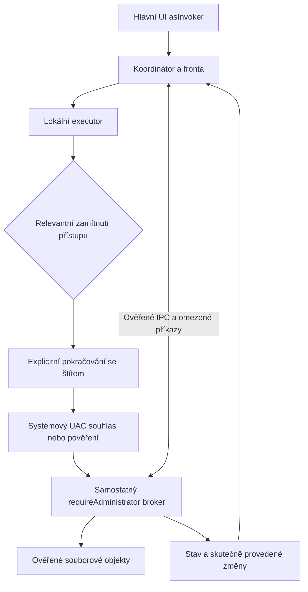

<!--
| Date | Summary | Reason | Ticket | Model |
| 2026-11-07 | Document the UAC architecture, source audit, implementation stages and validation gates. | Plan per-operation elevation without implementing it. |  | GPT-6 (Codex) |
| 2026-11-07 | Record the first P0 experiment. | Link the prototype and remaining gates. | | GPT-6.1 Sol (Codex) |
| 2026-11-07 | Record the VM elevation matrix. | Capture the result with a separate administrator account. | | GPT-6.1 Sol (Codex) |
| 2026-11-07 | Record pipe loss and Shell comparisons and select the P0 backend. | Set the first local implementation slice and remaining gates. | | GPT-6.1 Sol (Codex) |
-->

# Plán implementace podpory UAC v Open Samandarin

Stav: návrh pro budoucí implementaci, 7. listopadu 2026. Tato změna obsahuje pouze dokumentaci; nemění zdrojový kód, manifesty, instalátor ani workflow.

Základem je upstream [release/5.0-samandarin-0.16](https://github.com/KRtkovo-eu-AI/salamander/tree/release/5.0-samandarin-0.16), ověřený commit [`16b4cd0176dc82752a11ee6bc09615780b6987a2`](https://github.com/KRtkovo-eu-AI/salamander/commit/16b4cd0176dc82752a11ee6bc09615780b6987a2). Stejný commit měla při založení práce referenční větev `majklvi/salamander:samandarin-0.16`. Pracovní větev je `feature/uac-support`, lokální checkout `C:\Samandarin\uac-support`. Všechny níže uvedené řádky zdrojů odkazují na tento pevný upstream commit, nikoli na proměnlivý HEAD.

**Doporučená architektura:** hlavní aplikace zůstane `asInvoker`; úzce vymezené administrativní souborové operace vykoná samostatný minimální EXE broker spuštěný přes Windows UAC. Uživatelské rozhraní, fronta, rozhodování o konfliktech, konfigurace, pluginy a parsování zůstanou v původním procesu. Volbu backendu dokládá [výsledek P0](#61-výsledky-p0-a-volba-backendu) včetně porovnání s `IFileOperation`.

## 1. Cíl a rozsah

Cílový scénář: uživatel v běžně spuštěném Samandarinu kopíruje do chráněného adresáře. Operace nejprve použije běžná oprávnění. Pokud narazí na relevantní zamítnutí přístupu, nabídne pokračování s oprávněním správce pro konkrétní položku nebo vymezenou dávku. Windows zobrazí vlastní souhlas či přihlášení administrátora. Samandarin pokračuje z bezpečného bodu, zachová přehled o hotových změnách a zobrazí skutečný výsledek.

První funkční rozsah má zahrnovat lokální vytvoření adresáře, přejmenování, kopírování, přesun, trvalé mazání a běžné atributy/časy, včetně přípravy nepřístupného podstromu. Podpora se zpřístupňuje postupně podle etap; zvláštní vlastnosti souborů se nesmějí tiše zahazovat.

Samostatné navazující oblasti: Koš, pokročilé NTFS vlastnosti, chráněný listing/hledání/čtení, editace chráněného souboru, archivy a pluginy. Nepodporovaný případ musí mít přesnou reakci a nesmí spustit širší náhradní operaci bez rozhodnutí uživatele.

Výchozí návrh neobsahuje trvalou službu SYSTEM, automatický restart celého GUI jako správce, změny UAC policy, ukládání administrátorského hesla ani automatické převzetí vlastnictví či přepis ACL jako opravu chyby přístupu. Ručně zvýšené spuštění celé aplikace je samostatný existující provozní režim.

## 2. Zásady doložené dokumentací Microsoftu

Níže jsou odděleny vlastnosti Windows od konkrétních návrhových rozhodnutí pro Samandarin.

| Oblast | Dokumentovaná vlastnost a důsledek pro návrh |
| --- | --- |
| Nejmenší oprávnění | Microsoft doporučuje běžným desktopovým aplikacím `asInvoker` a oddělení zvýšených úkonů do pomocného procesu. [Running with Administrator Privileges](https://learn.microsoft.com/en-us/windows/win32/secbp/running-with-administrator-privileges). |
| Rozdělení procesů | Administrator Broker Model používá běžný program a samostatný `requireAdministrator` program, spuštěný až při potřebě administrativní operace. Přenos stavu a duplikace kódu jsou výslovně uvedené nevýhody. [Administrator Broker Model](https://learn.microsoft.com/en-us/windows/win32/secauthz/administrator-broker-model). |
| Manifest | `asInvoker` znamená token spouštějícího procesu, nikoli vždy medium integrity. Explicitní `requestedExecutionLevel` vypíná virtualizaci souborů/registru. `uiAccess` není obecná cesta k souborovým oprávněním. [Application manifests](https://learn.microsoft.com/en-us/windows/win32/sbscs/application-manifests). |
| Spuštění elevace | `runas` spouští systémový mechanismus souhlasu/pověření. Pro broker použít `ShellExecuteExW`, absolutní cestu a `SEE_MASK_NOCLOSEPROCESS`; kontrolovat úspěch i dostupnost process handle. ShellExecute vyžaduje správný COM/thread kontext. [ShellExecuteW](https://learn.microsoft.com/en-us/windows/win32/api/shellapi/nf-shellapi-shellexecutew), [ShellExecuteExW](https://learn.microsoft.com/en-us/windows/win32/api/shellapi/nf-shellapi-shellexecuteexw). |
| Uživatelský souhlas | Vysvětlit potřebu oprávnění v místě operace, označit akci systémovým štítem a po zrušení souhlasu vrátit řízení do původního UI. Citovaný UX text pochází z éry Windows 7; používáme jeho principy, nikoli staré obrázky jako dnešní vizuální normu. [UAC design guidance](https://learn.microsoft.com/en-us/windows/desktop/uxguide/winenv-uac). |
| Jiný účet správce | Standardní uživatel může zadat pověření jiného administrátora. Logon session a mapované disky se mohou lišit. Návrh nesmí předpokládat shodné SID, HKCU, profil, síťová pověření nebo `%TEMP%`. [How UAC works](https://learn.microsoft.com/en-us/windows/security/application-security/application-control/user-account-control/how-it-works), [Mapped drives and elevation](https://learn.microsoft.com/en-us/troubleshoot/windows-client/networking/mapped-drives-not-available-from-elevated-command). |
| Privilegia tokenu | `AdjustTokenPrivileges` nepřidá tokenu privilegium, které nemá, a úspěšný BOOL nevylučuje `ERROR_NOT_ALL_ASSIGNED`. Backup/restore práva mohou měnit běžné ACL kontroly. Zapínání privilegií není UAC elevace. [AdjustTokenPrivileges](https://learn.microsoft.com/en-us/windows/win32/api/securitybaseapi/nf-securitybaseapi-adjusttokenprivileges), [Managing privileges in a file system](https://learn.microsoft.com/en-us/windows-hardware/drivers/ifs/privileges). |
| Rozsah ochrany | MSRC klasifikuje UAC jako defense-in-depth, nikoli robustní bezpečnostní hranici. Návrh přesto musí chránit IPC a respektovat hranice uživatelů, sessions a procesů. Nelze slibovat bezpečné oddělení již kompromitovaného autorizovaného hostu od všech jím schválených administrativních úkonů. [Windows Security Servicing Criteria](https://www.microsoft.com/en-us/msrc/windows-security-servicing-criteria). |

## 3. Co už je ve zdrojích

Přesnější označení chybějící funkce je **integrovaná elevace nativních souborových operací**. Aplikace už obsahuje některé části podpory UAC a shellové operace; jejich pouhá existence neprokazuje kompletní funkční pokrytí.

| Stávající oblast | Ověřený zdroj | Dopad |
| --- | --- | --- |
| Manifest hlavního EXE | [src/manifest.xml:25](https://github.com/KRtkovo-eu-AI/salamander/blob/16b4cd0176dc82752a11ee6bc09615780b6987a2/src/manifest.xml#L25) | `asInvoker`, `uiAccess=false`, dále UTF-8 a `longPathAware`; zachovat. |
| Administrátorský příkazový řádek | [src/mainwnd3.cpp:8668](https://github.com/KRtkovo-eu-AI/salamander/blob/16b4cd0176dc82752a11ee6bc09615780b6987a2/src/mainwnd3.cpp#L8668) | `CM_DOSSHELLASADMIN`, `runas` na 8740, zvláštní zacházení s `ERROR_CANCELLED` na 8749. |
| Stav aktuálního procesu | [src/salamdr1.cpp:4897](https://github.com/KRtkovo-eu-AI/salamander/blob/16b4cd0176dc82752a11ee6bc09615780b6987a2/src/salamdr1.cpp#L4897), [src/salamdr6.cpp:2265](https://github.com/KRtkovo-eu-AI/salamander/blob/16b4cd0176dc82752a11ee6bc09615780b6987a2/src/salamdr6.cpp#L2265) | `RunningAsAdmin` vychází z integrity level. Doplnit přesný interní popis tokenu, uživatele a session. |
| Členství v Administrators | [src/worker.cpp:2605](https://github.com/KRtkovo-eu-AI/salamander/blob/16b4cd0176dc82752a11ee6bc09615780b6987a2/src/worker.cpp#L2605), [spl_gen.h:3511](https://github.com/KRtkovo-eu-AI/salamander/blob/16b4cd0176dc82752a11ee6bc09615780b6987a2/src/plugins/shared/spl_gen.h#L3511) | Aktivní `IsUserAdmin()` hledá SID v TokenGroups bez kontroly deny-only flags; SDK popisuje členství. Nepoužít jako důkaz skutečné elevace a neměnit nepozorovaně význam SDK. |
| Privilegia kopírování zabezpečení | [src/worker.cpp:2413](https://github.com/KRtkovo-eu-AI/salamander/blob/16b4cd0176dc82752a11ee6bc09615780b6987a2/src/worker.cpp#L2413), [volání na 10459](https://github.com/KRtkovo-eu-AI/salamander/blob/16b4cd0176dc82752a11ee6bc09615780b6987a2/src/worker.cpp#L10459) | `GainWriteOwnerAccess` se pokouší zapnout restore/take-ownership/security práva v procesu. Nepřenášet tento globální režim automaticky do brokeru. |
| Koš | [src/fileswn8.cpp:134](https://github.com/KRtkovo-eu-AI/salamander/blob/16b4cd0176dc82752a11ee6bc09615780b6987a2/src/fileswn8.cpp#L134), [src/operationrecycle.h:39](https://github.com/KRtkovo-eu-AI/salamander/blob/16b4cd0176dc82752a11ee6bc09615780b6987a2/src/operationrecycle.h#L39) | Již používá `IFileOperation`; chování UAC a jednotlivých kombinací flags je třeba ověřit ve VM. |

## 4. Mapa zásahů do souborových operací

| Místo | Současná role | Plánovaný zásah |
| --- | --- | --- |
| [fileswn8.cpp:275 — FilesAction](https://github.com/KRtkovo-eu-AI/salamander/blob/16b4cd0176dc82752a11ee6bc09615780b6987a2/src/fileswn8.cpp#L275) | Vstup copy/move/delete a sběr voleb. | Zachytit neměnný uživatelský záměr, vybrané položky, oprávněný rozsah dávky a její ID. |
| [fileswn6.cpp:1290 — BuildScriptMain](https://github.com/KRtkovo-eu-AI/salamander/blob/16b4cd0176dc82752a11ee6bc09615780b6987a2/src/fileswn6.cpp#L1290), `BuildScriptDir:1786`, `BuildScriptFile:2818` | Příprava skriptu ještě před workerem. Enumerace na 2406, otevření zdroje na 3119 a čtení ADS mohou selhat na oprávněních. | Omezený privilegovaný discovery/metadata endpoint pro právě schválený podstrom. Neúplný scan nesmí být vydán za kompletní výběr. |
| [worker.h:223](https://github.com/KRtkovo-eu-AI/salamander/blob/16b4cd0176dc82752a11ee6bc09615780b6987a2/src/worker.h#L223), [COperation:327](https://github.com/KRtkovo-eu-AI/salamander/blob/16b4cd0176dc82752a11ee6bc09615780b6987a2/src/worker.h#L327) | Opkódy, pointery, `std::wstring`, koordinátor; některé pointerové členy nesou číselné hodnoty. | Vlastní serializovaný kontrakt bez raw struktur, pointerů, `HWND` jako autority a závislosti na bitové šířce procesu. |
| [workerpath.h:12](https://github.com/KRtkovo-eu-AI/salamander/blob/16b4cd0176dc82752a11ee6bc09615780b6987a2/src/workerpath.h#L12) | Převod cest a zachování wide identity. | Přenášet přesné délkované UTF-16 cesty; zachovat již známé `SourceNameW/TargetNameW`. |
| [worker.cpp:10376 — ThreadWorkerBody](https://github.com/KRtkovo-eu-AI/salamander/blob/16b4cd0176dc82752a11ee6bc09615780b6987a2/src/worker.cpp#L10376) | Dispatcher opkódů a worker orchestrace. | Volba lokálního/elevovaného executor backendu na úrovni doménového úkonu, po oddělení UI. |
| [worker.cpp:5593 — DoCopyFile](https://github.com/KRtkovo-eu-AI/salamander/blob/16b4cd0176dc82752a11ee6bc09615780b6987a2/src/worker.cpp#L5593), smyčky 4335 a 5259 | Kopírování, přepis, asynchronní I/O, metadata, cleanup. | Stavový výsledek rozlišující nezačato, částečný zápis, hotová data a selhání metadat. Elevace nesmí slepě opakovat `CREATE_ALWAYS` z 6548. |
| [worker.cpp:6785 — DoMoveFile](https://github.com/KRtkovo-eu-AI/salamander/blob/16b4cd0176dc82752a11ee6bc09615780b6987a2/src/worker.cpp#L6785) | Rename a copy+delete; odstranění zdroje na 7385. | Odlišit přesun v rámci svazku od více kroků. Po úspěšné kopii a selhání delete pokračovat pouze odstraněním ověřeného zdroje. |
| [worker.cpp:7422 — DoDeleteFile](https://github.com/KRtkovo-eu-AI/salamander/blob/16b4cd0176dc82752a11ee6bc09615780b6987a2/src/worker.cpp#L7422), `DoCreateDir:7671`, `DoDeleteDir:8004`, `DoChangeAttrs:8836` | Základní mutace; i delete mění readonly a mkdir může vytvořit část rodičů. | Typované jednotlivé příkazy a evidence skutečně provedených změn, včetně částečného výsledku. |
| [fileswn5.cpp:2993 — CreateDir](https://github.com/KRtkovo-eu-AI/salamander/blob/16b4cd0176dc82752a11ee6bc09615780b6987a2/src/fileswn5.cpp#L2993), `RenameFileInternalW:3452`, `RenameFile:3840` | F7 a přejmenování mají cesty mimo hlavní worker. | Zapojit stejný executor a rozhodování o elevaci; nezanechat rozdílné chování F7, rename dialogu a Quick Rename. |
| [dialogs.cpp:1128 — CProgressDialog::DialogProc](https://github.com/KRtkovo-eu-AI/salamander/blob/16b4cd0176dc82752a11ee6bc09615780b6987a2/src/dialogs.cpp#L1128), `WM_USER_DIALOG:1592` | Progress, StartWorker na 1361, odpovědi dialogů předávané pointery přes SendMessage, cancel na 2061. | Typované události mezi executor/koordinátorem a IPC, všechny běžné dialogy v původním UI. Neprotahovat pointerový protokol mezi procesy. |
| [worker.cpp:1405](https://github.com/KRtkovo-eu-AI/salamander/blob/16b4cd0176dc82752a11ee6bc09615780b6987a2/src/worker.cpp#L1405), lease na 1434 a validace na 1806 | Scan-ahead, konflikty, generace a paralelní copy. | Jediný koordinátor vlastní pořadí a rozhodnutí. Elevovaný executor přijímá jen aktuálně přidělenou práci. |
| [worker.cpp:10534](https://github.com/KRtkovo-eu-AI/salamander/blob/16b4cd0176dc82752a11ee6bc09615780b6987a2/src/worker.cpp#L10534) | Komentář výslovně připouští pathname race po poslední kontrole identity. | Bezpečnostní podmínka: ověřený handle musí nést identitu do mutace; nepřesunout mechanicky legacy dispatch do high integrity. |
| [worker.cpp:9164](https://github.com/KRtkovo-eu-AI/salamander/blob/16b4cd0176dc82752a11ee6bc09615780b6987a2/src/worker.cpp#L9164), 9206, 9341 | Paralelní cesta ověřuje identity otevřených zdrojů/cílů a cleanup. | Využít dílčí vzor a testy; neprohlašovat ostatní operace za bezpečné jen díky této kontrole. |
| [worker.cpp:2666 — DoCopySecurity](https://github.com/KRtkovo-eu-AI/salamander/blob/16b4cd0176dc82752a11ee6bc09615780b6987a2/src/worker.cpp#L2666), `DeleteDirLink:8257` | Legacy ANSI/security a `MAX_PATH` větve, vícekroková práce s reparse. | Před elevací samostatně auditovat a převést potřebné cesty na wide/handle operace. |
| [worker.cpp:11059 — COperationsQueue::AddOperation](https://github.com/KRtkovo-eu-AI/salamander/blob/16b4cd0176dc82752a11ee6bc09615780b6987a2/src/worker.cpp#L11059) | Storage-aware fronta. | UAC nesmí obcházet frontu, zdvojovat pracovní sloty ani hlásit dokončení téže položky dvakrát. |

## 5. Další integrační plochy

| Oblast | Zdroj a plánované zacházení |
| --- | --- |
| Spouštění/helper | [salamdr1.cpp:6279](https://github.com/KRtkovo-eu-AI/salamander/blob/16b4cd0176dc82752a11ee6bc09615780b6987a2/src/salamdr1.cpp#L6279) má časný `DriveFreeSpaceHelperDispatch`; [drivefreespace.cpp:572](https://github.com/KRtkovo-eu-AI/salamander/blob/16b4cd0176dc82752a11ee6bc09615780b6987a2/src/drivefreespace.cpp#L572) je precedent pomocného procesu. Pro UAC zvolit vlastní minimální EXE bez importů a inicializace celého hostu. |
| Existující IPC | [salamdr6.cpp:2191](https://github.com/KRtkovo-eu-AI/salamander/blob/16b4cd0176dc82752a11ee6bc09615780b6987a2/src/salamdr6.cpp#L2191) dává požadovaná práva Everyone; pro broker nepoužít. [ShellPreviewHost.cpp:431](https://github.com/KRtkovo-eu-AI/salamander/blob/16b4cd0176dc82752a11ee6bc09615780b6987a2/src/plugins/pictview/wic/ShellPreviewHost.cpp#L431) má novější pipe/lifecycle vzor, ale jde o neelevovaný helper a neřeší automaticky jiný administrátorský účet. |
| Panel a hledání | [fileswn3.cpp:780 — ReadDirectory](https://github.com/KRtkovo-eu-AI/salamander/blob/16b4cd0176dc82752a11ee6bc09615780b6987a2/src/fileswn3.cpp#L780), [find.cpp:1540 — SearchDirectory](https://github.com/KRtkovo-eu-AI/salamander/blob/16b4cd0176dc82752a11ee6bc09615780b6987a2/src/find.cpp#L1540). Pozdější explicitně autorizované čtení/listing; žádné nové UAC prompty při každém refreshi, náhledu či background scan. |
| Viewer a editor | [viewer2.cpp:45 — OpenViewerFileForRead](https://github.com/KRtkovo-eu-AI/salamander/blob/16b4cd0176dc82752a11ee6bc09615780b6987a2/src/viewer2.cpp#L45), [fileswn5.cpp:1787](https://github.com/KRtkovo-eu-AI/salamander/blob/16b4cd0176dc82752a11ee6bc09615780b6987a2/src/fileswn5.cpp#L1787), `EditFile:2303`, [fileactionpath.h:53](https://github.com/KRtkovo-eu-AI/salamander/blob/16b4cd0176dc82752a11ee6bc09615780b6987a2/src/fileactionpath.h#L53). Chráněné čtení může později předat omezený read-only stream/handle; dekodéry a UI zůstanou neelevované. Externí editor jako správce je jiný kontrakt. |
| Pluginy a SDK | [plugins1.cpp:2242 — InitDLL](https://github.com/KRtkovo-eu-AI/salamander/blob/16b4cd0176dc82752a11ee6bc09615780b6987a2/src/plugins1.cpp#L2242) načítá DLL do hostu. [safefile.cpp:108](https://github.com/KRtkovo-eu-AI/salamander/blob/16b4cd0176dc82752a11ee6bc09615780b6987a2/src/safefile.cpp#L108), `SafeFileCreate:188` a [spl_file.h:106](https://github.com/KRtkovo-eu-AI/salamander/blob/16b4cd0176dc82752a11ee6bc09615780b6987a2/src/plugins/shared/spl_file.h#L106) poskytují handle-based API. Jeho plošné otevření s admin právy by rozšířilo moc pluginů; první fáze beze změny SDK. |
| Konfigurace | [configstorage.cpp:225](https://github.com/KRtkovo-eu-AI/salamander/blob/16b4cd0176dc82752a11ee6bc09615780b6987a2/src/configstorage.cpp#L225) používá HKCU; portable cesta na 283 a ukládání na 383. Vlastníkem preferencí a historie zůstává původní uživatel; helper nesmí inicializovat ani přepisovat profil administrátora. |
| Build a distribuce | [src/vcxproj/salamand.sln](https://github.com/KRtkovo-eu-AI/salamander/blob/16b4cd0176dc82752a11ee6bc09615780b6987a2/src/vcxproj/salamand.sln), [salamand.vcxproj](https://github.com/KRtkovo-eu-AI/salamander/blob/16b4cd0176dc82752a11ee6bc09615780b6987a2/src/vcxproj/salamand.vcxproj), [Inno Setup:72](https://github.com/KRtkovo-eu-AI/salamander/blob/16b4cd0176dc82752a11ee6bc09615780b6987a2/doc/runbook-setup/inno_setup_salamander_x64.iss#L72), utils na 1133–1135. Přidat vlastní projekt, staging a balení helperu; manifesty ověřovat také ve výsledných EXE. |

## 6. Porovnání implementačních variant

| Varianta | Přínos | Omezení | Doporučení |
| --- | --- | --- | --- |
| `requireAdministrator`/`highestAvailable` pro celé GUI | Malý počáteční zásah. | Zvyšuje práva pluginům, parserům a externím akcím; mění identitu, drag-and-drop a běžné spuštění. | Nepoužít jako implementaci per-operation UAC. |
| Shell `IFileOperation` | Windows řeší souborové úkony a elevaci; část kódu jej již používá pro Koš. | Nutno porovnat přesné cesty, konflikty, metadata, frontu, progress a přerušení s vlastním enginem. | Zachovat pro Koš a samostatně ověřené shellové úkony. |
| Samostatný EXE broker + omezené IPC | Umožňuje zachovat vlastní engine a oddělit privilegovaný kód bez COM registrace. | Vlastní bezpečnostní protokol, životní cyklus, odpojení a práce s částečnými výsledky. | Zvoleno pro nativní operace. Produkční podmínky P2 a P3 zůstávají závazné. |
| COM elevation moniker | Dokumentovaný způsob elevace malé funkce a standardní marshaling. | Registrace HKLM, lokalizovaný název a COM security pro jiný účet; komplikace portable distribuce. | Záložní varianta, pokud bezpečnost a údržba EXE IPC nevyjdou dobře. |
| Služba / naplánovaná elevated úloha | Dlouhodobě dostupná privilegovaná část. | Instalace, stálý privilegovaný povrch a samostatná autorizace. | Pro tento rozsah nepřiměřené. |

COM podmínky vycházejí z [The COM Elevation Moniker](https://learn.microsoft.com/en-us/windows/win32/com/the-com-elevation-moniker); volba mezi variantami je návrhové hodnocení pro tento repozitář.

U `IFileOperation` nejsou flagy zaměnitelné: `FOFX_SHOWELEVATIONPROMPT` umožňuje UAC při potlačeném error UI, `FOFX_REQUIREELEVATION` odstraňuje předběžné potvrzení očekávané elevace, ne systémový UAC souhlas. `FOFX_EARLYFAILURE` je platný spolu s `FOF_NOERRORUI`; prověřit všechny současné kombinace. Po `PerformOperations` vyhodnotit jednotlivé výsledky a `GetAnyOperationsAborted`, i při úspěšném HRESULT. [SetOperationFlags](https://learn.microsoft.com/en-us/windows/win32/api/shobjidl_core/nf-shobjidl_core-ifileoperation-setoperationflags), [GetAnyOperationsAborted](https://learn.microsoft.com/en-us/windows/win32/api/shobjidl_core/nf-shobjidl_core-ifileoperation-getanyoperationsaborted).

Aktuální [OperationRecyclePath](https://github.com/KRtkovo-eu-AI/salamander/blob/16b4cd0176dc82752a11ee6bc09615780b6987a2/src/operationrecycle.h#L12) odmítá cesty s koncovými tečkami/mezerami, aby Shell nezasáhl jiný objekt. Proto není náhrada všech Win32 operací Shell API automaticky ekvivalentní.

### 6.1 Výsledky P0 a volba backendu

Pokusy proběhly ve vyhrazené Windows 11 Pro x64 VM, build 26200, se zabezpečenou plochou UAC. Shell zkoušel vytvořit jedinou novou složku v chráněném laboratorním adresáři pod Program Files. Přímý CreateDirectoryW ze stejného procesu pokaždé vrátil chybu 5. Pomocný EXE ověřoval spuštění, identitu a životnost spojení pomocí pevných zpráv. Sám v této etapě neprováděl souborové mutace. Podmínky opakování pokusů jsou v [laboratorním postupu](../tools/uac-lab/README.md).

| Scénář | Pozorovaný výsledek | Důsledek pro návrh |
| --- | --- | --- |
| EXE, host po ověřeném hello zavře rouru před potvrzením | Zvýšený klient rozpoznal uzavřené spojení a host ověřil jeho ukončení v pětisekundovém limitu. | Klient při ztrátě hostu ukončí relaci. Nový pokus vyžaduje nové rozhodnutí hostu. |
| EXE, klient skončí po přijetí potvrzení a před doručením testovacího potvrzení výsledku | Host zaznamenal chybu 109 (ERROR_BROKEN_PIPE), ověřil ukončení zvýšeného klienta a test skončil. | Odpojení je selhání transportu. Pokud už mohla začít mutace, host hlásí OutcomeUnknown a před případným opakováním ověří stav. |
| IFileOperation, kontrola s potlačenou výzvou | NewItem vrátil S_OK při zařazení. PerformOperations a PostNewItem vrátily 0x80270022 (COPYENGINE_E_ACCESS_DENIED_DEST). Aborted bylo 0 a cíl nevznikl. | Ani úspěšné zařazení položky, ani Aborted = 0 nedokládají provedení. |
| IFileOperation, zrušení výzvy | PerformOperations vrátil 0x80270000 (COPYENGINE_E_USER_CANCELLED). Aborted bylo 1, PostNewItem vrátil 0x80270002 (COPYENGINE_E_REQUIRES_ELEVATION) a cíl nevznikl. | Interpretovat společně výsledek dávky, stav přerušení a výsledek položky. |
| IFileOperation, schválení výzvy | PerformOperations i PostNewItem vrátily S_OK, Aborted bylo 0 a přesně pojmenovaný cílový adresář vznikl. | Shell v tomto scénáři skutečně zvládl jednoduché vytvoření složky se zvýšenými právy. |

**Rozhodnutí P0:** pro nativní engine zvolit samostatný EXE broker s omezeným protokolem. Na tomto backendu je možné zachovat stávající model fronty, konfliktů a fází operace a výslovně navázat provedení na ověřenou identitu objektů. Pokus se Shellem potvrdil jednoduchý mkdir, ale pro jeho použití v nativním enginu by bylo třeba zvlášť prokázat shodu přesných cest, pravidel přepisu, metadat a výsledků rozpracované dávky. IFileOperation ponechat pro stávající Koš a další samostatně ověřené Shell úkony. Výsledek P0 neposuzuje elevaci Koše pod jiným účtem.

**Další etapa P1a:** oddělit jediný lokální příkaz pro vytvoření koncové složky v existujícím rodiči v nativní větvi F7. Výchozí místo je volání SalCreateDirectoryExW a jeho stávající fallback v [fileswn5.cpp](https://github.com/KRtkovo-eu-AI/salamander/blob/16b4cd0176dc82752a11ee6bc09615780b6987a2/src/fileswn5.cpp#L3092). Zachovat konverze, dialogy, vytváření rodičů ve stávající cestě a oznámení změny. Vymezit typovaný výsledek příkazu s původní Win32 chybou. Ověřit úspěch, kolizi, neplatné jméno, chybějící nebo chráněný rodič, Unicode a dlouhou cestu. První řez P1a je neprivilegovaný a jeho rozsah nevyžaduje úpravu ostatních workerů.

P2 má ověřit produkční bootstrap, distribuci a bezpečné ukončení při ztrátě procesu i kanálu. P3 smí první mutaci zapnout po samostatném ověření identity rodiče včetně jeho výměny a reparse bodů. Po ztrátě spojení po možné mutaci nepoužívat slepé opakování. Počáteční distribuční pilot plánovat jako chráněnou instalaci pro Windows 11 x64 na lokálním NTFS. Rozšíření na portable, starší Windows nebo další souborové systémy vyžaduje vlastní testy.

## 7. Navržené rozdělení komponent

Následující názvy jsou pracovní návrh, ne existující třídy nebo soubory:

- **Operation coordinator v hostu:** snapshot výběru a voleb, autorizovaný rozsah, fronta, konflikty, generace a leasing práce, progress, výsledky a refresh panelů.
- **Local file executor:** stejné doménové příkazy bez elevace, oddělené od dialogů. Slouží i jako regresní základ před zavedením UAC.
- **Elevation controller v hostu:** klasifikace chyby, explicitní pokračování, spuštění/ověření brokeru, stav souhlasu, IPC a lifecycle. Jeden controller pro všechny vstupní cesty.
- **Privileged file executor v brokeru:** pouze schválené příkazy, validace vstupů a objektů, úzká privilegia, operace nad ověřenými objekty a strukturované výsledky. Žádné pluginové nebo skriptovací rozhraní.
- **Versioned protocol:** samostatná datová reprezentace sdílená oběma stranami, nezávislá na `COperation`, adresním prostoru a bitové šířce.

Požadavek nese verzi, velikost, typ příkazu, session/batch/request ID, generaci rozhodnutí, přesné zdrojové/cílové cesty, očekávané identity objektů a explicitní volby. Číselné typy mají pevnou šířku; řetězce mají délku a limit, embedded NUL se odmítá. Výsledek nese původní Win32/HRESULT chybu, fázi selhání, identitu provedeného úkonu, počty přenesených dat a skutečné vedlejší účinky. Neznámá verze/příkaz se odmítá před mutací.

Protokol neobsahuje obecné příkazy `Execute`, `LoadLibrary`, `RunPlugin`, libovolný zápis registru, neomezený `OpenHandle` ani raw pointery. Případné read-only streamy pro viewer budou samostatně autorizovanou pozdější schopností.

## 8. Bezpečnostní návrh a podmínky jeho přijetí

### 8.1 Důvěryhodné spuštění a distribuce

Helper má samostatný manifest `requireAdministrator`, `uiAccess=false`, wide/long-path podporu a minimální závislosti. Host jej spouští absolutní cestou z ověřeného instalačního umístění; aktivní panel ani jeho aktuální adresář neurčují executable, DLL search path či privilegovanou konfiguraci. COM inicializaci a `ShellExecuteExW` provést mimo loader lock a mimo zámky fronty; vlastník UAC dialogu je platné okno aplikace.

Release návrh zahrne podpis EXE, chráněné umístění a aktualizační řetězec, kontrolu verze/protokolu a audit všech statických i dynamických DLL závislostí. Omezení DLL vyhledávání až po vstupu do `main` nechrání importy načtené před startem. Broker nesmí načítat `.spl`, shell extensions, uživatelské dekodéry ani runtime Salamatrix. [Dynamic-Link Library Security](https://learn.microsoft.com/en-us/windows/win32/dlls/dynamic-link-library-security), [Code signing options](https://learn.microsoft.com/en-us/windows/apps/package-and-deploy/code-signing-options).

Podpis je návrhový požadavek distribučního řetězce, nikoli tvrzení, že Windows za všech politik zakazuje unsigned `runas`. Z absence `SignTool` v auditovaném `.iss` nelze určit stav podpisu skutečných release binárek.

Portable režim potřebuje explicitní rozhodnutí v P0: jak zajistit integritu helperu a závislostí v uživatelsky zapisovatelném umístění, případně použít chráněnou instalaci pomocné komponenty. Samotný podpis neřeší podvrženou sousední DLL ani race při záměně executable. Dokud není bezpečný režim navržen a ověřen, tento způsob distribuce nemá slibovat funkční broker. Běžná neelevovaná portable práce musí zůstat dostupná.

Instalátor povoluje `users-modify` pro [configstorage.ini a plugin-receipts.json](https://github.com/KRtkovo-eu-AI/salamander/blob/16b4cd0176dc82752a11ee6bc09615780b6987a2/doc/runbook-setup/inno_setup_salamander_x64.iss#L855). Tyto soubory nesmějí být autoritou pro důvěryhodnost helperu nebo povolené privilegované úkony.

### 8.2 IPC a identita

Preferovaným kandidátem k ověření je jednorázová lokální named pipe pro vymezenou dávku. DACL musí být explicitní; default poskytuje mimo jiné čtení Everyone/Anonymous. Nepoužít `CreateAccessableSecurityAttributes` ani udělení `GENERIC_ALL` všem. Klientská práva sestavit z potřebných jednotlivých práv, protože `FILE_GENERIC_WRITE` zahrnuje také vytvoření další instance pipe. [Named Pipe Security and Access Rights](https://learn.microsoft.com/en-us/windows/win32/ipc/named-pipe-security-and-access-rights).

Navržené obrany: náhodný název, jedna očekávaná instance, `FILE_FLAG_FIRST_PIPE_INSTANCE`, `PIPE_REJECT_REMOTE_CLIENTS`, omezené zprávy, validované délky/enumy, timeout handshake, zrušitelné I/O a konec autorizace po dokončení dávky. Přesné ACL a mandatory integrity label závisejí na zvoleném směru spojení a musí projít P0 pro split-token i jiné administrátorské pověření. [CreateNamedPipe API](https://learn.microsoft.com/en-us/windows/win32/api/winbase/nf-winbase-createnamedpipea) popisuje společné flagy; implementace použije wide variantu.

Název pipe, nonce ani PID samostatně neautentizují protistranu. Spojení musí být navázáno na očekávaný živý proces, kernelově zjištěné peer PID, udržovaný process handle a ověřenou identitu tokenu/session; odlišit identitu klienta od autorizace jednotlivého úkonu. Ošetřit PID reuse i podvržený helper/server. `client SID == helper SID` není přípustná obecná podmínka, protože rozbije elevaci pod jiným účtem. [GetNamedPipeClientProcessId](https://learn.microsoft.com/en-us/windows/win32/api/winbase/nf-winbase-getnamedpipeclientprocessid), [GetNamedPipeServerProcessId](https://learn.microsoft.com/en-us/windows/win32/api/winbase/nf-winbase-getnamedpipeserverprocessid), [Process Handles and Identifiers](https://learn.microsoft.com/en-us/windows/win32/procthread/process-handles-and-identifiers).

Pokud bude host pipe serverem a elevated helper klientem, helper nesmí dovolit hostu impersonovat administrátora: ověřit použití `SECURITY_SQOS_PRESENT | SECURITY_IDENTIFICATION`. Pokud bude serverem helper, případná impersonace klienta slouží identifikaci a omezeným kontrolám; před autorizovanou zvýšenou operací se kontext musí řízeně vrátit. Selhání impersonace odmítne požadavek; selhání `RevertToSelf` vyžaduje ukončení broker procesu, protože jeho bezpečnostní kontext již nelze považovat za řízený. [Impersonation Levels](https://learn.microsoft.com/en-us/windows/win32/secauthz/impersonation-levels), [ImpersonateNamedPipeClient](https://learn.microsoft.com/en-us/windows/win32/api/namedpipeapi/nf-namedpipeapi-impersonatenamedpipeclient), [RevertToSelf](https://learn.microsoft.com/en-us/windows/win32/api/securitybaseapi/nf-securitybaseapi-reverttoself).

**Výstup P0 musí obsahovat konkrétní sekvenci bootstrapu, SDDL, práva procesových handle a důkaz testy pro obě identity.** Tento dokument záměrně nepovažuje seznam opatření za hotový bezpečný protokol. Nelze jej nahradit pouze tajným argumentem na command line nebo kontrolou názvu EXE.

### 8.3 Autorizace, cesty a změny objektu

Autorizace je navázaná na vybranou operaci, položky/podstromy a výslovné volby, ne na obecnou možnost měnit celý disk. U dynamicky enumerovaného podstromu musí protokol určit, jaké nové položky ještě patří do schváleného rozsahu; nová dávka či rozšířený kořen vyžaduje nové rozhodnutí. Broker nepřijímá další nesouvisející úkony jen proto, že zůstal spuštěný.

Před mutací validovat otevřený objekt a pracovat dál se stejnou identitou. Ověřit i rodičovské adresáře, svazek, hardlinky a přesměrování přes junction/symlink; pouhý prefix cesty nebo normalizace `..` není bezpečnostní kontrola. Výchozí rozhraní přijímá souborové cesty, ne zařízení, raw volume, `GLOBALROOT`, named pipes nebo libovolný NT object namespace. ADS mají vlastní explicitní kontrakt, nemají nenápadně rozšířit povolený cílový soubor.

`FILE_FLAG_OPEN_REPARSE_POINT` mění chování otevření daného reparse objektu, ale sám negarantuje bezpečnost nadřazených komponent ani budoucího znovuotevření. Zvlášť definovat kopii odkazu, kopii cíle, odstranění odkazu a rekurzi. Windows API mají odlišnou link sémantiku, kterou nesmí elevace změnit. [Symbolic Link Effects](https://learn.microsoft.com/en-us/windows/win32/fileio/symbolic-link-effects-on-file-systems-functions), [Reparse Point Operations](https://learn.microsoft.com/en-us/windows/win32/fileio/reparse-point-operations).

Po návratu z UAC nebo konfliktního dialogu znovu ověřit původní rozhodnutí proti aktuální identitě. Změněný cíl není stále tentýž uživatelem schválený overwrite. Jestliže úkon nelze provést nad ověřenými objekty bez nepřijatelného race, ponechat tento případ nepodporovaný do další etapy. Testování je nutné i s aktivním přehazováním rodičovských adresářů, nikoli pouze finálního souboru.

### 8.4 Životnost a rozsah privilegií

Broker je svázán s jednou operací/dávkou. Ukončí se po dokončení, zrušení, ztrátě autentizovaného kanálu nebo smrti hostu; rozpracovanou mutaci dokončí/uklidí jen podle předem definovaného bezpečného bodu. Žádný idle administrátorský daemon ani automatické obnovení původního souhlasu po restartu hostu.

První mutace používají standardní administrativní token bez automatického backup/restore/take-ownership bypassu. Pozdější explicitní kopírování zabezpečení dostane vlastní kontrakt a krátké zapnutí pouze nutných privilegií s obnovením původního stavu. Vlastnictví TrustedInstaller, explicitní deny ACL nebo chybějící EFS klíč nejsou obecně řešitelné pouhým UAC souhlasem.

## 9. Uživatelský tok a stav operace

1. Provést běžnou operaci s aktuálním tokenem. Preflight může být informativní, nemá slibovat oprávnění budoucí mutace.
2. Zachytit přesnou chybu a bod selhání. Relevantní `ERROR_ACCESS_DENIED`, `ERROR_PRIVILEGE_NOT_HELD` nebo `ERROR_ELEVATION_REQUIRED` jsou vstupem do klasifikace, nikoli bezpodmínečným příkazem k elevaci. Odlišit readonly, existující objekt, sdílení, síťovou autentizaci a policy.
3. V existujícím chybovém/konfliktním UI nabídnout „Pokračovat jako správce“ se štítem, konkrétní cestou, operací a rozsahem. Zachovat Retry/Skip/Skip All/Cancel podle smyslu daného dialogu. „Pro tuto dávku“ nesmí platit pro budoucí nesouvisející práci.
4. Pozastavit dotčené přidělování práce a uvolnit zámky před souhlasem. Ostatní bezpečně nezávislé úlohy nemusí stát. Nevyvolávat několik UAC promptů současně z různých workerů.
5. Windows provede consent/credentials UI. Samandarin heslo nezískává ani neukládá. `ERROR_CANCELLED` vrátí uživatele k vyřešení položky či zrušení operace bez další chybové smyčky; po zamítnutí se prompt sám neopakuje.
6. Ověřit broker, protokol a identitu objektů. Zvýšená oprávnění přidělit jen příkazům patřícím do dané autorizace.
7. Propagovat skutečné výsledky, provedené změny a refresh; zničit autorizaci po skončení dávky.

Navržený stavový model musí rozlišit nejméně `NotStarted`, `WaitingForConsent`, `Executing`, `PartiallyApplied`, `Completed`, `Cancelled`, `Failed` a `OutcomeUnknown`. Stav `Completed` se nepotvrzuje pouze exit code procesu. Výsledky dat a metadat jsou samostatné.

| Situace | Požadované chování |
| --- | --- |
| UAC zrušeno před zvýšeným úkonem | Žádné nové zvýšené side effects. Dříve hotové lokální kroky zůstávají přesně evidované. |
| Kopie dat hotova, metadata selhala | Nabídnout řešení příslušných metadat; znovu netruncovat celý cíl. |
| Copy+delete: kopie hotova, zdroj nelze smazat | Hlásit „zkopírováno, zdroj zůstal“. Před opakováním delete ověřit, že obsah/verze zdroje stále odpovídá provedené kopii a cíl tuto dokončenou kopii stále obsahuje. Shodné FileID nestačí; při změně kterékoli strany zneplatnit pending delete a znovu řešit copy/konflikt. |
| Přepsaný/změněný cíl během souhlasu | Zneplatnit původní overwrite rozhodnutí a znovu řešit konflikt. |
| Odpojení IPC po možné mutaci | `OutcomeUnknown`; nereplayovat destruktivní příkaz. Ověřit stav a identity, při nejistotě nechat explicitní rozhodnutí uživateli. |
| Zrušení během kopírování | Zastavit v definovaném bodě; uklízet jen prokazatelně vlastní rozpracovaný objekt, nikdy cizí soubor na stejné cestě. |
| Celé GUI už je elevated | Nežádat další souhlas bez potřeby; používat stejné validační a výsledkové kontrakty. Nepovažovat členství v Administrators za oprávnění ke každému objektu. |

Request ID a deduplikace mohou zabránit opakování během života brokeru, samy však nezajišťují „exactly once“ přes jeho pád. MVP nebude slibovat automatickou obnovu rozpracované administrativní dávky po restartu. Případný journal musí mít vlastní ochranu, recovery protokol a pravidla expirace; není skrytým předpokladem této etapy. Pro odložený delete zdroje po kopii musí P0/P4 určit spolehlivý kontrakt verze obsahu a ochrany proti souběžnému zápisu; samotné porovnání velikosti a času není obecný důkaz nezměněných dat.

Elevované operace mohou být zpočátku sériové. Musí však zachovat současný společný koordinátor, generace, invalidaci lease, závislosti adresářů, pauzu/zrušení a přesné účtování progressu. Neprovádět lokální a zvýšený retry téže mutace souběžně.

Nové texty patří do lokalizačního systému. Dialogy musí respektovat projektový režim Windows Dark Mode (experimental), `win32-darkmodelib`, DPI, klávesnici a dostupnost; UAC secure desktop zůstává plně v režii Windows. Podle `AGENTS.md` používat projektový dialogový font `MS Shell Dlg`.

## 10. Sémantika zvláštních případů

- **Síť a jiný administrátor:** písmeno mapovaného disku převést v původním kontextu na skutečný endpoint, kde je to možné; UNC samo nezajistí stejné pověření. Preferovat čtení síťového zdroje původním uživatelem a zvýšit pouze lokální zápis. Předávání obsahu/handle má vlastní minimální práva a validaci. Neměnit `EnableLinkedConnections`, nekopírovat hesla ani neslibovat, že lokální admin získá práva na vzdáleném serveru.
- **ACL a owner:** zaznamenat očekávané chování nového souboru, overwrite a cross-volume move pro obě identity. Administrátor vytvářející soubor může změnit owner/security sémantiku; nesmí být přehlédnuta. Obnovu owner/ACL nezapínat jako neviditelný vedlejší efekt.
- **EFS, ADS, sparse, compression, časy:** explicitní feature matrix; zachování nebo popsané odmítnutí. EFS může vyžadovat klíč původního účtu. Chyby dat versus metadat zůstanou rozlišitelné. Žádné tiché ztráty streamů nebo dešifrování.
- **Koš:** zachovat uživatelem zvolenou recyklaci a ověřit viditelnost/obnovu při jiném admin účtu. Pokud to backend pro daný případ nezvládá, operaci odmítnout či nabídnout samostatně potvrzené trvalé smazání. Žádný tichý fallback na delete.
- **Branch View:** rozsah je množina přesných položek z různých rodičů; nesyntetizovat falešný společný kořen. Ověřit i označené přípony a rekurzivní operace.
- **Panel/hledání:** pozdější explicitní autorizovaný listing omezený na kořen a dobu života. Stav musí být viditelný, bez automatické změny ACL adresáře a bez promptů při každém refreshi. Výsledná data nejsou příkazem brokeru.
- **Viewer:** parsování, náhledy a pluginy zůstávají mimo broker; read-only stream/handle se váže na schválený objekt. Refresh a přechod na další soubor vyžadují nové ověření rozsahu.
- **Editor:** zvlášť navrhnout explicitní „spustit editor jako správce“ nebo neelevované edit-copy-commit s porovnáním identity/verze původního souboru. Není to automatický fallback běžného `CreateProcessW`.
- **Archivy a plugin FS:** nepovyšovat parser ZIP ani celý plugin. Později oddělit neprivilegované získání dat od schváleného cílového zápisu a auditovat staging, metadata, symlinky a cleanup. Virtuální pluginové cesty nelze předat jako nativní Windows cesty.
- **SDK a Salamatrix:** případné nové API až v samostatné etapě. Zachovat prefix vtable starých interface, nové metody pouze připojovat; automatizační schopnosti udržet stejné ve všech pěti runtime providerech podle `AGENTS.md`. Skripty nesmějí získat obecný elevated execute endpoint.
- **WOW64 a architektury:** helper odpovídá architektuře distribuce; ověřit, že cesty jako `System32` míří na stejný objekt jako v hostu. Nespouštět jinou bitovou variantu jako transparentní náhradu bez explicitního kontraktu. Nepoužívat globální vypínání přesměrování jako univerzální opravu.

## 11. Implementační etapy a akceptační podmínky

Etapy níže jsou budoucí práce. V tomto plánovacím commitu se neprovádí ani prototyp P0.

| Etapa | Obsah | Závislost | Podmínka dokončení |
| --- | --- | --- | --- |
| P0 — architektura a bezpečnostní ověření | Feature matrix, threat model, EXE vs IFileOperation/COM experiment; konkrétní bootstrap pro split admin a jiné credentials, link/handle strategie, portable/signing rozhodnutí, cílové OS/architektury. | Tento audit. | Ověřený návrh autentizace a cancellation, zaznamenané rozdíly backendů, bezpečnostní review; žádná otevřená kritická otázka před privilegovanou mutací. |
| P1 — lokální oddělení executorů | Vyjmout úzké file commands z UI, typované vstupy/výsledky, zachování původních širokých cest, oddělení discovery, konfliktů a I/O; připravit protocol codec a testy bez elevace. | P0. | Lokální chování copy/move/delete/rename/F7 beze změny výsledků; stávající testy projdou; žádný raw `COperation` v transportu. |
| P2 — broker bez mutací | Samostatný EXE, manifest, bezpečný loader/start, IPC autentizace, version/capability handshake, timeout/cancel/lifecycle, build/staging pro architektury. | P0, protokol P1. | Cizí klient/server odmítnut, OTS funguje, zamítnutí UAC nemá side effects, pád hostu nezanechá otevřený privilegovaný endpoint. |
| P3 — základní lokální úkony | Nejprve mkdir a same-volume rename, poté běžné atributy/časy a trvalé delete. Společné zapojení F7/rename/Quick Rename a odpovídajících worker opkódů. | P1, P2, review handle/path mutací. | Jeden explicitní prompt, správné skip/cancel, žádná nová mutace po odmítnutí, ověřené chování vůči záměně cíle/rodiče. Nepodporované reparse případy jsou explicitně odmítnuty. |
| P4 — příprava a copy/move | Privilegovaný discovery omezených podstromů, sériový copy, overwrite, rekurze, cross-volume copy+delete a částečné výsledky; zapojení stávající fronty a koordinátoru. | P3. | Chráněný zdroj/cíl fungují end-to-end, žádné duplikované lease/dokončení, bezpečné retry i po částečné změně, úplnost výběru a progress jsou pravdivé. |
| P5 — metadata, odkazy a Koš | ADS/EFS/sparse/compression, ACL/owner, directory times, symlink/junction a shell recycle jako jednotlivě ověřené capability. Dle potřeby širší síťový přenos. | P4 + konkrétní bezpečnostní návrh každé capability. | Matice zachování vlastností pro obě identity; žádná tichá ztráta dat/metadat, žádné změny cíle odkazu či fallback z Koše na delete. |
| P6 — další plochy | Explicitní chráněný listing/search/viewer, následně edit-copy-commit, archivy a případné SDK. Každá plocha jako samostatný návrh a review. | Stabilní P4/P5 podle schopnosti. | Parsery/pluginy zůstávají neelevované, scope přístupu srozumitelný, staré pluginy binárně funkční, případná runtime parity zachována. |
| P7 — release a provozní ověření | Kompletní security review, fault injection, podepsané artefakty, instalace/update/odinstalace, dokumentace, lokalizace, full CI a interaktivní VM matice. Změřit výkon a teprve potom rozšiřovat elevated paralelizaci. | Všechny capability určené do vydání. | Splněná release kritéria níže, žádné známé kritické IPC/path identity chyby; omezení jasně popsaná. |

První použitelný pilot může skončit po P3; plnohodnotná nativní file-operation podpora vyžaduje P4 a příslušné vlastnosti z P5. Označení „UAC hotovo“ nesmí skrýt nepokryté chráněné zdroje, Koš či již existující metadata volby. P6 může být následné vydání s explicitně uvedeným rozsahem.

Budoucí změny rozdělit na malé revizovatelné commity podle těchto hranic. Refactoring bez elevace, transport, jednotlivé privilegované příkazy a integraci UI nemíchat do jedné nerozlišitelné změny. Praktická náročnost je nejvyšší u identity objektů, částečných operací, IPC pod jiným účtem a konfliktového koordinátoru; samotné `runas` je malá část práce. Kalendářní odhad má smysl až po výsledcích P0/P1.

## 12. Testovací strategie

### 12.1 Automatizované testy

Využít existující sady `src/tests/worker_copy_path_tests.cpp`, `worker_path_tests.cpp`, `operation_recycle_tests.cpp`, `copy_move_conflict_state_tests.py`, `operations_queue_tests.py`, `storage_scheduling_tests.cpp`, `file_action_path_tests.cpp`, `viewer_unicode_tests.cpp` a příslušné `branch_*` testy. Nové testy mají ověřovat chování a bezpečnostní invarianty, nikoli jen přítomnost API názvu ve zdroji.

- Codec/fuzz: zkrácené a nadměrné zprávy, přetečení délek/počtů, NUL, neznámé opkódy/verze, neplatné ID, replay, překřížené odpovědi a zastaralé generace.
- Lifecycle: neexistující/poškozený helper, mismatch verzí, timeout, mrtvý host/helper, zrušení v každé fázi, odpojení před i po side effect, nedostatek paměti/handle.
- IPC: squatting pipe, cizí uživatel/session, falešný server/klient, opětovné připojení, vzdálený klient, PID reuse, zakázaná impersonace admin tokenu.
- Identita: záměna souboru i rodiče během souhlasu a I/O, junction/symlink/hardlink útok, case-only rename, opakovaně použitá cesta, odmítnuté namespaces, cleanup pouze vlastního cíle.
- Sémantika: overwrite/skip/skip-all, obsah hotov a metadata fail, kopie hotova a delete-source fail, disk full, readonly, sharing violation, explicit deny ACL, souběžná změna zdroje.
- Koordinátor: invalidace lease při souhlasu, přeskočený podstrom, finalizace adresáře, pause/cancel, dvě souběžné dávky a storage scheduling, Branch View s různými rodiči.
- Cesty: ASCII, Unicode jméno i všechny adresářové komponenty, UTF-8 délka nad 260 při kratším UTF-16, UTF-16 long path, UNC, koncové tečky/mezery a přesné názvy streamů. Žádné nové `MAX_PATH` buffery pro cesty.

### 12.2 Interaktivní matice Windows

Skutečné souhlasy a credentials ověřovat v oddělených testovacích VM se snapshoty a vlastními ACL fixtures, nikoli destruktivními pokusy ve skutečných systémových adresářích uživatele. Unit testy nenahrazují secure desktop.

| Osa | Povinné scénáře |
| --- | --- |
| Účet/token | Admin se split tokenem; standardní uživatel a jiný admin; již elevated host; nedostupná/policy zakázaná elevace; zvlášť zaznamenat běh s vypnutým UAC. |
| Souhlas | Schválení, odmítnutí, zrušení credentials, chybná credentials, čekající prompt a zavření hostu; bez automatické opakované výzvy. |
| OS/architektura | Projektově potvrzené podporované Windows v P0; pilot na podporované Windows 11, dále relevantní podporované Windows 10/LTSC/Server varianty. Build Win32/x64/ARM64; runtime testy na odpovídajících dostupných platformách a jejich omezení zaznamenat. |
| Souborový systém | NTFS chráněný zdroj/cíl, FAT/exFAT pro rozdíly metadat, UNC/SMB a mapované disky, odpojení sítě, EFS, odkazy, ADS, cross-volume move. |
| Distribuce | Instalovaná kopie, portable podle schváleného modelu, aktualizovaný host se starým helperem a naopak, chybějící/podvržený helper/DLL, podpis a firemní execution policy. |
| UI | Česká i další lokalizace, light a projektový dark mode, různá DPI, klávesnice, správný owner UAC, fronta, oba panely, Branch View, drag-and-drop s běžným Explorerem. |

### 12.3 CI a přijetí vydání

Současné [pr-msbuild.yml](https://github.com/KRtkovo-eu-AI/salamander/blob/16b4cd0176dc82752a11ee6bc09615780b6987a2/.github/workflows/pr-msbuild.yml) pokrývá Debug Win32/x64/ARM64 a warnings-as-errors; [pr-tests.yml](https://github.com/KRtkovo-eu-AI/salamander/blob/16b4cd0176dc82752a11ee6bc09615780b6987a2/.github/workflows/pr-tests.yml) spouští nativní/source-contract a Python testy; [codeql.yml](https://github.com/KRtkovo-eu-AI/salamander/blob/16b4cd0176dc82752a11ee6bc09615780b6987a2/.github/workflows/codeql.yml) má Release x64 `security-extended` s výběrem relevantních změn. Ověřit, že nový projekt brokeru skutečně vstoupí do build výběru i CodeQL databáze; zelený filtr se skipem není analýza helperu.

Podmínky vydání:

1. Běžné neprivilegované úkony fungují bez nových promptů a bez změny stávajících výsledků.
2. Každá vydaná capability projde scénáře pro split-token i jiný administrátorský účet, odmítnutí a částečné selhání.
3. Neautorizované IPC nesmí provést ani přečíst chráněný objekt; neexistuje obecný elevated execute/handle endpoint.
4. Path identity/reparse závody a cleanup prošly samostatným review a aktivními race testy.
5. Pád/odpojení nikdy nespustí slepý replay a nezamění neznámý výsledek za úspěch; hotové úkony zůstanou evidované.
6. Distribuční artefakty, manifesty, závislosti a podpisy odpovídají auditovanému modelu. Běžně zapisovatelná konfigurace nemění privilegovanou politiku.
7. Dokumentace přesně uvádí podporované i dosud odložené operace. Testy odložených schopností se nevykazují jako úspěšné testy UAC.

## 13. Stav implementační větve

Původní plán vychází ze statického auditu upstreamu a rešerše dokumentace Microsoftu. První experiment P0 je popsán v [laboratorním postupu](../tools/uac-lab/README.md). Obsahuje ověření místního spojení, testy odmítnutí chybného protějšku a seznam otevřených podmínek před zapojením brokeru do souborových operací.

Ve vyhrazené VM prošlo schválení i zrušení UAC. Přihlášení jiným správcem původně selhalo při otevírání roury. Po doplnění úzkého práva pro čtení atributů roury prototyp ověřil zvýšený token jiného účtu. P0 doplnilo ověření ztráty spojení v obou směrech a srovnání s IFileOperation. Rozhodnutí o backendu a rozsah prvního řezu jsou v části 6.1.

Implementační větev používá stávající [interní draft PR](https://github.com/majklvi/salamander/pull/67) proti referenční větvi samandarin-0.16. U každého běhu kontrol rozlišit skutečně sestavené a analyzované projekty od přeskočených kroků. Výsledky laboratorního prototypu se vykazují zvlášť.
