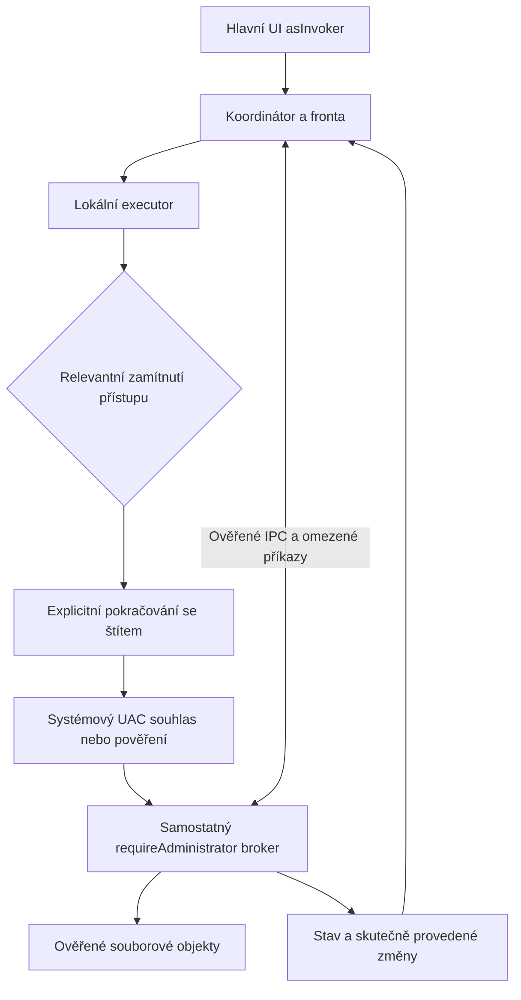

<!--
| Date | Summary | Reason | Ticket | Model |
| 2026-11-08 | Record independent Find scopes. | Document serialized consent, cancellation and scoped duplicate reads. | | GPT-6.1 Sol (Codex) |
| 2026-11-08 | Record protected Find keywords. | Document host-side parsing, verified stream limits and local evidence. | | GPT-6.1 Sol (Codex) |
| 2026-11-08 | Record protected duplicate search. | Document metadata grouping, scoped hashing and pending VM acceptance. | | GPT-6.1 Sol (Codex) |
| 2026-11-08 | Record protected Find content streaming. | Document explicit scope, local evidence and remaining acceptance. | | GPT-6.1 Sol (Codex) |
| 2026-11-08 | Record the additional cross-volume source guard probes. | Establish the behavior of NTFS attributes and delete-pending under contention. | | GPT-6.1 Sol (Codex) |
| 2026-11-08 | Record per-item UAC in native operation batches. | Document cancellation, existing worker boundaries and pending VM evidence. | | GPT-6.1 Sol (Codex) |
| 2026-11-08 | Record the protected disk overwrite pilot. | Document the verified replacement and VM acceptance boundary. | | GPT-6.1 Sol (Codex) |
| 2026-11-08 | Start the native overwrite work after ZIP acceptance. | Share the verified exchange before wiring disk conflicts. | | GPT-6.1 Sol (Codex) |
| 2026-11-08 | Record final protected ZIP acceptance. | Preserve disk, CRC, cancellation and disconnect evidence. | | GPT-6.1 Sol (Codex) |
| 2026-11-08 | Keep interrupted ZIP handling internal to the write. | Remove the standalone command and record the VM edit results. | | GPT-6.1 Sol (Codex) |
| 2026-11-08 | Record ZIP recovery and the first acceptance results. | Track successful read and extraction and the diagnosed Windows ACL difference. | | GPT-6.1 Sol (Codex) |
| 2026-11-08 | Document protected ZIP editing from the panel. | Track staging, validation, delete and F5 additions. | | GPT-6.1 Sol (Codex) |
| 2026-11-08 | Document streamed ZIP replacement and session handoff. | Track the implemented write protocol before wiring ZIP commands. | | GPT-6.1 Sol (Codex) |
| 2026-11-08 | Document ZIP recovery journal and the locked archive revision. | Record the broker boundary for updating and restoring a protected archive. | | GPT-6.1 Sol (Codex) |
| 2026-11-08 | Describe verified ZIP update publication and recovery. | Track the write backend and remaining ZIP integration. | | GPT-6.1 Sol (Codex) |
| 2026-11-08 | Record protected ZIP selection extraction. | Track manifest bounds, one target consent, and partial outcomes. | | GPT-6.1 Sol (Codex) |
| 2026-11-08 | Record single-entry protected ZIP extraction. | Separate source reads from bounded destination publication. | | GPT-6.1 Sol (Codex) |
| 2026-11-08 | Record the protected ZIP F3 implementation. | Track the verified entry reader and deferred joint acceptance. | | GPT-6.1 Sol (Codex) |
| 2026-11-08 | Limit the current UAC scope to core functions and ZIP. | Sequence the remaining ZIP work and defer other plugins and public SDK changes. | | GPT-6.1 Sol (Codex) |
| 2026-11-08 | Verify persistent protected ZIP authorization. | Reuse one broker across manual refreshes and release it on archive exit. | | GPT-6.1 Sol (Codex) |
| 2026-11-08 | Verify the protected ZIP64 archive panel. | Record folder navigation, manual refresh, cancellation, and ordinary ZIP behavior. | | GPT-6.1 Sol (Codex) |
| 2026-11-08 | Define the protected ZIP panel acceptance gate. | Require the existing archive panel and compare an elevated plugin host. | | GPT-6.1 Sol (Codex) |
| 2026-11-08 | Record the protected ZIP64 listing pilot. | Document the bounded protocol and local and VM evidence. | | GPT-6.1 Sol (Codex) |
| 2026-11-08 | Revise protected archive reads for ZIP64. | Use bounded reads from the original and keep the archive parser at ordinary integrity. | | GPT-6.1 Sol (Codex) |
| 2026-11-08 | Design the protected ZIP listing pilot. | Separate protected source reads from elevated extraction and verify ZIP staging constraints. | | GPT-6.1 Sol (Codex) |
| 2026-11-08 | Record explicit administrator editing on F4. | Document the original-file flow, editor validation, and pilot checks. | | GPT-6.1 Sol (Codex) |
| 2026-11-08 | Record detailed protected Ctrl+Q measurements. | Verify the existing occupied-space dialog and editable estimate. | | GPT-6.1 Sol (Codex) |
| 2026-11-08 | Keep protected totals in the full Ctrl+Q dialog. | Use identical geometry and controls for both access modes. | | GPT-6.1 Sol (Codex) |
| 2026-11-08 | Record protected F3 viewer snapshots and compact size results. | Describe the single-file authorization and VM checks. | | GPT-6.1 Sol (Codex) |
| 2026-11-08 | Record P6 protected logical sizing and metadata Find. | Reuse the rooted listing broker and verify ordinary search continues while consent is pending. | | GPT-6.1 Sol (Codex) |
| 2026-11-08 | Close the P5 metadata and Recycle Bin matrix. | Record EFS refusal and Shell recycling acceptance. | | GPT-6.1 Sol (Codex) |
| 2026-11-08 | Record P5n explicit security preservation in F5. | Document the bounded DACL and ownership contract and its verification. | | GPT-6.1 Sol (Codex) |
| 2026-11-08 | Record P5m permanent junction deletion. | Document the junction checks and local and VM evidence. | | GPT-6.1 Sol (Codex) |
| 2026-11-08 | Record P5l permanent directory symbolic-link deletion. | Document scope and local and VM evidence. | | GPT-6.1 Sol (Codex) |
| 2026-11-08 | Record P5k permanent file symbolic-link deletion. | Document scope and local and VM checks. | | GPT-6.1 Sol (Codex) |
| 2026-11-08 | Record P5j junction rename. | Document the accepted junction format and the local and VM results. | | GPT-6.1 Sol (Codex) |
| 2026-11-08 | Record P5i directory symbolic-link rename. | Document the type check and the local and VM results. | | GPT-6.1 Sol (Codex) |
| 2026-11-08 | Record P5h file symbolic-link rename. | Document the no-follow boundary and the local and VM results. | | GPT-6.1 Sol (Codex) |
| 2026-11-08 | Record P5g NTFS compression preservation in F5. | Document consent, attribute behavior, and local and VM evidence. | | GPT-6.1 Sol (Codex) |
| 2026-11-08 | Record P5f sparse F5 preservation. | Document local and VM evidence for data and allocation. | | GPT-6.1 Sol (Codex) |
| 2026-11-08 | Record P5e preservation of named streams in protected F5. | Document the pilot scope and local and VM results. | | GPT-6.1 Sol (Codex) |
| 2026-11-08 | Document P5d explicit Ignore ADS for protected F5. | Record stream handling in the broker and the VM checks. | | GPT-6.1 Sol (Codex) |
| 2026-11-08 | Document P5c basic directory attributes. | Track bounded Ctrl+F2 changes and their verification. | | GPT-6.1 Sol (Codex) |
| 2026-11-08 | Document P5b directory time preservation in protected F5. | Record the explicit option and its pilot limits. | | GPT-6.1 Sol (Codex) |
| 2026-11-08 | Document P5a directory timestamps and local validation. | Track the first bounded metadata extension after the transfer pilots. | | GPT-6.1 Sol (Codex) |
| 2026-11-08 | Record the P4n NTFS source-retirement probe. | Verify the late-stream race before enabling cross-volume F6. | | GPT-6.1 Sol (Codex) |
| 2026-11-08 | Record the P4m NTFS overwrite probe. | Establish which rename modes permit a target substitution. | | GPT-6.1 Sol (Codex) |
| 2026-11-08 | Document cancellation of a running protected F5 copy. | Track cleanup before publication and acknowledged success after it. | | GPT-6.1 Sol (Codex) |
| 2026-11-08 | Record the P4k CI result and allocation fix. | Keep the next stage gated on clean analysis. | https://github.com/majklvi/salamander/runs/128721425272 | GPT-6.1 Sol (Codex) |
| 2026-11-08 | Record P4j CodeQL and the protected F5 queue pilot. | Track queue admission and isolated VM acceptance. | | GPT-6.1 Sol (Codex) |
| 2026-11-07 | Document the UAC architecture, source audit, implementation stages and validation gates. | Plan per-operation elevation without implementing it. |  | GPT-6 (Codex) |
| 2026-11-07 | Record the first P0 experiment. | Link the prototype and remaining gates. | | GPT-6.1 Sol (Codex) |
| 2026-11-07 | Record the VM elevation matrix. | Capture the result with a separate administrator account. | | GPT-6.1 Sol (Codex) |
| 2026-11-07 | Record pipe loss and Shell comparisons and select the P0 backend. | Set the first local implementation slice and remaining gates. | | GPT-6.1 Sol (Codex) |
| 2026-11-07 | Add the P2 broker bootstrap and test procedure. | Track verified transport and the isolated VM acceptance gate. | | GPT-6.1 Sol (Codex) |
| 2026-11-07 | Record interactive P2 acceptance results. | Verify the exact staged broker pair in the isolated VM. | | GPT-6.1 Sol (Codex) |
| 2026-11-07 | Record the P3a verified-parent experiment. | Prove object identity under substitution before authorizing a broker write. | | GPT-6.1 Sol (Codex) |
| 2026-11-07 | Record the protected F7 broker pilot. | Track the one-leaf capability and VM validation. | | GPT-6.1 Sol (Codex) |
| 2026-11-07 | Record the P3b native rename proof and pilot boundary. | Verify target anchoring and source identity before exposing a second broker command. | | GPT-6.1 Sol (Codex) |
| 2026-11-07 | Document the P3b panel and broker integration. | Track the shared rename path, validation and VM acceptance. | | GPT-6.1 Sol (Codex) |
| 2026-11-07 | Record the four P3b consent tests in the isolated VM. | Verify both panel entry points with real UAC approval and cancellation. | | GPT-6.1 Sol (Codex) |
| 2026-11-07 | Record the extended P3b matrix in the isolated VM. | Verify a late collision, a different administrator, and disconnects around the rename. | | GPT-6.1 Sol (Codex) |
| 2026-11-07 | Document the P3c basic metadata pilot. | Track the single-file attribute and timestamp command and its acceptance. | | GPT-6.1 Sol (Codex) |
| 2026-11-07 | Document the P3d permanent delete pilot. | Record its limited scope, verified NTFS operation and VM cases. | | GPT-6.1 Sol (Codex) |
| 2026-11-07 | Record P3d acceptance and the Administrator button shield. | Verify real consent and preserve Cancel as the default. | | GPT-6.1 Sol (Codex) |
| 2026-11-07 | Document the P3e protected directory listing pilot and VM evidence. | Track reuse and termination of one rooted listing session. | | GPT-6.1 Sol (Codex) |
| 2026-11-07 | Document the UAC shield in the protected panel path bar. | Keep the translated status in a tooltip. | | GPT-6.1 Sol (Codex) |
| 2026-11-07 | Document the selected-item palette for the approved path. | Make the scope visible using the active color scheme. | | GPT-6.1 Sol (Codex) |
| 2026-11-08 | Keep the regular directory bar background behind the UAC text. | Use the selected-item foreground only. | | GPT-6.1 Sol (Codex) |
| 2026-11-08 | Record the P4a staged one-file copy primitive. | Define the copy and commit behavior before connecting it to F5. | | GPT-6.1 Sol (Codex) |
| 2026-11-08 | Document the P4b single-file broker copy. | Record both access-denied routes, bounds and acceptance. | | GPT-6.1 Sol (Codex) |
| 2026-11-08 | Document the P4c same-volume F6 pilot. | Track the transfer gate, verified rename and VM results. | | GPT-6.1 Sol (Codex) |
| 2026-11-08 | Document the P4d protected subtree inventory. | Record strict scanning and the VM acceptance. | | GPT-6.1 Sol (Codex) |
| 2026-11-08 | Document P4e source manifest revalidation. | Define the input and verification required by the recursive copy pilot. | | GPT-6.1 Sol (Codex) |
| 2026-11-08 | Record the P4d CodeQL result and the inventory label fix. | Track the format-string regression and its validation. | https://github.com/majklvi/salamander/security/code-scanning/13 | GPT-6.1 Sol (Codex) |
| 2026-11-08 | Document the P4f native tree copy pilot. | Record tested publication, rollback and the remaining broker integration gate. | | GPT-6.1 Sol (Codex) |
| 2026-11-08 | Document the P4g staging integrity profile. | Record verified access isolation and inherited destination DACLs. | | GPT-6.1 Sol (Codex) |
| 2026-11-08 | Document the registered P4h F5 pilot. | Describe consent, target identity provisioning and broker checks. | | GPT-6.1 Sol (Codex) |
| 2026-11-08 | Record P4h failure and alternate-account acceptance. | Distinguish clean rollback from the protected residue of forced broker termination. | | GPT-6.1 Sol (Codex) |
| 2026-11-08 | Record journaled recovery for interrupted tree copies. | Define the recovery trigger, identity checks and isolated VM result. | | GPT-6.1 Sol (Codex) |
| 2026-11-08 | Record multiple registered F5 destinations. | Describe protected ancestry and per-target recovery isolation. | | GPT-6.1 Sol (Codex) |
-->

# Plán implementace podpory UAC v Open Samandarin

Stav k 8. listopadu 2026: pilot F7 (P3a), přejmenování jednoho souboru (P3b), změna jeho běžných atributů a časů (P3c), pilot trvalého mazání (P3d), pilot procházení chráněného podstromu (P3e) a piloty kopírování přes F5 a přesunu přes F6 (P4a–P4c) a soupis chráněného podstromu (P4d). Výsledky a zbývající podmínky jsou v oddílech 8 a 11.

Základem je upstream [release/5.0-samandarin-0.16](https://github.com/KRtkovo-eu-AI/salamander/tree/release/5.0-samandarin-0.16), ověřený commit [`16b4cd0176dc82752a11ee6bc09615780b6987a2`](https://github.com/KRtkovo-eu-AI/salamander/commit/16b4cd0176dc82752a11ee6bc09615780b6987a2). Stejný commit měla při založení práce referenční větev `majklvi/salamander:samandarin-0.16`. Pracovní větev je `feature/uac-support`, lokální checkout `C:\Samandarin\uac-support`. Všechny níže uvedené řádky zdrojů odkazují na tento pevný upstream commit, nikoli na proměnlivý HEAD.

**Doporučená architektura:** hlavní aplikace zůstane `asInvoker`; úzce vymezené administrativní souborové operace vykoná samostatný minimální EXE broker spuštěný přes Windows UAC. Uživatelské rozhraní, fronta, rozhodování o konfliktech, konfigurace, pluginy a parsování zůstanou v původním procesu. Volbu backendu dokládá [výsledek P0](#61-výsledky-p0-a-volba-backendu) včetně porovnání s `IFileOperation`.

## 1. Cíl a rozsah

Cílový scénář: uživatel v běžně spuštěném Samandarinu kopíruje do chráněného adresáře. Operace nejprve použije běžná oprávnění. Pokud narazí na relevantní zamítnutí přístupu, nabídne pokračování s oprávněním správce pro konkrétní položku nebo vymezenou dávku. Windows zobrazí vlastní souhlas či přihlášení administrátora. Samandarin pokračuje z bezpečného bodu, zachová přehled o hotových změnách a zobrazí skutečný výsledek.

První funkční rozsah má zahrnovat lokální vytvoření adresáře, přejmenování, kopírování, přesun, trvalé mazání a běžné atributy/časy, včetně přípravy nepřístupného podstromu. Podpora se zpřístupňuje postupně podle etap; zvláštní vlastnosti souborů se nesmějí tiše zahazovat.

Samostatné navazující oblasti: Koš, pokročilé NTFS vlastnosti, chráněný listing/hledání/čtení, editace chráněného souboru, archivy a pluginy. Nepodporovaný případ musí mít přesnou reakci a nesmí spustit širší náhradní operaci bez rozhodnutí uživatele.

Výchozí návrh neobsahuje trvalou službu SYSTEM, automatický restart celého GUI jako správce, změny UAC policy, ukládání administrátorského hesla ani automatické převzetí vlastnictví či přepis ACL jako opravu chyby přístupu. Ručně zvýšené spuštění celé aplikace je samostatný existující provozní režim.

## 2. Zásady doložené dokumentací Microsoftu

Níže jsou odděleny vlastnosti Windows od konkrétních návrhových rozhodnutí pro Samandarin.

| Oblast | Dokumentovaná vlastnost a důsledek pro návrh |
| --- | --- |
| Nejmenší oprávnění | Microsoft doporučuje běžným desktopovým aplikacím `asInvoker` a oddělení zvýšených úkonů do pomocného procesu. [Running with Administrator Privileges](https://learn.microsoft.com/en-us/windows/win32/secbp/running-with-administrator-privileges). |
| Rozdělení procesů | Administrator Broker Model používá běžný program a samostatný `requireAdministrator` program, spuštěný až při potřebě administrativní operace. Přenos stavu a duplikace kódu jsou výslovně uvedené nevýhody. [Administrator Broker Model](https://learn.microsoft.com/en-us/windows/win32/secauthz/administrator-broker-model). |
| Manifest | `asInvoker` znamená token spouštějícího procesu, nikoli vždy medium integrity. Explicitní `requestedExecutionLevel` vypíná virtualizaci souborů/registru. `uiAccess` není obecná cesta k souborovým oprávněním. [Application manifests](https://learn.microsoft.com/en-us/windows/win32/sbscs/application-manifests). |
| Spuštění elevace | `runas` spouští systémový mechanismus souhlasu/pověření. Pro broker použít `ShellExecuteExW`, absolutní cestu a `SEE_MASK_NOCLOSEPROCESS`; kontrolovat úspěch i dostupnost process handle. ShellExecute vyžaduje správný COM/thread kontext. [ShellExecuteW](https://learn.microsoft.com/en-us/windows/win32/api/shellapi/nf-shellapi-shellexecutew), [ShellExecuteExW](https://learn.microsoft.com/en-us/windows/win32/api/shellapi/nf-shellapi-shellexecuteexw). |
| Uživatelský souhlas | Vysvětlit potřebu oprávnění v místě operace, označit akci systémovým štítem a po zrušení souhlasu vrátit řízení do původního UI. Citovaný UX text pochází z éry Windows 7; používáme jeho principy, nikoli staré obrázky jako dnešní vizuální normu. [UAC design guidance](https://learn.microsoft.com/en-us/windows/desktop/uxguide/winenv-uac). |
| Jiný účet správce | Standardní uživatel může zadat pověření jiného administrátora. Logon session a mapované disky se mohou lišit. Návrh nesmí předpokládat shodné SID, HKCU, profil, síťová pověření nebo `%TEMP%`. [How UAC works](https://learn.microsoft.com/en-us/windows/security/application-security/application-control/user-account-control/how-it-works), [Mapped drives and elevation](https://learn.microsoft.com/en-us/troubleshoot/windows-client/networking/mapped-drives-not-available-from-elevated-command). |
| Privilegia tokenu | `AdjustTokenPrivileges` nepřidá tokenu privilegium, které nemá, a úspěšný BOOL nevylučuje `ERROR_NOT_ALL_ASSIGNED`. Backup/restore práva mohou měnit běžné ACL kontroly. Zapínání privilegií není UAC elevace. [AdjustTokenPrivileges](https://learn.microsoft.com/en-us/windows/win32/api/securitybaseapi/nf-securitybaseapi-adjusttokenprivileges), [Managing privileges in a file system](https://learn.microsoft.com/en-us/windows-hardware/drivers/ifs/privileges). |
| Rozsah ochrany | MSRC klasifikuje UAC jako defense-in-depth, nikoli robustní bezpečnostní hranici. Návrh přesto musí chránit IPC a respektovat hranice uživatelů, sessions a procesů. Nelze slibovat bezpečné oddělení již kompromitovaného autorizovaného hostu od všech jím schválených administrativních úkonů. [Windows Security Servicing Criteria](https://www.microsoft.com/en-us/msrc/windows-security-servicing-criteria). |

## 3. Co už je ve zdrojích

Přesnější označení chybějící funkce je **integrovaná elevace nativních souborových operací**. Aplikace už obsahuje některé části podpory UAC a shellové operace; jejich pouhá existence neprokazuje kompletní funkční pokrytí.

| Stávající oblast | Ověřený zdroj | Dopad |
| --- | --- | --- |
| Manifest hlavního EXE | [src/manifest.xml:25](https://github.com/KRtkovo-eu-AI/salamander/blob/16b4cd0176dc82752a11ee6bc09615780b6987a2/src/manifest.xml#L25) | `asInvoker`, `uiAccess=false`, dále UTF-8 a `longPathAware`; zachovat. |
| Administrátorský příkazový řádek | [src/mainwnd3.cpp:8668](https://github.com/KRtkovo-eu-AI/salamander/blob/16b4cd0176dc82752a11ee6bc09615780b6987a2/src/mainwnd3.cpp#L8668) | `CM_DOSSHELLASADMIN`, `runas` na 8740, zvláštní zacházení s `ERROR_CANCELLED` na 8749. |
| Stav aktuálního procesu | [src/salamdr1.cpp:4897](https://github.com/KRtkovo-eu-AI/salamander/blob/16b4cd0176dc82752a11ee6bc09615780b6987a2/src/salamdr1.cpp#L4897), [src/salamdr6.cpp:2265](https://github.com/KRtkovo-eu-AI/salamander/blob/16b4cd0176dc82752a11ee6bc09615780b6987a2/src/salamdr6.cpp#L2265) | `RunningAsAdmin` vychází z integrity level. Doplnit přesný interní popis tokenu, uživatele a session. |
| Členství v Administrators | [src/worker.cpp:2605](https://github.com/KRtkovo-eu-AI/salamander/blob/16b4cd0176dc82752a11ee6bc09615780b6987a2/src/worker.cpp#L2605), [spl_gen.h:3511](https://github.com/KRtkovo-eu-AI/salamander/blob/16b4cd0176dc82752a11ee6bc09615780b6987a2/src/plugins/shared/spl_gen.h#L3511) | Aktivní `IsUserAdmin()` hledá SID v TokenGroups bez kontroly deny-only flags; SDK popisuje členství. Nepoužít jako důkaz skutečné elevace a neměnit nepozorovaně význam SDK. |
| Privilegia kopírování zabezpečení | [src/worker.cpp:2413](https://github.com/KRtkovo-eu-AI/salamander/blob/16b4cd0176dc82752a11ee6bc09615780b6987a2/src/worker.cpp#L2413), [volání na 10459](https://github.com/KRtkovo-eu-AI/salamander/blob/16b4cd0176dc82752a11ee6bc09615780b6987a2/src/worker.cpp#L10459) | `GainWriteOwnerAccess` se pokouší zapnout restore/take-ownership/security práva v procesu. Nepřenášet tento globální režim automaticky do brokeru. |
| Koš | [src/fileswn8.cpp:134](https://github.com/KRtkovo-eu-AI/salamander/blob/16b4cd0176dc82752a11ee6bc09615780b6987a2/src/fileswn8.cpp#L134), [src/operationrecycle.h:39](https://github.com/KRtkovo-eu-AI/salamander/blob/16b4cd0176dc82752a11ee6bc09615780b6987a2/src/operationrecycle.h#L39) | Již používá `IFileOperation`; chování UAC a jednotlivých kombinací flags je třeba ověřit ve VM. |

## 4. Mapa zásahů do souborových operací

| Místo | Současná role | Plánovaný zásah |
| --- | --- | --- |
| [fileswn8.cpp:275 — FilesAction](https://github.com/KRtkovo-eu-AI/salamander/blob/16b4cd0176dc82752a11ee6bc09615780b6987a2/src/fileswn8.cpp#L275) | Vstup copy/move/delete a sběr voleb. | Zachytit neměnný uživatelský záměr, vybrané položky, oprávněný rozsah dávky a její ID. |
| [fileswn6.cpp:1290 — BuildScriptMain](https://github.com/KRtkovo-eu-AI/salamander/blob/16b4cd0176dc82752a11ee6bc09615780b6987a2/src/fileswn6.cpp#L1290), `BuildScriptDir:1786`, `BuildScriptFile:2818` | Příprava skriptu ještě před workerem. Enumerace na 2406, otevření zdroje na 3119 a čtení ADS mohou selhat na oprávněních. | Omezený privilegovaný discovery/metadata endpoint pro právě schválený podstrom. Neúplný scan nesmí být vydán za kompletní výběr. |
| [worker.h:223](https://github.com/KRtkovo-eu-AI/salamander/blob/16b4cd0176dc82752a11ee6bc09615780b6987a2/src/worker.h#L223), [COperation:327](https://github.com/KRtkovo-eu-AI/salamander/blob/16b4cd0176dc82752a11ee6bc09615780b6987a2/src/worker.h#L327) | Opkódy, pointery, `std::wstring`, koordinátor; některé pointerové členy nesou číselné hodnoty. | Vlastní serializovaný kontrakt bez raw struktur, pointerů, `HWND` jako autority a závislosti na bitové šířce procesu. |
| [workerpath.h:12](https://github.com/KRtkovo-eu-AI/salamander/blob/16b4cd0176dc82752a11ee6bc09615780b6987a2/src/workerpath.h#L12) | Převod cest a zachování wide identity. | Přenášet přesné délkované UTF-16 cesty; zachovat již známé `SourceNameW/TargetNameW`. |
| [worker.cpp:10376 — ThreadWorkerBody](https://github.com/KRtkovo-eu-AI/salamander/blob/16b4cd0176dc82752a11ee6bc09615780b6987a2/src/worker.cpp#L10376) | Dispatcher opkódů a worker orchestrace. | Volba lokálního/elevovaného executor backendu na úrovni doménového úkonu, po oddělení UI. |
| [worker.cpp:5593 — DoCopyFile](https://github.com/KRtkovo-eu-AI/salamander/blob/16b4cd0176dc82752a11ee6bc09615780b6987a2/src/worker.cpp#L5593), smyčky 4335 a 5259 | Kopírování, přepis, asynchronní I/O, metadata, cleanup. | Stavový výsledek rozlišující nezačato, částečný zápis, hotová data a selhání metadat. Elevace nesmí slepě opakovat `CREATE_ALWAYS` z 6548. |
| [worker.cpp:6785 — DoMoveFile](https://github.com/KRtkovo-eu-AI/salamander/blob/16b4cd0176dc82752a11ee6bc09615780b6987a2/src/worker.cpp#L6785) | Rename a copy+delete; odstranění zdroje na 7385. | Odlišit přesun v rámci svazku od více kroků. Po úspěšné kopii a selhání delete pokračovat pouze odstraněním ověřeného zdroje. |
| [worker.cpp:7422 — DoDeleteFile](https://github.com/KRtkovo-eu-AI/salamander/blob/16b4cd0176dc82752a11ee6bc09615780b6987a2/src/worker.cpp#L7422), `DoCreateDir:7671`, `DoDeleteDir:8004`, `DoChangeAttrs:8836` | Základní mutace; i delete mění readonly a mkdir může vytvořit část rodičů. | Typované jednotlivé příkazy a evidence skutečně provedených změn, včetně částečného výsledku. |
| [fileswn5.cpp:2993 — CreateDir](https://github.com/KRtkovo-eu-AI/salamander/blob/16b4cd0176dc82752a11ee6bc09615780b6987a2/src/fileswn5.cpp#L2993), `RenameFileInternalW:3452`, `RenameFile:3840` | F7 a přejmenování mají cesty mimo hlavní worker. | Zapojit stejný executor a rozhodování o elevaci; nezanechat rozdílné chování F7, rename dialogu a Quick Rename. |
| [dialogs.cpp:1128 — CProgressDialog::DialogProc](https://github.com/KRtkovo-eu-AI/salamander/blob/16b4cd0176dc82752a11ee6bc09615780b6987a2/src/dialogs.cpp#L1128), `WM_USER_DIALOG:1592` | Progress, StartWorker na 1361, odpovědi dialogů předávané pointery přes SendMessage, cancel na 2061. | Typované události mezi executor/koordinátorem a IPC, všechny běžné dialogy v původním UI. Neprotahovat pointerový protokol mezi procesy. |
| [worker.cpp:1405](https://github.com/KRtkovo-eu-AI/salamander/blob/16b4cd0176dc82752a11ee6bc09615780b6987a2/src/worker.cpp#L1405), lease na 1434 a validace na 1806 | Scan-ahead, konflikty, generace a paralelní copy. | Jediný koordinátor vlastní pořadí a rozhodnutí. Elevovaný executor přijímá jen aktuálně přidělenou práci. |
| [worker.cpp:10534](https://github.com/KRtkovo-eu-AI/salamander/blob/16b4cd0176dc82752a11ee6bc09615780b6987a2/src/worker.cpp#L10534) | Komentář výslovně připouští pathname race po poslední kontrole identity. | Bezpečnostní podmínka: ověřený handle musí nést identitu do mutace; nepřesunout mechanicky legacy dispatch do high integrity. |
| [worker.cpp:9164](https://github.com/KRtkovo-eu-AI/salamander/blob/16b4cd0176dc82752a11ee6bc09615780b6987a2/src/worker.cpp#L9164), 9206, 9341 | Paralelní cesta ověřuje identity otevřených zdrojů/cílů a cleanup. | Využít dílčí vzor a testy; neprohlašovat ostatní operace za bezpečné jen díky této kontrole. |
| [worker.cpp:2666 — DoCopySecurity](https://github.com/KRtkovo-eu-AI/salamander/blob/16b4cd0176dc82752a11ee6bc09615780b6987a2/src/worker.cpp#L2666), `DeleteDirLink:8257` | Legacy ANSI/security a `MAX_PATH` větve, vícekroková práce s reparse. | Před elevací samostatně auditovat a převést potřebné cesty na wide/handle operace. |
| [worker.cpp:11059 — COperationsQueue::AddOperation](https://github.com/KRtkovo-eu-AI/salamander/blob/16b4cd0176dc82752a11ee6bc09615780b6987a2/src/worker.cpp#L11059) | Storage-aware fronta. | UAC nesmí obcházet frontu, zdvojovat pracovní sloty ani hlásit dokončení téže položky dvakrát. |

## 5. Další integrační plochy

| Oblast | Zdroj a plánované zacházení |
| --- | --- |
| Spouštění/helper | [salamdr1.cpp:6279](https://github.com/KRtkovo-eu-AI/salamander/blob/16b4cd0176dc82752a11ee6bc09615780b6987a2/src/salamdr1.cpp#L6279) má časný `DriveFreeSpaceHelperDispatch`; [drivefreespace.cpp:572](https://github.com/KRtkovo-eu-AI/salamander/blob/16b4cd0176dc82752a11ee6bc09615780b6987a2/src/drivefreespace.cpp#L572) je precedent pomocného procesu. Pro UAC zvolit vlastní minimální EXE bez importů a inicializace celého hostu. |
| Existující IPC | [salamdr6.cpp:2191](https://github.com/KRtkovo-eu-AI/salamander/blob/16b4cd0176dc82752a11ee6bc09615780b6987a2/src/salamdr6.cpp#L2191) dává požadovaná práva Everyone; pro broker nepoužít. [ShellPreviewHost.cpp:431](https://github.com/KRtkovo-eu-AI/salamander/blob/16b4cd0176dc82752a11ee6bc09615780b6987a2/src/plugins/pictview/wic/ShellPreviewHost.cpp#L431) má novější pipe/lifecycle vzor, ale jde o neelevovaný helper a neřeší automaticky jiný administrátorský účet. |
| Panel a hledání | [fileswn3.cpp:780 — ReadDirectory](https://github.com/KRtkovo-eu-AI/salamander/blob/16b4cd0176dc82752a11ee6bc09615780b6987a2/src/fileswn3.cpp#L780), [find.cpp:1540 — SearchDirectory](https://github.com/KRtkovo-eu-AI/salamander/blob/16b4cd0176dc82752a11ee6bc09615780b6987a2/src/find.cpp#L1540). Pozdější explicitně autorizované čtení/listing; žádné nové UAC prompty při každém refreshi, náhledu či background scan. |
| Viewer a editor | [viewer2.cpp:45 — OpenViewerFileForRead](https://github.com/KRtkovo-eu-AI/salamander/blob/16b4cd0176dc82752a11ee6bc09615780b6987a2/src/viewer2.cpp#L45), [fileswn5.cpp:1787](https://github.com/KRtkovo-eu-AI/salamander/blob/16b4cd0176dc82752a11ee6bc09615780b6987a2/src/fileswn5.cpp#L1787), `EditFile:2303`, [fileactionpath.h:53](https://github.com/KRtkovo-eu-AI/salamander/blob/16b4cd0176dc82752a11ee6bc09615780b6987a2/src/fileactionpath.h#L53). Chráněné čtení může později předat omezený read-only stream/handle; dekodéry a UI zůstanou neelevované. Externí editor jako správce je jiný kontrakt. |
| Pluginy a SDK | [plugins1.cpp:2242 — InitDLL](https://github.com/KRtkovo-eu-AI/salamander/blob/16b4cd0176dc82752a11ee6bc09615780b6987a2/src/plugins1.cpp#L2242) načítá DLL do hostu. [safefile.cpp:108](https://github.com/KRtkovo-eu-AI/salamander/blob/16b4cd0176dc82752a11ee6bc09615780b6987a2/src/safefile.cpp#L108), `SafeFileCreate:188` a [spl_file.h:106](https://github.com/KRtkovo-eu-AI/salamander/blob/16b4cd0176dc82752a11ee6bc09615780b6987a2/src/plugins/shared/spl_file.h#L106) poskytují handle-based API. Jeho plošné otevření s admin právy by rozšířilo moc pluginů; první fáze beze změny SDK. |
| Konfigurace | [configstorage.cpp:225](https://github.com/KRtkovo-eu-AI/salamander/blob/16b4cd0176dc82752a11ee6bc09615780b6987a2/src/configstorage.cpp#L225) používá HKCU; portable cesta na 283 a ukládání na 383. Vlastníkem preferencí a historie zůstává původní uživatel; helper nesmí inicializovat ani přepisovat profil administrátora. |
| Build a distribuce | [src/vcxproj/salamand.sln](https://github.com/KRtkovo-eu-AI/salamander/blob/16b4cd0176dc82752a11ee6bc09615780b6987a2/src/vcxproj/salamand.sln), [salamand.vcxproj](https://github.com/KRtkovo-eu-AI/salamander/blob/16b4cd0176dc82752a11ee6bc09615780b6987a2/src/vcxproj/salamand.vcxproj), [Inno Setup:72](https://github.com/KRtkovo-eu-AI/salamander/blob/16b4cd0176dc82752a11ee6bc09615780b6987a2/doc/runbook-setup/inno_setup_salamander_x64.iss#L72), utils na 1133–1135. Přidat vlastní projekt, staging a balení helperu; manifesty ověřovat také ve výsledných EXE. |

## 6. Porovnání implementačních variant

| Varianta | Přínos | Omezení | Doporučení |
| --- | --- | --- | --- |
| `requireAdministrator`/`highestAvailable` pro celé GUI | Malý počáteční zásah. | Zvyšuje práva pluginům, parserům a externím akcím; mění identitu, drag-and-drop a běžné spuštění. | Nepoužít jako implementaci per-operation UAC. |
| Shell `IFileOperation` | Windows řeší souborové úkony a elevaci; část kódu jej již používá pro Koš. | Nutno porovnat přesné cesty, konflikty, metadata, frontu, progress a přerušení s vlastním enginem. | Zachovat pro Koš a samostatně ověřené shellové úkony. |
| Samostatný EXE broker + omezené IPC | Umožňuje zachovat vlastní engine a oddělit privilegovaný kód bez COM registrace. | Vlastní bezpečnostní protokol, životní cyklus, odpojení a práce s částečnými výsledky. | Zvoleno pro nativní operace. Produkční podmínky P2 a P3 zůstávají závazné. |
| COM elevation moniker | Dokumentovaný způsob elevace malé funkce a standardní marshaling. | Registrace HKLM, lokalizovaný název a COM security pro jiný účet; komplikace portable distribuce. | Záložní varianta, pokud bezpečnost a údržba EXE IPC nevyjdou dobře. |
| Služba / naplánovaná elevated úloha | Dlouhodobě dostupná privilegovaná část. | Instalace, stálý privilegovaný povrch a samostatná autorizace. | Pro tento rozsah nepřiměřené. |

COM podmínky vycházejí z [The COM Elevation Moniker](https://learn.microsoft.com/en-us/windows/win32/com/the-com-elevation-moniker); volba mezi variantami je návrhové hodnocení pro tento repozitář.

U `IFileOperation` nejsou flagy zaměnitelné: `FOFX_SHOWELEVATIONPROMPT` umožňuje UAC při potlačeném error UI, `FOFX_REQUIREELEVATION` odstraňuje předběžné potvrzení očekávané elevace, ne systémový UAC souhlas. `FOFX_EARLYFAILURE` je platný spolu s `FOF_NOERRORUI`; prověřit všechny současné kombinace. Po `PerformOperations` vyhodnotit jednotlivé výsledky a `GetAnyOperationsAborted`, i při úspěšném HRESULT. [SetOperationFlags](https://learn.microsoft.com/en-us/windows/win32/api/shobjidl_core/nf-shobjidl_core-ifileoperation-setoperationflags), [GetAnyOperationsAborted](https://learn.microsoft.com/en-us/windows/win32/api/shobjidl_core/nf-shobjidl_core-ifileoperation-getanyoperationsaborted).

Aktuální [OperationRecyclePath](https://github.com/KRtkovo-eu-AI/salamander/blob/16b4cd0176dc82752a11ee6bc09615780b6987a2/src/operationrecycle.h#L12) odmítá cesty s koncovými tečkami/mezerami, aby Shell nezasáhl jiný objekt. Proto není náhrada všech Win32 operací Shell API automaticky ekvivalentní.

### 6.1 Výsledky P0 a volba backendu

Pokusy proběhly ve vyhrazené Windows 11 Pro x64 VM, build 26200, se zabezpečenou plochou UAC. Shell zkoušel vytvořit jedinou novou složku v chráněném laboratorním adresáři pod Program Files. Přímý CreateDirectoryW ze stejného procesu pokaždé vrátil chybu 5. Pomocný EXE ověřoval spuštění, identitu a životnost spojení pomocí pevných zpráv. Sám v této etapě neprováděl souborové mutace. Podmínky opakování pokusů jsou v [laboratorním postupu](../tools/uac-lab/README.md).

| Scénář | Pozorovaný výsledek | Důsledek pro návrh |
| --- | --- | --- |
| EXE, host po ověřeném hello zavře rouru před potvrzením | Zvýšený klient rozpoznal uzavřené spojení a host ověřil jeho ukončení v pětisekundovém limitu. | Klient při ztrátě hostu ukončí relaci. Nový pokus vyžaduje nové rozhodnutí hostu. |
| EXE, klient skončí po přijetí potvrzení a před doručením testovacího potvrzení výsledku | Host zaznamenal chybu 109 (ERROR_BROKEN_PIPE), ověřil ukončení zvýšeného klienta a test skončil. | Odpojení je selhání transportu. Pokud už mohla začít mutace, host hlásí OutcomeUnknown a před případným opakováním ověří stav. |
| IFileOperation, kontrola s potlačenou výzvou | NewItem vrátil S_OK při zařazení. PerformOperations a PostNewItem vrátily 0x80270022 (COPYENGINE_E_ACCESS_DENIED_DEST). Aborted bylo 0 a cíl nevznikl. | Ani úspěšné zařazení položky, ani Aborted = 0 nedokládají provedení. |
| IFileOperation, zrušení výzvy | PerformOperations vrátil 0x80270000 (COPYENGINE_E_USER_CANCELLED). Aborted bylo 1, PostNewItem vrátil 0x80270002 (COPYENGINE_E_REQUIRES_ELEVATION) a cíl nevznikl. | Interpretovat společně výsledek dávky, stav přerušení a výsledek položky. |
| IFileOperation, schválení výzvy | PerformOperations i PostNewItem vrátily S_OK, Aborted bylo 0 a přesně pojmenovaný cílový adresář vznikl. | Shell v tomto scénáři skutečně zvládl jednoduché vytvoření složky se zvýšenými právy. |

**Rozhodnutí P0:** pro nativní engine zvolit samostatný EXE broker s omezeným protokolem. Na tomto backendu je možné zachovat stávající model fronty, konfliktů a fází operace a výslovně navázat provedení na ověřenou identitu objektů. Pokus se Shellem potvrdil jednoduchý mkdir, ale pro jeho použití v nativním enginu by bylo třeba zvlášť prokázat shodu přesných cest, pravidel přepisu, metadat a výsledků rozpracované dávky. IFileOperation ponechat pro stávající Koš a další samostatně ověřené Shell úkony. Výsledek P0 neposuzuje elevaci Koše pod jiným účtem.

**Další etapa P1a:** oddělit jediný lokální příkaz pro vytvoření koncové složky v existujícím rodiči v nativní větvi F7. Výchozí místo je volání SalCreateDirectoryExW a jeho stávající fallback v [fileswn5.cpp](https://github.com/KRtkovo-eu-AI/salamander/blob/16b4cd0176dc82752a11ee6bc09615780b6987a2/src/fileswn5.cpp#L3092). Zachovat konverze, dialogy, vytváření rodičů ve stávající cestě a oznámení změny. Vymezit typovaný výsledek příkazu s původní Win32 chybou. Ověřit úspěch, kolizi, neplatné jméno, chybějící nebo chráněný rodič, Unicode a dlouhou cestu. První řez P1a je neprivilegovaný a jeho rozsah nevyžaduje úpravu ostatních workerů.

P2 má ověřit produkční bootstrap, distribuci a bezpečné ukončení při ztrátě procesu i kanálu. P3 smí první mutaci zapnout po samostatném ověření identity rodiče včetně jeho výměny a reparse bodů. Po ztrátě spojení po možné mutaci nepoužívat slepé opakování. Počáteční distribuční pilot plánovat jako chráněnou instalaci pro Windows 11 x64 na lokálním NTFS. Rozšíření na portable, starší Windows nebo další souborové systémy vyžaduje vlastní testy.

## 7. Navržené rozdělení komponent

Následující názvy jsou pracovní návrh, ne existující třídy nebo soubory:

- **Operation coordinator v hostu:** snapshot výběru a voleb, autorizovaný rozsah, fronta, konflikty, generace a leasing práce, progress, výsledky a refresh panelů.
- **Local file executor:** stejné doménové příkazy bez elevace, oddělené od dialogů. Slouží i jako regresní základ před zavedením UAC.
- **Elevation controller v hostu:** klasifikace chyby, explicitní pokračování, spuštění/ověření brokeru, stav souhlasu, IPC a lifecycle. Jeden controller pro všechny vstupní cesty.
- **Privileged file executor v brokeru:** pouze schválené příkazy, validace vstupů a objektů, úzká privilegia, operace nad ověřenými objekty a strukturované výsledky. Žádné pluginové nebo skriptovací rozhraní.
- **Versioned protocol:** samostatná datová reprezentace sdílená oběma stranami, nezávislá na `COperation`, adresním prostoru a bitové šířce.

Požadavek nese verzi, velikost, typ příkazu, session/batch/request ID, generaci rozhodnutí, přesné zdrojové/cílové cesty, očekávané identity objektů a explicitní volby. Číselné typy mají pevnou šířku; řetězce mají délku a limit, embedded NUL se odmítá. Výsledek nese původní Win32/HRESULT chybu, fázi selhání, identitu provedeného úkonu, počty přenesených dat a skutečné vedlejší účinky. Neznámá verze/příkaz se odmítá před mutací.

Protokol neobsahuje obecné příkazy `Execute`, `LoadLibrary`, `RunPlugin`, libovolný zápis registru, neomezený `OpenHandle` ani raw pointery. Případné read-only streamy pro viewer budou samostatně autorizovanou pozdější schopností.

## 8. Bezpečnostní návrh a podmínky jeho přijetí

### 8.1 Důvěryhodné spuštění a distribuce

Helper má samostatný manifest `requireAdministrator`, `uiAccess=false`, wide/long-path podporu a minimální závislosti. Host jej spouští absolutní cestou z ověřeného instalačního umístění; aktivní panel ani jeho aktuální adresář neurčují executable, DLL search path či privilegovanou konfiguraci. COM inicializaci a `ShellExecuteExW` provést mimo loader lock a mimo zámky fronty; vlastník UAC dialogu je platné okno aplikace.

Release návrh zahrne podpis EXE, chráněné umístění a aktualizační řetězec, kontrolu verze/protokolu a audit všech statických i dynamických DLL závislostí. Omezení DLL vyhledávání až po vstupu do `main` nechrání importy načtené před startem. Broker nesmí načítat `.spl`, shell extensions, uživatelské dekodéry ani runtime Salamatrix. [Dynamic-Link Library Security](https://learn.microsoft.com/en-us/windows/win32/dlls/dynamic-link-library-security), [Code signing options](https://learn.microsoft.com/en-us/windows/apps/package-and-deploy/code-signing-options).

Podpis je návrhový požadavek distribučního řetězce, nikoli tvrzení, že Windows za všech politik zakazuje unsigned `runas`. Z absence `SignTool` v auditovaném `.iss` nelze určit stav podpisu skutečných release binárek.

Portable režim potřebuje explicitní rozhodnutí v P0: jak zajistit integritu helperu a závislostí v uživatelsky zapisovatelném umístění, případně použít chráněnou instalaci pomocné komponenty. Samotný podpis neřeší podvrženou sousední DLL ani race při záměně executable. Dokud není bezpečný režim navržen a ověřen, tento způsob distribuce nemá slibovat funkční broker. Běžná neelevovaná portable práce musí zůstat dostupná.

Instalátor povoluje `users-modify` pro [configstorage.ini a plugin-receipts.json](https://github.com/KRtkovo-eu-AI/salamander/blob/16b4cd0176dc82752a11ee6bc09615780b6987a2/doc/runbook-setup/inno_setup_salamander_x64.iss#L855). Tyto soubory nesmějí být autoritou pro důvěryhodnost helperu nebo povolené privilegované úkony.

### 8.2 IPC a identita

Preferovaným kandidátem k ověření je jednorázová lokální named pipe pro vymezenou dávku. DACL musí být explicitní; default poskytuje mimo jiné čtení Everyone/Anonymous. Nepoužít `CreateAccessableSecurityAttributes` ani udělení `GENERIC_ALL` všem. Klientská práva sestavit z potřebných jednotlivých práv, protože `FILE_GENERIC_WRITE` zahrnuje také vytvoření další instance pipe. [Named Pipe Security and Access Rights](https://learn.microsoft.com/en-us/windows/win32/ipc/named-pipe-security-and-access-rights).

Navržené obrany: náhodný název, jedna očekávaná instance, `FILE_FLAG_FIRST_PIPE_INSTANCE`, `PIPE_REJECT_REMOTE_CLIENTS`, omezené zprávy, validované délky/enumy, timeout handshake, zrušitelné I/O a konec autorizace po dokončení dávky. Přesné ACL a mandatory integrity label závisejí na zvoleném směru spojení a musí projít P0 pro split-token i jiné administrátorské pověření. [CreateNamedPipe API](https://learn.microsoft.com/en-us/windows/win32/api/winbase/nf-winbase-createnamedpipea) popisuje společné flagy; implementace použije wide variantu.

Název pipe, nonce ani PID samostatně neautentizují protistranu. Spojení musí být navázáno na očekávaný živý proces, kernelově zjištěné peer PID, udržovaný process handle a ověřenou identitu tokenu/session; odlišit identitu klienta od autorizace jednotlivého úkonu. Ošetřit PID reuse i podvržený helper/server. `client SID == helper SID` není přípustná obecná podmínka, protože rozbije elevaci pod jiným účtem. [GetNamedPipeClientProcessId](https://learn.microsoft.com/en-us/windows/win32/api/winbase/nf-winbase-getnamedpipeclientprocessid), [GetNamedPipeServerProcessId](https://learn.microsoft.com/en-us/windows/win32/api/winbase/nf-winbase-getnamedpipeserverprocessid), [Process Handles and Identifiers](https://learn.microsoft.com/en-us/windows/win32/procthread/process-handles-and-identifiers).

Pokud bude host pipe serverem a elevated helper klientem, helper nesmí dovolit hostu impersonovat administrátora: ověřit použití `SECURITY_SQOS_PRESENT | SECURITY_IDENTIFICATION`. Pokud bude serverem helper, případná impersonace klienta slouží identifikaci a omezeným kontrolám; před autorizovanou zvýšenou operací se kontext musí řízeně vrátit. Selhání impersonace odmítne požadavek; selhání `RevertToSelf` vyžaduje ukončení broker procesu, protože jeho bezpečnostní kontext již nelze považovat za řízený. [Impersonation Levels](https://learn.microsoft.com/en-us/windows/win32/secauthz/impersonation-levels), [ImpersonateNamedPipeClient](https://learn.microsoft.com/en-us/windows/win32/api/namedpipeapi/nf-namedpipeapi-impersonatenamedpipeclient), [RevertToSelf](https://learn.microsoft.com/en-us/windows/win32/api/securitybaseapi/nf-securitybaseapi-reverttoself).

**Výstup P0 musí obsahovat konkrétní sekvenci bootstrapu, SDDL, práva procesových handle a důkaz testy pro obě identity.** Tento dokument záměrně nepovažuje seznam opatření za hotový bezpečný protokol. Nelze jej nahradit pouze tajným argumentem na command line nebo kontrolou názvu EXE.

### 8.3 Autorizace, cesty a změny objektu

Autorizace je navázaná na vybranou operaci, položky/podstromy a výslovné volby, ne na obecnou možnost měnit celý disk. U dynamicky enumerovaného podstromu musí protokol určit, jaké nové položky ještě patří do schváleného rozsahu; nová dávka či rozšířený kořen vyžaduje nové rozhodnutí. Broker nepřijímá další nesouvisející úkony jen proto, že zůstal spuštěný.

Před mutací validovat otevřený objekt a pracovat dál se stejnou identitou. Ověřit i rodičovské adresáře, svazek, hardlinky a přesměrování přes junction/symlink; pouhý prefix cesty nebo normalizace `..` není bezpečnostní kontrola. Výchozí rozhraní přijímá souborové cesty, ne zařízení, raw volume, `GLOBALROOT`, named pipes nebo libovolný NT object namespace. ADS mají vlastní explicitní kontrakt, nemají nenápadně rozšířit povolený cílový soubor.

`FILE_FLAG_OPEN_REPARSE_POINT` mění chování otevření daného reparse objektu, ale sám negarantuje bezpečnost nadřazených komponent ani budoucího znovuotevření. Zvlášť definovat kopii odkazu, kopii cíle, odstranění odkazu a rekurzi. Windows API mají odlišnou link sémantiku, kterou nesmí elevace změnit. [Symbolic Link Effects](https://learn.microsoft.com/en-us/windows/win32/fileio/symbolic-link-effects-on-file-systems-functions), [Reparse Point Operations](https://learn.microsoft.com/en-us/windows/win32/fileio/reparse-point-operations).

Po návratu z UAC nebo konfliktního dialogu znovu ověřit původní rozhodnutí proti aktuální identitě. Změněný cíl není stále tentýž uživatelem schválený overwrite. Jestliže úkon nelze provést nad ověřenými objekty bez nepřijatelného race, ponechat tento případ nepodporovaný do další etapy. Testování je nutné i s aktivním přehazováním rodičovských adresářů, nikoli pouze finálního souboru.

### 8.4 Životnost a rozsah privilegií

Broker je svázán s jednou operací/dávkou. Ukončí se po dokončení, zrušení, ztrátě autentizovaného kanálu nebo smrti hostu; rozpracovanou mutaci dokončí/uklidí jen podle předem definovaného bezpečného bodu. Žádný idle administrátorský daemon ani automatické obnovení původního souhlasu po restartu hostu.

První mutace používají standardní administrativní token bez automatického backup/restore/take-ownership bypassu. Pozdější explicitní kopírování zabezpečení dostane vlastní kontrakt a krátké zapnutí pouze nutných privilegií s obnovením původního stavu. Vlastnictví TrustedInstaller, explicitní deny ACL nebo chybějící EFS klíč nejsou obecně řešitelné pouhým UAC souhlasem.

### 8.5 Akceptační test P2 ve VM

Test proběhl 7. listopadu 2026 ve vyhrazené Windows 11 Pro x64 VM, build 26200, se zapnutou zabezpečenou plochou UAC. Použili jsme dvojici binárek z commitu ca70fb8c. Kontrola SHA-256 potvrdila shodu obou kopií v Program Files s lokálními sestaveními. Vlastníkem obou kopií byla skupina Administrators. Protokol měl verzi 1 a masku schopností 0.

| Scénář | Výsledek v izolované VM |
| --- | --- |
| Schválení UAC ze sníženého tokenu správce | Host ověřil PID a zvýšený identifikační token brokeru. Proběhly všechny tři zprávy. Broker i host skončili kódem 0. |
| Uzavření roury hostem po ověření brokeru | Broker zaznamenal odpojení a skončil kódem 5. Host ověřil jeho ukončení a test vrátil 0. |
| Nekompatibilní verze po ověření brokeru | Broker odmítl odpověď a skončil kódem 4. Host ověřil jeho ukončení a test vrátil 0. |
| Odmítnutí UAC | ShellExecuteExW vrátil ERROR_CANCELLED (1223) a host skončil kódem 2. |
| Přihlášení jiným správcem ze standardního účtu | Diagnostický host běžel pod standardním účtem mimo skupinu Administrators. Po zadání údajů správce ověřil zvýšený identifikační token a dokončil výměnu. Broker i host skončili kódem 0. |

Po první sérii i po běhu pod jiným účtem nezůstal spuštěný žádný broker ani diagnostický host. Oddělený nativní test skutečné roury v Debug a Release ověřil odmítnutí nesprávného PID na straně klienta i serveru, nezvýšený identifikační token, odpojení a vypršení časového limitu. Ve VM bylo odpojení vyvoláno uzavřením roury hostem během výměny. Pozorovaný výsledek se vztahuje k tomuto testu spojení a ukončení.

Pro přesný commit ca70fb8c prošlo sestavení Win32, x64 i ARM64, nativní a Python testy a CodeQL včetně nahrání SARIF. GitHub u draftu při kontrole nehlásil otevřená upozornění. [Běh CodeQL](https://github.com/majklvi/salamander/actions/runs/42400974697/job/128488939014)

[Postup a očekávané kódy P2](../src/uacbroker/README.md)

### 8.6 P3a: ověření identity rodiče pro mkdir

V izolované Windows 11 Pro x64 VM na NTFS byl ověřen kandidát pro vytvoření jedné složky. Operace vezme otevřený handle rodiče, očekávanou identitu složenou z GUID svazku, sériového čísla a FileId a jeden validovaný název. Volání NtCreateFile s FILE_CREATE vytvoří složku relativně k tomuto handle. FILE_CREATE zachová kolidující objekt. OBJ_DONT_REPARSE a kontrola tagů odmítají přesměrování. [NtCreateFile](https://learn.microsoft.com/en-us/windows/win32/api/winternl/nf-winternl-ntcreatefile) · [OBJECT_ATTRIBUTES](https://learn.microsoft.com/en-us/windows/win32/api/ntdef/ns-ntdef-_object_attributes)

| Scénář s reálným NTFS | Výsledek v Debug i Release |
| --- | --- |
| Přejmenování otevřeného rodiče a vytvoření náhrady na původní cestě | Náhrada měla jinou identitu a byla odmítnuta s chybou 1006. Zápis přes původní handle vytvořil složku výhradně pod původním objektem. |
| Junction jako rodič nebo mezilehlá komponenta | Otevření bylo odmítnuto. |
| Přidání junction tagu na už otevřený rodič | Kontrola před zápisem odmítla změnu. Když test přidal tag až po kontrole a zavolal přímo nativní vytvoření, Windows vrátil chybu 1921 a přesměrovaný cíl zůstal prázdný. |
| Kolize, nepovolený název, Unicode a cesta nad MAX_PATH | Kolize zůstala zachována, průchod k nadřazené složce, ADS a nejednoznačné názvy byly odmítnuty a platná Unicode složka vznikla na správném místě. |

Kontrolní běh Computer Use otevřel běžnou F7 v oddělené kopii nainstalované verze Samandarin 0.15.1. V dialogu byl zadán vlastní testovací název a vznik složky byl ověřen na disku. Výsledek této kontroly se vztahuje k běžné F7. Nativní test nové operace používá skutečné NTFS objekty a testovací proces bez elevace.

Pro napojení do F7 musí host zachytit identitu rodiče před souhlasem, držet ji pro tuto žádost a broker musí ověřit cestu od důvěryhodného kořene téhož svazku. Broker smí přijmout pouze jednu žádost o jeden potomek. Při otevření náhrady, nedostupné identitě, cizím svazku nebo nepodporované cestě operaci odmítne. Ještě je potřeba napojit autentizovaný instalační host Samandarinu, doplnit jednorázový příkaz a ověřit jeho výsledek po skutečném souhlasu UAC. Stávající protokol P2 má masku schopností 0.

### 8.7 Pilot F7 s jednorázovým příkazem

P3a propojuje nativní F7 s ověřenou operací vytvoření jediného potomka. Běžný pokus proběhne se stávajícími právy. Po chybě ERROR_ACCESS_DENIED nabídne ověřený host v chráněné pilotní instalaci pokračování jako správce, pokud rodič už existoval a má ověřitelnou identitu na lokálním NTFS. Před souhlasem drží host handle rodiče a porovná původní DOS cestu s průchodem od kořene svazku. Broker autentizuje instalovaný salamand.exe, znovu otevře rodiče relativně k GUID svazku a porovná FileId i sériové číslo. Jediný příkaz vytvoří složku na otevřeném objektu a předá přesný Win32 výsledek. Při ztrátě spojení po zahájení žádosti host obnoví výpis a označí výsledek za neznámý.

Diagnostický host P2 používá nadále schopnost 0. Instalovaný Samandarin používá pouze schopnost 1 pro mkdir. Balíček pilotu se ručně ověřuje v Program Files\\Open Samandarin UAC. Tato etapa nepřidává instalační distribuci.

- Sestavení Samandarinu, brokeru a sondy x64 v Debug prošlo. Regresní sady lokální F7, transportu a identity rodiče prošly v Debug i Release.
- Computer Use ověřil v nové sestavě běžné vytvoření Unicode složky a aktualizaci panelů. Stejná binárka mimo chráněnou instalaci při zápisu do chráněného testovacího adresáře zobrazila ERROR_ACCESS_DENIED bez nabídky elevace a cíl nevznikl.
- V chráněném průchodu ve Windows 11 Pro x64 build 26200 se SHA-256 obou EXE shodovala s ověřeným sestavením 0629e0eb. Computer Use vyvolal F7 v chráněném F7-fixture a ověřil, že potvrzení aplikace uvádí přesný cíl a tlačítko správce. Systémový souhlas obsloužil uživatel na zabezpečené ploše.
- Po volbě Ne ve výzvě pro P3a-zruseno se aplikace vrátila do panelu a složka nevznikla. Po volbě Ano ve výzvě pro P3a-schvaleno vznikla přesně tato složka a objevila se v obou panelech. Po obou pokusech nezůstal běžící broker.
- Opakovaná F7 se stejným názvem zobrazila chybu 183 bez nové nabídky elevace. Existující složka zůstala zachovaná včetně původního času vytvoření.
- Chráněný průchod ověřil split-token účet správce. Přihlášení jiným správcem a ztráta spojení byly ověřeny pro handshake P2. Jejich opakování během souborové mutace je další rozšíření testovací matice.

### 8.8 P3b — přejmenování jednoho souboru

P0 nedokázalo relativní přejmenování přes Win32 `SetFileInformationByHandle`. Nativní `NtSetInformationFile` s `FileRenameInformation` přijalo jednoduché jméno relativní k otevřenému cílovému adresáři a s vypnutým přepisem. V izolované VM na NTFS zůstala mutace po přejmenování a výměně cílového rodiče na původním objektu. Junction vložený do otevřeného cílového adresáře po validaci vrátil chybu 1921, zdroj zůstal zachovaný a v cíli junction nic nevzniklo. [NtSetInformationFile](https://learn.microsoft.com/en-us/windows-hardware/drivers/ddi/ntifs/nf-ntifs-ntsetinformationfile) · [FILE_RENAME_INFORMATION](https://learn.microsoft.com/en-us/windows-hardware/drivers/ddi/ntifs/ns-ntifs-_file_rename_information)

`RenameVerifiedFile` v `src/uacbroker/renameleaf.h` omezuje první variantu na jeden běžný soubor v témže ověřeném rodiči na NTFS. Porovnává identitu rodiče i zdroje, otevírá zdroj relativně k rodiči s právem DELETE a bez sdílení pro zápis nebo smazání a předá jádru cílové jméno bez práva přepsat cíl. Volající drží handly původního rodiče a zdroje až do dokončení. Rozsah zatím vylučuje adresáře, změnu pouze velikosti písmen, zdroj s více hardlinky a přejmenování mezi rodiči.

Nativní testy prošly v x64 Debug, x64 Release a Win32 Release ve Windows 11 Pro build 26200. Ověřily zachování identity při úspěchu a kolizi, odmítnutí záměny rodiče i zdroje, souběžného zápisu, hardlinku a syntaxe pro ADS. Ověřily také Unicode názvy pod cestou delší než 260 znaků a zopakovaly kontroly mkdir.

Commit `a408ffe5` zapojuje příkaz do `RenameFileInternalW`, společného pro dialog F2 i přejmenování přímo v panelu. Běžný pokus předchází nabídce. V běžném diskovém panelu může host nabídnout pokračování po `ERROR_ACCESS_DENIED`, pokud cílová položka chybí a původní cesty odpovídají otevřenému rodiči a zdroji. Nabídka ukáže obě plné cesty. Zrušení skončí návratem do panelu, potvrzený úspěch použije běžné přejmenování položky v panelu a obnovu výpisu. Kolize po zahájení požadavku vrátí chybu a nepřejde do větve pro přepsání. Při neověřeném výsledku host obnoví výpis a vyžádá kontrolu cíle před opakováním.

Instalovaný host a broker používají masku 3 s jednou zprávou označenou jako mkdir nebo rename. Sonda používá masku 0 a původní handshake. Starší host či broker s maskou 1 se s novou verzí nedomluví. Privilegované otevření IPC používá pevný lokální prefix a název znovu sestavený ze zpracovaného GUID. Testy odmítly neplatný GUID, cizí stroj i doplněnou část cesty.

Lokálně prošlo sestavení aplikace, brokeru a sondy x64 Debug a sestavení brokeru a sondy Win32 a ARM64 Debug. Regresní sady NTFS, IPC a lokální F7 prošly v x64 Debug i Release. Běh CI nad `3132907e` prošel ve třech architekturách. Prošlo 214 testů včetně opravené fixture Branch View. CodeQL po opravě validace názvu roury nezjistil nové nálezy. [Nativní a Python testy](https://github.com/majklvi/salamander/actions/runs/42411773209/job/128521282800) · [CodeQL](https://github.com/majklvi/salamander/runs/128524066284)

Computer Use v izolované VM ověřil s binárkou `a408ffe5` bez elevace dialog F2 (`normal.txt` → `běžný-東京.txt`) i úpravu názvu přímo v panelu (`běžný-東京.txt` → `inline-ověřeno.txt`). Po obou změnách se aktualizovaly oba panely. Interaktivní zkoušky s UAC používají samostatné soubory v chráněném `P3b-fixture`.

V chráněné instalaci se SHA-256 aplikace, brokeru a anglického jazykového modulu shodovaly se sestavením `a408ffe5`. Computer Use ověřil ve Windows 11 Pro x64 build 26200 čtyři případy. Volby na zabezpečené ploše provedl uživatel se split-token účtem správce.

| Vstup | Volba UAC | Ověřený výsledek |
| --- | --- | --- |
| Dialog F2 | Ne | `01-dialog-cancel.txt` zůstal, `01-dialog-must-not-exist.txt` chyběl. |
| Dialog F2 | Ano | `02-dialog-approve.txt` byl přejmenován na `02-dialog-schváleno-東京.txt`. |
| Quick Rename přímo v panelu | Ne | `03-quick-cancel.txt` zůstal, `03-quick-must-not-exist.txt` chyběl. |
| Quick Rename přímo v panelu | Ano | `04-quick-approve.txt` byl přejmenován na `04-quick-schváleno-日本.txt`. |

Po všech čtyřech průchodech se aplikace vrátila do panelu. U schválených případů oba panely zobrazily přesný nový název. Kontrola na disku potvrdila původní obsah všech čtyř souborů, absenci nežádoucích jmen a ukončení brokeru.

**Kolize během souhlasu.** V chráněné složce `P3b-extended-01` cíl při nabídce elevace chyběl. Nezávislý zvýšený proces vytvořil cíl pomocí `CreateNew` a zaznamenal, že původní PID systémové výzvy byl po zápisu stále živý. Po volbě Ano běžný broker vrátil chybu 183. Computer Use potvrdil chybový dialog bez volby přepsání. Zdroj i kolidující cíl na disku obsahovaly původní, navzájem odlišná data. Hash cíle odpovídal záznamu z doby souhlasu a broker skončil.

**Jiný účet správce.** Test spustil běžný pilotní host pod standardním účtem `SamandarinUacTest`. Vlastníka procesu potvrdil SID z `Win32_Process.GetOwnerSid`. Ve výzvě Windows uživatel použil odlišný účet správce. V okně standardního účtu se zobrazil `02-other-admin-target.txt`. Na disku měl cíl obsah původního zdroje, zdrojové jméno chybělo a broker skončil.

**Ztráta spojení před a po přejmenování.** Běžný host běžel proti dočasnému laboratornímu brokeru sestavenému mimo repozitář. Broker ukončil rouru po autentizaci a příjmu požadavku, buď těsně před voláním `RenameVerifiedFile`, nebo po jeho úspěchu před odesláním výsledku. V obou případech uživatel schválil systémovou výzvu UAC.

| Bod odpojení | Ověřený stav na disku |
| --- | --- |
| Před přejmenováním | `03-before-source.txt` zachoval původní obsah a `03-before-target.txt` nevznikl. |
| Po přejmenování, před odpovědí | `04-after-target.txt` měl původní obsah a `04-after-source.txt` chyběl. |

V obou případech Computer Use potvrdil hlášení, že výsledek nebyl ověřen, s výzvou ke kontrole cíle před opakováním. Po zavření hlášení se výpis obnovil, po druhém testu oba panely ukázaly nový název a žádný požadavek se automaticky neopakoval. Kontrola po všech čtyřech rozšířených scénářích potvrdila očekávaný stav souborů a ukončení brokeru. V chráněné instalaci byl obnoven běžný broker a jeho SHA-256 se shodoval s ověřenou sestavou pilotu. Rozšířená akceptace P3b je tím uzavřena.

### 8.9 P3c — běžné atributy a časy jednoho souboru

Commit `78668151` zapojuje pilot do dialogu Ctrl+F2 a workeru `ocChangeAttrs` pro jeden běžný soubor na lokálním NTFS v chráněné instalaci. Podporuje Archiv, Jen pro čtení, Skrytý, Systémový a časy vytvoření, posledního přístupu a poslední změny. Adresáře, více položek, rekurze, Branch View, soubory se zvláštními atributy, komprese a EFS zůstávají na stávající cestě.

Běžný token a broker používají stejný executor. Po ověření rodiče, identity souboru a původních atributů zapíše vybrané hodnoty jediným `SetFileInformationByHandle(FileBasicInfo)` s právem `FILE_WRITE_ATTRIBUTES`. Nulová pole zachovají nevybrané hodnoty. Executor odmítá nepodporované příznaky a záporné speciální hodnoty časů. Při běžném `ERROR_ACCESS_DENIED` zobrazí progress dialog konkrétní cestu a nabídku správce. Zrušení ukončí tento požadavek. Při ztrátě výsledku aplikace upozorní na neověřený výsledek, obnoví výpis a operaci automaticky neopakuje. [FILE_BASIC_INFO](https://learn.microsoft.com/en-us/windows/win32/api/winbase/ns-winbase-file_basic_info) · [FILE_BASIC_INFORMATION](https://learn.microsoft.com/en-us/windows-hardware/drivers/ddi/wdm/ns-wdm-_file_basic_information)

Maska schopností aplikace a brokeru je 7. Nová operace přidává pevný 32bajtový blok metadat k jednorázovému požadavku. Sonda se schopností 0 používá původní handshake. Host a broker z různých generací pilotu se při nesouhlasící masce odmítnou.

Nativní NTFS testy v x64 Debug i Release ověřily současný zápis atributů a všech tří časů, zachování nevybraných časů a atributu Jen pro čtení, vynulování běžných atributů přes `FILE_ATTRIBUTE_NORMAL`, odmítnutí odlišné identity a mezitím změněných atributů, nepovolené příznaky a dlouhou Unicode cestu. Prošly také testy stávajícího workeru atributů, NTFS komprese a EFS a transportu. Sestavení aplikace, brokeru a sondy x64 Debug a brokeru a sondy Win32 a ARM64 Debug prošlo.

Computer Use ověřil ve Windows 11 Pro x64 build 26200 stejné sestavení aplikace, brokeru a anglického modulu podle SHA-256. V chráněné složce `P3c-fixture` nabídla aplikace správce až po odmítnutí běžného zápisu a v každé nabídce uvedla přesnou cestu.

- U `01-cancel.txt` byla ve Windows zvolena možnost Ne. První kontrola po návratu do panelu potvrdila původní atribut Archiv, všechny tři původní časy a obsah. Následné čtení obsahu při ověřování změnilo NTFS čas posledního přístupu až po této kontrole.
- U `02-approve.txt` se v chráněné složce zapsaly přesně zvolené atributy Archiv a Jen pro čtení a všechny tři časy na `2026-11-07T21:44:11Z`. Panel zobrazil nový čas poslední změny a atributy. Obsah souboru zůstal stejný. Uživatel při tomto průchodu systémovou výzvu neviděl, proto byl souhlas zopakován pod standardním účtem.
- Samandarin pod `SamandarinUacTest` měl ověřený SID vlastníka procesu. Uživatel potvrdil systémovou výzvu jiným účtem správce. Broker u stejného souboru odebral Jen pro čtení a nastavil čas poslední změny na `2026-11-07T21:50:54Z`. Čas vytvoření i čas posledního přístupu zůstaly na hodnotách naměřených před tímto pokusem.
- U zapisovatelného `normal.txt` prošla změna na Archiv a Systémový bez výzvy. Obsah zůstal stejný. Po testech nezůstal běžet žádný broker.

Na commitu `78668151` prošla sestavení Win32, x64 a ARM64 i všech 214 nativních a Python testů. [Nativní a Python testy](https://github.com/majklvi/salamander/actions/runs/42416998027/job/128537178973)

### 8.10 P3d — trvalé smazání jednoho souboru

Pilot se spouští v diskovém panelu pro jeden běžný soubor na lokálním NTFS, pokud dialog i worker vyhodnotily zvolenou operaci jako trvalé smazání. Používá stávající potvrzení akce a následně běžný token. Po `ERROR_ACCESS_DENIED` zobrazí přesnou cestu a výslovnou nabídku trvalého smazání jako správce. Výchozím tlačítkem je Zrušit. Po neověřeném výsledku obnoví panel a vyžádá kontrolu položky před novým pokusem. Koš, adresáře, dávky, Branch View a soubory s jinými atributy než Archiv nebo Normální zůstávají na stávajících cestách.

Host drží handle původního souboru a rodiče přes souhlas i ruční Retry. Broker je znovu otevře relativně k ověřenému svazku, zkontroluje jejich identity, typ a počet hardlinků. Smazání požaduje `DELETE` bez sdílení pro práci s daty, kontroly spuštěného obrazu se zachovávají a příznak pro obejití Jen pro čtení se nepoužívá. `FileDispositionInfoEx` odstraní ověřené jméno při zavření mutačního handlu i při otevřeném handlu hosta pro čtení identity. Maska schopností hosta a brokeru je 15. [FILE_DISPOSITION_INFORMATION_EX](https://learn.microsoft.com/en-us/windows-hardware/drivers/ddi/ntddk/ns-ntddk-_file_disposition_information_ex)

Na NTFS v x64 Debug i Release prošly případy záměny zdroje a rodiče, jiného hardlinku, otevřeného čtenáře, atributu Jen pro čtení, syntaxe ADS a dlouhé Unicode cesty. Test také ověřil odstranění pouze ověřeného jména, zatímco původní handle pro čtení identity zůstal otevřený. Regresní test původního workeru prošel pro trvalé smazání i Koš včetně chyby Koše bez následného trvalého mazání. Prošlo sestavení aplikace, brokeru a sondy x64 Debug, sestavení brokeru a sondy Win32 a ARM64 Debug a test transportu.

Ve Windows 11 Pro x64 build 26200 byl pilot `cd1b65d3` ověřen v chráněné složce `P3d-fixture`. Po Shift+Delete, potvrzení akce a volbě Ne v systémové výzvě zůstaly všechny tři testovací soubory se stejným obsahem. Volba Ano odstranila jen `02-approve.txt`. Sousední soubor i soubor ze zrušeného pokusu zůstaly, v Koši nebyla odpovídající položka a broker skončil. Uživatel při testu nahlásil chybějící štít na tlačítku Administrator. Dialog nyní přiřazuje štít tlačítku Administrator samostatně a výchozí fokus ponechává na Zrušit.

V opraveném sestavení `038d02a7` Computer Use vizuálně potvrdil štít na Administrator a výchozí fokus na Zrušit. Escape ukončil kontrolu bez další výzvy UAC a oba zbývající soubory zůstaly v panelu.

### 8.11 P3e — výpis chráněného podstromu v panelu

Po odepření výpisu při explicitní navigaci může uživatel schválit konkrétní adresář na lokálním NTFS. Host před spuštěním brokeru zachytí identitu kořene. Broker ověří stejný objekt a otevře ho pro výpis. Každý další požadavek přijímá pouze relativní cestu vůči otevřenému kořeni a odmítá průchod přes reparse body. Vyhrazená relace umožňuje pouze výpis názvů a metadat, maximálně 4096 položek na adresář. Pilot vynechává názvy, které neprojdou stávající kontrolou běžných komponent cest Win32. Čtení obsahu a změny souborů vyžadují oprávnění běžného procesu nebo vlastní autorizaci dané operace.

Panel označuje relaci systémovým štítem UAC za cestou. Lokalizovaný popisek se zobrazí po najetí na štít. Od názvu schváleného kořene po aktuální podsložku používá cesta barvu textu označených položek z aktuálního schématu. Pod celou cestou zůstává běžné pozadí lišty. Nadřazená část cesty a maska filtru mají běžné barvy. Ve VM se schválená část zobrazila červeně ve výchozím světlém schématu a žlutě ve Windows Dark Mode. Uvnitř stejného podstromu používá jedno spojení pro navigaci a obnovu. Při opuštění podstromu nebo zavření panelu spojení zaniká. Broker ho ukončí také po 15 minutách bez požadavku. Automatická obnova sama novou elevaci nespouští. Ve VM byl štít vidět v chráněném kořeni i v podsložce a po odchodu do běžné složky zmizel.

Před zahájením P3e prošel commit P3d `648cf484` sestavením pro Win32, x64 a ARM64, všemi 214 testy a kontrolou Source Growth. [CodeQL bez nových nálezů](https://github.com/majklvi/salamander/runs/128548192172).

Na Windows 11 Pro x64 build 26200 běžný výpis kořene a jeho první podsložky skončil odepřením přístupu. V panelu zobrazil broker po volbě Administrator kořen a dvě úrovně podsložek. Nový `refresh-marker.txt` se objevil po návratu do okna. Ruční Ctrl+R i návrat přes `..` uvnitř podstromu proběhly bez další výzvy. PID brokeru `26648` zůstal stejný a po návratu do nadřazené běžné složky proces skončil a označení panelu zmizelo. U prvního běhu uživatel nepotvrdil zobrazení úvodní systémové výzvy.

V opakované zkoušce běžel host jako standardní účet `SamandarinUacTest`, ověřený podle SID. Uživatel potvrdil skutečnou systémovou výzvu přihlašovacími údaji jiného správce. Výpis kořene, vstup do podsložky, Ctrl+R a návrat do kořene použily stejný broker (PID `21640`) bez další výzvy. Po odchodu z podstromu proces skončil a panel opět zobrazil běžný výpis.

Nativní test ověřil obnovení výpisu nad stejným handlem, novou položku s názvem Unicode a odmítnutí cesty opouštějící kořen. Pro P4 zůstává samostatným krokem discovery pro kopírování a přesun s kontrolou úplnosti a navazující autorizací operace.

### 8.12 P4a — kopie jednoho souboru mezi ověřenými adresáři

Nativní executor `UacCopyLeaf::CopyVerifiedFile` ověřuje identitu obou rodičů na lokálním NTFS a identitu zdrojového souboru. Zdroj otevře pro čtení bez sdílení zápisu nebo mazání. Kopíruje nejmenovaný datový proud, základní časy a podporované atributy. Kopie dědí zabezpečení cílového adresáře a dostane bit Archive stejně jako běžné F5 při vypnuté volbě přesného zachování atributů. Zdroj s dalšími datovými proudy, rozšířenými atributy, více pevnými odkazy, reparse tagem nebo dalšími speciálními atributy executor odmítne.

Executor založí dočasný soubor relativně k ověřenému cílovému adresáři s příznakem mazání při zavření. Po úplném zápisu, nastavení metadat, flushi a kontrole zrušení provede přejmenování bez přepisu. Příznak mazání při zavření zruší až po přejmenování. Kolize zachová stávající cíl. Zavření před potvrzením odstraní dočasný nebo již přejmenovaný objekt. Zdroj zůstává zachovaný. [Mazání při zavření a příznaky dispozice souboru](https://learn.microsoft.com/en-us/windows-hardware/drivers/ddi/ntddk/ns-ntddk-_file_disposition_information_ex).

Nativní zkoušky na NTFS prošly v Debug i Release. Zahrnují shodu víceblokových dat, prázdný soubor, časy a běžné atributy, dlouhou cestu s Unicode, odmítnutí chybné identity zdroje či cíle, souběžného zapisovače, zrušení před zápisem, kolizi, úklid po přejmenování před potvrzením a odmítnutí souboru s alternativním datovým proudem.

P4a poskytuje základ pro P4b. P4b přidává jednorázový požadavek brokeru pro dvojici ověřených adresářů a jednu položku F5, s výslovným zobrazením zdroje a cíle, pravdivým průběhem a výsledkem při ztrátě spojení. Privilegovanou přípravu podstromů, přepis, dávky a přesun rozšíří navazující díly P4 po samostatných testech.

### 8.13 P4b — jeden soubor přes F5 a broker

Pilot pokrývá jeden běžný soubor do 16 MiB v diskových panelech a existující rodiče na lokálním NTFS. Stávající F5 nejprve zkusí běžný přístup. Odepření čtení zdroje nebo vytvoření cíle může nabídnout správce. Pokud se při přípravě nepodaří přečíst seznam proudů kvůli odepřenému přístupu ke zdroji, kontrolu úplnosti provede broker. Dialog ukáže obě přesné cesty, nabídne tlačítko se štítem a výchozí volbu Cancel.

Host drží identitu zdroje a obou rodičů přes potvrzení. Broker zkontroluje identity a očekávanou délku a použije executor P4a. Úspěch započítá worker až po přijetí výsledku. Broker kontroluje spojení během kopírování i před zveřejněním souboru. Lhůta pilotu pro kopírování je 30 sekund a kontroluje se mezi kroky I/O. Při ztrátě odpovědi host vyzve ke kontrole cíle před dalším pokusem. Stávající fronta drží přístup k dotčeným diskům až do vyhodnocení operace. [Kontrola stavu spojení přes PeekNamedPipe](https://learn.microsoft.com/en-us/windows/win32/api/namedpipeapi/nf-namedpipeapi-peeknamedpipe).

Rozsah zahrnuje kopii do nového názvu s běžnými volbami. Přepis, rekurze, přesun, speciální metadata, omezení přenosové rychlosti a režim kontroly konfliktů předem patří mimo tento pilot. Broker kontroluje alternativní proudy i u chráněného zdroje a soubor s dalšími proudy odmítne.

Nativní testy v Debug a Release pokryly také nesoulad očekávané velikosti, vypršení lhůty a ztrátu spojení před zveřejněním cíle. Prošly stávající testy autentizace brokeru a plánování workeru.

V izolované Windows 11 x64 VM prošly všechny čtyři zkoušky F5 v panelu. Volba Ne pro 01-target-cancel.txt a 03-source-cancel.txt ponechala zdroj a cíl nevznikl. Volba Ano pro 02-target-approve.txt vytvořila v chráněné složce kopii o 340 000 bajtech a pro 04-source-approve.txt vytvořila z chráněného zdroje kopii o 240 000 bajtech. SHA-256 obou kopií souhlasil s výchozím souborem. Běžná kontrolní kopie přes F5 proběhla bez výzvy. Po dokončení v cílech nebyly dočasné soubory a broker skončil.

### 8.14 P4c — přesun jednoho souboru přes F6 na stejném svazku

Před zahájením prošla P4b na commitu `8551730b` sestavením pro Win32, x64 a ARM64 a všemi 214 testy. CodeQL na stejném commitu nehlásil nové nálezy. [Nativní a Python testy](https://github.com/majklvi/salamander/actions/runs/42427505068/job/128568864727) · [CodeQL](https://github.com/majklvi/salamander/runs/128572567207).

P4c zavádí F6 pro jeden běžný soubor s běžnými volbami, existující cílovou složku a dosud volný název na stejném lokálním svazku NTFS. Po odepření běžného přesunu ukáže dialog obě cesty a nabídne tlačítko Administrator se štítem a výchozí Cancel. Broker porovná svazek a identitu zdroje i obou rodičů. Přesun provede jedním nativním přejmenováním pod ověřený cílový adresář. Při kolizi zůstanou zdroj i stávající cíl zachované. Worker započte úspěch po potvrzení brokeru. Při ztrátě odpovědi zobrazí výzvu ke kontrole obou cest před opakováním. [Dokumentace nativního přejmenování](https://learn.microsoft.com/en-us/windows-hardware/drivers/ddi/ntifs/ns-ntifs-_file_rename_information).

Nativní testy v Debug i Release ověřily zachování ID souboru a obsahu, odmítnutí nesouhlasící identity svazku a záměny cílového adresáře, kolizi a odpojení před přejmenováním. Pilot používá stejný souborový objekt, takže může být ověřen samostatně před přesunem mezi svazky, který vyžaduje kopii a následné odstranění zdroje. Privilegovaný soupis podstromu, přepis a dávky zůstávají samostatnými kroky P4.

V izolované Windows 11 x64 VM prošly čtyři zkoušky F6 s Computer Use. Volba Ne pro 01-target-cancel.txt a 03-source-cancel.txt ponechala původní soubory a cílové soubory nevznikly. Volba Ano přesunula 02-target-approve.txt do chráněné složky a 04-source-approve.txt z chráněné složky do běžné. Oba výsledky se zobrazily v panelech a měly původní SHA-256 i ID souboru. Po zkoušce žádný broker neběžel.

### 8.15 P4d — ověřený soupis chráněného podstromu

P4c na commitu `09f69b9c` prošla sestavením Win32, x64 a ARM64, kontrolou růstu zdrojů, všemi 214 testy a CodeQL bez nových nálezů. [Nativní a Python testy](https://github.com/majklvi/salamander/actions/runs/42429710501/job/128575707993) · [CodeQL](https://github.com/majklvi/salamander/runs/128578678485).

P4d ověřuje procházení před rekurzivním kopírováním. V panelu s aktivním administrátorským výpisem zobrazí Alt+F10 pro jednu vybranou podsložku počet souborů, počet podsložek a logický součet bajtů hlavních datových proudů. Výsledkem je souhrn živého výpisu. Seznam identit pro následné kopírování a záruka konzistentního snímku zůstávají navazujícím krokem. [Metadata NTFS používaná při výpisu](https://learn.microsoft.com/en-us/windows/win32/api/winbase/ns-winbase-file_id_extd_dir_info).

Broker použije stávající schválené spojení. Každý podadresář otevírá relativně k již otevřenému rodiči. Reparse point, nejednoznačný název, chyba výpisu, překročení 4096 položek či 32 úrovní nebo vypršení lhůty znamenají chybu celého soupisu. Panel v takovém případě zobrazí důvod bez dílčích hodnot. Nativní testy v Debug i Release pokryly vnořený Unicode soubor, junction, nejednoznačný název, oba limity a vypršení lhůty.

V izolované VM uživatel jednou schválil výzvu Windows pro vstup do složky 01-protected. Přes Computer Use vrátilo Alt+F10 pro 01-complete tři soubory, jednu podsložku a 15 logických bajtů. U 02-with-junction panel zobrazil chybu 4393 a skryl všechny dílčí hodnoty. Oba požadavky obsloužil broker se stejným PID bez další výzvy UAC. Kontrolní soubor za odkazem měl nadále 11 bajtů. Po návratu mimo schválený podstrom zmizel štít u cesty a broker se ukončil.

Přesun mezi svazky zůstává oddělený. NTFS spravuje sdílení po proudech, takže protokol pro následné odstranění zdroje musí řešit souběžné vytvoření alternativního datového proudu. [Sdílení datových proudů NTFS](https://learn.microsoft.com/en-us/windows/win32/fileio/file-streams).

### 8.16 P4e — seznam identit zdrojového podstromu

P4d na commitu `bb96d871` prošla sestavením Win32, x64 a ARM64 a všemi 214 testy. CodeQL našel lokalizovaný text předaný jako formát do `_snprintf_s`. Oprava připojuje jednotlivé lokalizované popisky a čísla přímo, takže překlady se už nevyhodnocují jako formátovací řetězec. [Testy P4d](https://github.com/majklvi/salamander/actions/runs/42462877960/job/128675780226) · [Nález CodeQL](https://github.com/majklvi/salamander/security/code-scanning/13).

Broker vytváří pro schválený podstrom interní manifest. Uloží identitu kořene a u každé položky přesný název, index rodiče, 128bitové ID souboru, atributy a logickou velikost souboru. Před sestupem porovná identitu právě otevřené složky s identitou z výpisu. Stávající Alt+F10 odvodí souhrn ze stejného průchodu. Formát odpovědi brokeru ani ovládání panelu se nemění. [Identita souboru ve Win32](https://learn.microsoft.com/en-us/windows/win32/api/winbase/ns-winbase-file_id_info).

Opakovaný průchod ověří identitu kořene a shodu zachycených položek. Testy na NTFS v Debug i Release pokryly nezměněný strom, nahrazení souboru se stejným názvem, velikostí a obsahem, nahrazení prázdné složky se stejným názvem, přidané a odebrané položky, dlouhé cesty v Unicode a odmítnutí částečného manifestu u odkazu typu junction. Broker se sestavil pro x64 v Debug i Release a prošla také nativní zkouška komunikace.

Manifest vychází ze živého výpisu a neobsahuje obsah souborů ani seznam alternativních datových proudů. Navazující pilot rekurzivního kopírování musí ověřovat identitu přímo na otevřených zdrojových handlech, uplatnit pravidla pro datové proudy a metadata, sestavit kopii v dočasném cílovém podstromu a teprve po ověření zveřejnit celý výsledek bez přepisu existujícího cíle.

### 8.17 P4f — nativní pilot rekurzivního kopírování

P4e včetně opravy dialogu Alt+F10 na commitu `71b43a1e` prošla sestavením Win32, x64 a ARM64, všemi 214 testy a CodeQL bez nových nálezů. [Testy P4e](https://github.com/majklvi/salamander/actions/runs/42464318006/job/128680211059) · [CodeQL P4e](https://github.com/majklvi/salamander/runs/128684176188).

Nativní executor ve vyhrazeném cíli kopíruje jeden běžný podstrom NTFS s nejvýše 128 položkami a 16 MiB dat. Ověří identitu zdrojového kořene, cílového rodiče a jednotlivých otevřených položek. Kopie běžných souborů používá stejná pravidla pro hlavní datový proud a metadata jako P4b. Pilot odmítá alternativní datové proudy, rozšířené atributy, reparse points a nepodporované typy souborů. Pracovní kopie dědí oprávnění cílového rodiče.

Po sestavení dočasného stromu executor znovu ověří zdroj a porovná názvy, identity, atributy a velikosti ve skutečném dočasném stromu. Hotovou kopii zveřejní jediným přejmenováním bez přepisu. Při zachycené chybě odstraní pouze dočasné objekty, které sám vytvořil. Výsledek rozlišuje chybu operace a chybu úklidu. Tvrdé ukončení procesu může zanechat dočasný adresář. Kontroly probíhají nad živým NTFS a neposkytují konzistentní snímek v čase. [Přejmenování na NTFS](https://learn.microsoft.com/en-us/windows-hardware/drivers/ddi/ntifs/ns-ntifs-_file_rename_information).

V Debug i Release prošlo 104 nativních kontrol včetně dlouhých cest v Unicode, prázdné podsložky, zachování času změny, kolize cíle, odmítnutí ADS na souboru i složce, záměny identity a přerušení před kopírováním. V testu kolize a při chybě po zahájení kopie nevznikl nový cílový strom a dočasné položky se uklidily.

Před připojením k F5 je potřeba zajistit dočasný prostor proti souběžným změnám ze standardního procesu a zachovat očekávané dědění cílových oprávnění. Stejnosvazkové přejmenování samo dědičná oprávnění nepřepočítá. Akceptace brokeru má ověřit běžný souhlas i jiný účet správce, zrušení, kolizi během souhlasu, ztrátu spojení v průběhu kopie a stav po tvrdém ukončení. [Dědění oprávnění při přesunu na stejném svazku](https://learn.microsoft.com/en-us/troubleshoot/windows-server/windows-security/inherited-permissions-not-automatically-update).

### 8.18 P4g — ochrana dočasného stromu a dědění DACL

P4f na commitu `443b94c7` prošla sestavením Win32, x64 a ARM64, všemi 214 testy a CodeQL bez nových nálezů. [Testy P4f](https://github.com/majklvi/salamander/actions/runs/42465725484/job/128684701676) · [CodeQL P4f](https://github.com/majklvi/salamander/runs/128688223176).

První profil podporuje jen cíle NTFS s děditelným štítkem vysoké integrity, který zakazuje čtení i zápis procesům s nižší integritou. Executor ověří profil cíle před vytvořením pracovní složky a před zveřejněním. Každou pracovní složku a soubor vytvoří s odpovídajícím štítkem a ověří jej dřív, než do objektu zapíše kopírovaná data. DACL se při vytvoření nadále dědí od rodiče a jediné přejmenování hotového stromu je zachová. U pracovní kořenové složky executor drží handle bez sdílení pro smazání. [Řízení integrity ve Windows](https://learn.microsoft.com/en-us/windows/win32/secauthz/mandatory-integrity-control) · [Dědění ACE](https://learn.microsoft.com/en-us/windows/win32/secauthz/ace-inheritance-rules).

Nativní testy v Debug i Release porovnaly zděděné ACE a příznaky DACL u kořene, vnořené složky a souboru s běžně vytvořenými položkami ve stejném cíli. Token s nižší integritou dostal zákaz výpisu, zápisu, čtení, změny DACL a otevření pro smazání i se znalostí přesné pracovní cesty. Běžný cíl bez profilu vysoké integrity se odmítne před vytvořením pracovní složky.

V izolované VM prošel také běh Release se skutečným cílem s vysokou integritou (`ExitCode=0`). Test použil token běžícího Průzkumníka se střední integritou a stejným SID jako zvýšený testovací proces. Výpis, přidání položky, otevření pro smazání a přístup ke známému pracovnímu souboru pro čtení, zápis nebo změnu DACL vrátily `ERROR_ACCESS_DENIED`. Zděděné DACL hotové kopie odpovídaly běžně vytvořeným položkám.

Při doplňkové zkoušce se tokenu s nízkou integritou nepodařilo otevřít pracovní kořen pro zjištění identity ani s nulovým požadovaným přístupem. Pro F5 proto nelze předpokládat, že běžný token získá identitu vysoce chráněného cíle. Pilot musí před souhlasem vymezit konkrétní zdroj a cíl a získat očekávanou identitu z důvěryhodného zdroje. Broker ji po souhlasu ověří na cílovém rodiči otevřeném s `READ_CONTROL`. Zkoušky brokeru v izolované VM zůstávají samostatným krokem podle oddílu 8.17.

### 8.19 P4h — F5 pro jednu složku do registrovaného cíle

P4g na commitu `4cb69ff2` prošla sestavením Win32, x64 a ARM64, všemi 214 testy a CodeQL bez nových nálezů. [Testy P4g](https://github.com/majklvi/salamander/actions/runs/42466977906/job/128688661453) · [CodeQL P4g](https://github.com/majklvi/salamander/runs/128692125171).

V chráněné pilotní instalaci správce spustí `uacbroker.exe --register-tree-target`. Příkaz vytvoří nebo ověří vyhrazený adresář `UacTreeTarget` s profilem z P4g a uloží jeho sériové číslo svazku a ID adresáře do chráněného souboru `uac-tree-target.id`. Samandarin může záznam číst, jeho zápis je vyhrazený správcům a systému. Stávající registrace se nepřepisuje, pokud cíl mezitím změnil identitu.

Při F5 vybere uživatel jednu složku v místním panelu a zadá přesnou cestu registrovaného cíle. Pilot vyžaduje výchozí volby kopírování. Dialog se štítem zobrazí celý zdroj a výslednou cílovou cestu. Broker po UAC nezávisle načte registraci, znovu ověří identity rodiče zdroje, zdrojové složky a cíle, a teprve potom spustí omezenou kopii z P4f a P4g. Výsledek při chybě úklidu nebo ztrátě potvrzení vyžaduje kontrolu cíle před opakováním. Jiné cíle, výběry a volby používají stávající kopírovací tok.

V izolované VM se podařilo cíl zaregistrovat a pomocí Computer Use ověřit skutečnou cestu z F5. Po volbě Ne zdroj zůstal a kopie nevznikla. Po volbě Ano se SHA-256 obou souborů, včetně vnořeného souboru s názvem v Unicode, shodovaly se zdrojem. Vznikla i prázdná podsložka a ve chráněném cíli nezůstala žádná pracovní složka. F5 do běžného cíle zkopírovalo obdobný strom bez výzvy UAC. Prošlo také 110 nativních kontrol NTFS, zkouška komunikace brokeru a kontrola plánování kopírování.

Rozšířená akceptace v izolované VM:

- **Jiný účet správce.** Samandarin běžel pod ověřeným SID standardního účtu `SamandarinUacTest`. Po zadání údajů správce do Windows se shodovaly SHA-256 obou souborů, vznikla prázdná podsložka a nezůstal pracovní strom.
- **Kolize během souhlasu.** Zkušební proces vytvořil cílovou složku a kontrolní soubor, dokud výzva Windows ještě běžela. Samandarin po schválení zobrazil chybu 183. Cílová složka obsahovala pouze původní kontrolní soubor se stejným SHA-256 a pracovní strom se uklidil.
- **Tvrdé ukončení brokeru po zápisu prvního souboru.** Laboratorní sestavení se po zápisu pozastavilo, aby bylo možné ukončit přesně ověřený proces. Zdroj zůstal zachovaný a finální cíl nevznikl. Samandarin vyzval ke kontrole cíle před opakováním. V cíli zůstala chráněná pracovní složka. Běžný token dostal odepřený výpis i čtení známého souboru.
- **Ztráta hostitele po zápisu prvního souboru.** Po ukončení testovacího procesu Samandarinu broker zaznamenal odpojení a skončil s kódem 5. Finální cíl nevznikl, zdroj se nezměnil a broker pracovní strom odstranil.

Po zkouškách byl obnoven běžný broker, jeho SHA-256 se shodoval s ověřeným sestavením P4h a pozůstatek byl odstraněn až po kontrole jeho cesty a obsahu. Před rozšířením rekurzivní kopie na další cíle zbývá navrhnout bezpečný automatický úklid po tvrdém ukončení brokeru. Název s předponou `.samandarin-tree-` sám nedokládá původ složky. Úklid musí ověřovat vlastnictví konkrétní pracovní složky a vyloučit souběh s aktivní operací.

Implementační commit P4h `e6a6f30b` prošel sestavením Win32, x64 a ARM64, všemi 214 testy a CodeQL bez nových nálezů. [Testy P4h](https://github.com/majklvi/salamander/actions/runs/42468338533/job/128693002504) · [CodeQL P4h](https://github.com/majklvi/salamander/runs/128696541547).

### 8.20 P4i — automatický úklid po tvrdém ukončení brokeru

Při schváleném F5 do registrovaného cíle broker výhradně otevře soubor `uac-tree-recovery.dat` v chráněné instalaci. Souběžný požadavek při obsazeném žurnálu skončí chybou sdílení. Broker uloží vygenerovaný název pracovní složky a identity cílového rodiče a pracovní složky včetně sériového čísla svazku. Při vytváření prázdné složky je aktivní odstranění při zavření. Broker je vypne až po uložení a synchronizaci záznamu, před prvním zápisem kopírovaných dat. [Odstranění při zavření](https://learn.microsoft.com/en-us/openspecs/windows_protocols/ms-fscc/2e860264-018a-47b3-8555-565a13b35a45) · [Synchronizace souboru](https://learn.microsoft.com/en-us/windows/win32/api/fileapi/nf-fileapi-flushfilebuffers).

Příští schválená kopie zpracuje předchozí záznam před vytvořením nové pracovní složky. Broker otevírá jen zaznamenaný pracovní název, porovná identity, ověří profil integrity a před smazáním otevře a zkontroluje celý omezený strom po jednotlivých položkách. Nepodporovaný objekt, reparse point, hardlink nebo nesoulad identity úklid zastaví. Pokud zaznamenaný název po běžném dokončení nebo úklidu už neexistuje, další kopie pokračuje. Broker podle prefixu nevyhledává další složky. Starší pozůstatky bez záznamu ponechá k ručnímu posouzení.

V Debug i Release prošlo 115 nativních kontrol. Testy ověřily výhradní přístup k žurnálu, odstranění prázdné složky před dokončením záznamu, odstranění zaznamenaného stromu při další kopii, zachování dříve zveřejněné kopie i cizí složky se stejným prefixem a odmítnutí záměny identity i hardlinku.

V izolované VM byl laboratorní broker tvrdě ukončen po zápisu prvního souboru z `08-recovery-crash`. Pracovní strom zůstal, finální cíl nevznikl a Samandarin zobrazil hlášení o nejistém výsledku. Po obnovení ověřeného běžného brokeru P4i uživatel schválil F5 pro `09-recovery-next`. Broker odstranil přesně zaznamenaný pozůstatek a zachoval zdroj přerušené kopie, cizí kontrolní složku se stejným prefixem i dříve dokončenou kopii. Oba nové soubory měly shodné SHA-256 se zdrojem a vznikla i prázdná podsložka.

### 8.21 P4j — další registrované cíle pro F5

P4i na commitu `399462bb` prošla sestavením Win32, x64 a ARM64, všemi 214 testy a CodeQL bez nových nálezů. [Testy P4i](https://github.com/majklvi/salamander/actions/runs/42470427151/job/128699682504) · [CodeQL P4i](https://github.com/majklvi/salamander/runs/128703700204).

Správce může z chráněné pilotní instalace zaregistrovat až osm dalších existujících složek příkazem `uacbroker.exe --register-tree-target <1–8> "<absolutní cesta>"`. Broker požaduje místní pevný svazek NTFS, chráněné nadřazené složky a děditelný štítek vysoké integrity cíle z P4g. Cestu projde po jednotlivých komponentách a odmítne reparse points. Záznam sváže cestu s GUID svazku, jeho sériovým číslem a ID cílové složky. Obsazený slot nelze tímto příkazem přepsat. Původní registrace a její žurnál zůstávají použitelné. [Identita souboru ve Win32](https://learn.microsoft.com/en-us/windows/win32/api/winbase/ns-winbase-file_id_info).

Samandarin před souhlasem porovná zadanou cestu s chráněným registračním záznamem. Broker po souhlasu nezávisle ověří záznam, fyzickou identitu i ochranu cílové cesty a podrží otevřené nadřazené složky bez sdílení pro smazání. Další cíle mají oddělené žurnály odvozené od fyzické identity. Uživatel nadále vybírá jednu zdrojovou složku a zadává cestu registrovaného cíle v běžném dialogu F5.

V izolované VM se pomocí Computer Use ověřilo F5 do dvou chráněných složek mimo instalaci na místním svazku `C:`. Druhý název obsahoval diakritiku. Po obou souhlasech se shodovaly SHA-256 kořenového i vnořeného souboru a vznikly prázdné podsložky. Každá kopie skončila jen ve svém cíli. Záznamy dvou oddělených žurnálů odpovídaly identitám registrovaných cílů a SHA-256 původního žurnálu se nezměnil. V obou cílech byl počet zbylých pracovních složek nula. Správní registrace odmítla cíl pod zapisovatelným rodičem a zachovala obsazený slot při pokusu přiřadit mu jiný cíl. V Debug i Release prošlo 115 nativních kontrol a prošla zkouška komunikace brokeru.

Sestavení Win32, x64 a ARM64, 214 testů a kontrola růstu zdrojového kódu prošly na commitu `430e0d4f`. CodeQL dokončil analýzu bez nových nálezů při čtvrtém pokusu. Předchozí běhy skončily při stahování zlib s HTTP 503. [Kontroly PR #67](https://github.com/majklvi/salamander/pull/67/checks) · [Výsledek CodeQL](https://github.com/majklvi/salamander/runs/128714391662).

### 8.22 P4k — fronta pro chráněnou kopii stromu přes F5

Připravený požadavek drží ověřený zdroj a identitu zaregistrovaného cíle, zatímco je ve stávající frontě kopírování a přesunu. Fronta jej zpracuje sériově jako jeden celek. Dialog se štítem se otevírá až po přidělení úlohy. Během čekání lze úlohu zrušit. Stav dokončení a oznámení změny cíle vyžadují potvrzený výsledek brokeru. Rozhraní zobrazuje stav operace bez odhadu průběhu v bajtech. Vypršení spojení s neznámým výsledkem zachovává upozornění z pilotu a vyžaduje ověření cíle před případným dalším pokusem.

Sestavení x64 Debug a test smlouvy fronty prošly. Prošlo 115 nativních kontrol adresářových a souborových operací a nativní test autentizace transportu včetně přerušení spojení.

V izolované VM byly dvě úlohy F5 zařazeny v jednom procesu. První čekala na volbu Administrator a druhá měla stav čekání na aktivní kopírování či přesun. Po zrušení první systémové výzvy se otevřela nabídka správce pro druhou úlohu. Po potvrzení druhé výzvy zůstal první zdroj zachován a jeho cíl nevznikl. V druhém cíli s diakritikou souhlasily SHA-256 kořenového a vnořeného souboru, zůstala zachována prázdná podsložka, cesty se nezaměnily a nezůstala žádná pracovní složka. Ověřily se také otisky instalovaných souborů.

Ve finálním sestavení se stav čekání zobrazil bez zavádějícího popisku Storage-aware. Druhou úlohu šlo zrušit přímo ve frontě, zatímco první nabídka správce zůstala otevřená. Po uzavření první nabídky byly obě úlohy ukončené a Windows neotevřel systémovou výzvu. Tato etapa řídí přidělení a zrušení čekající úlohy. Po spuštění brokeru se kopírování dokončuje jako jedna operace.

GitHub CI pro P4k na commitu `bcb8e25e` dokončila sestavení Win32, x64 a ARM64, 214 testů a kontrolu růstu zdrojů. CodeQL označil kontrolu nulového ukazatele po běžném `new` ve vytvoření skriptu fronty. Oprava používá `std::nothrow` u skriptu i připraveného požadavku, takže existující kontroly odpovídají způsobu alokace. [Testy P4k](https://github.com/majklvi/salamander/actions/runs/42475983806/job/128717387727) · [Nález CodeQL](https://github.com/majklvi/salamander/runs/128721425272).

Opravená P4k na commitu `fde75378` prošla sestavením Win32, x64 a ARM64, 214 testy, kontrolou růstu zdrojů a CodeQL bez nových nálezů. [Testy](https://github.com/majklvi/salamander/actions/runs/42477577204) · [Výsledek CodeQL](https://github.com/majklvi/salamander/runs/128726793684).

### 8.23 P4l — zrušení běžící chráněné kopie přes F5

Po souhlasu spouští požadavek pracovní vlákno. Okno průběhu může přijmout Cancel a odeslat řídicí bajt přes stávající autentizované spojení. Broker jej přijímá pouze pro kopii stromu. Host při odeslání ponechá čtení odpovědi otevřené. Nový příznak schopnosti zajistí, že host i broker použijí stejný formát. [Souběžné čtení a zápis v pojmenované rouře](https://learn.microsoft.com/en-us/windows/win32/ipc/synchronous-and-overlapped-input-and-output).

Broker kontroluje zrušení během kopírování i těsně před atomickým zveřejněním. Při včasném zrušení uklidí jen vlastní pracovní složku a teprve poté vrátí zrušení. Pokud už cíl zveřejnil, vrátí úspěch a host obnoví výpis cíle. Selhání úklidu nebo ztráta odpovědi zachovávají stav neověřeného výsledku z předchozího pilotu. Ostatní příkazy dál odmítají neočekávaná data v rouře. [Kontrola čekajících dat bez odebrání z roury](https://learn.microsoft.com/en-us/windows/win32/api/namedpipeapi/nf-namedpipeapi-peeknamedpipe).

Sestavení x64 Debug prošlo. V Debug i Release prošlo 117 nativních kontrol, včetně odmítnutí neplatného řídicího bajtu. Prošly i test transportu, test plánování a test konverzních tabulek.

V izolované Windows VM byl přes Computer Use připraven běžný vstup F5 a uživatel potvrdil systémové výzvy. Laboratorní broker čekal na stejný řídicí bajt ve dvou předem určených bodech. Pozorovací skript ověřil pořadí fází a stav na disku.

- U `17-active-cancel` už byl první soubor v pracovní složce. Po Cancel a Yes se cíl nezveřejnil, zdroj zůstal a pracovní složka zmizela. Broker řádně skončil a Samandarin se vrátil do panelu.
- U `18-late-cancel` skript viděl zveřejněný cíl ještě před odpovědí brokeru. Pozdní Cancel kopii ponechal. SHA-256 obou souborů odpovídal zdroji, vznikla prázdná podsložka, zdroj zůstal a počet pracovních složek byl nula. Broker řádně skončil a Samandarin se vrátil do panelu.

Po zkouškách se obnovil běžný broker P4l a ověřil se jeho SHA-256.

P4l na commitu `1051f6d6` prošla sestavením Win32, x64 a ARM64, 214 testy, kontrolou růstu zdrojů a CodeQL bez nových nálezů. [Testy P4l](https://github.com/majklvi/salamander/actions/runs/42479961132/job/128729574366) · [Výsledek CodeQL](https://github.com/majklvi/salamander/runs/128733331657).

### 8.24 P4m — ověření přepisu cíle na NTFS

Volitelný režim `--overwrite-probe` v existující nativní sadě ověřuje výměnu souboru v dočasné složce. Porovnává běžný a POSIX přepis přes `FileRenameInfoEx` při čtyřech kombinacích práv a sdílení cílového handlu. Samostatná zkouška simuluje přesné pořadí schválení, výměny cíle a následného přepisu ve stejném rodiči. Ověřuje identitu objektů i bajty, které zůstaly pod cílovým jménem. [Příznaky nativního přejmenování](https://learn.microsoft.com/en-us/windows-hardware/drivers/ddi/ntifs/ns-ntifs-_file_rename_information).

V izolované VM s Windows 11, sestavením 26200, a NTFS vyšly v Debug i Release shodně tyto výsledky:

| Otevření původního cíle | Souběžné otevření pro smazání | Běžný přepis | POSIX přepis |
| --- | --- | --- | --- |
| Pouze atributy, bez sdílení pro smazání | Povoleno | Chyba 5 | Povoleno |
| Čtení dat, bez sdílení pro smazání | Chyba 32 | Chyba 5 | Chyba 32 |
| Výhradní čtení dat a právo smazat | Chyba 32 | Chyba 5 | Chyba 32 |
| Čtení dat se sdílením pro smazání | Povoleno | Chyba 5 | Povoleno |

Při proložené zkoušce si schválený handle ponechal původní ID, zatímco cílové jméno už patřilo druhému objektu. Následující POSIX přepis odstranil právě druhý objekt z cílového jména. Ověření rodiče a samotného handlu proto k autorizaci výměny nestačí. Stávající broker nadále používá zveřejnění bez přepisu. Přepis lze zapojit až s postupem, který spojí schválenou identitu se samotnou mutací a vyřeší obnovu při částečném výsledku. Časná kontrola ID před přejmenováním takovou podmínku v jádře nevytvoří.

V každé konfiguraci prošlo všech devět kontrol experimentu. Běžný běh nativní sady v Release prošel se 117 kontrolami. Pokus používal pouze dočasné testovací soubory a nevyžadoval novou výzvu UAC.

P4m na commitu `499339b1` prošla sestavením Win32, x64 a ARM64, 214 testy, kontrolou růstu zdrojů a CodeQL bez nových nálezů. [Testy P4m](https://github.com/majklvi/salamander/actions/runs/42481818507/job/128735228970) · [Výsledek CodeQL](https://github.com/majklvi/salamander/runs/128739507797).

**Pilot diskového přepisu F5.** Worker zachytí revizi existujícího cíle před dialogem o konfliktu. U cíle zobrazeného v dialogu zkontroluje shodu revize. Nabídku správce zobrazí po odepření běžného pokusu, pokud místní worker cíl ještě nezměnil. Nabídka uvádí obě cesty a výslovně žádá o souhlas s nahrazením. Broker znovu ověří oba rodiče, identitu zdroje a revizi cíle. Připravený soubor převezme oprávnění a čas vytvoření cíle, data a čas poslední změny zdroje. Žurnál a záložní jméno diskového přepisu jsou oddělené od ZIPu. Zveřejnění používá dvě přejmenování bez přepisu. Při kolizi nebo ztrátě spojení se pokusí vrátit původní soubor bez přepisu cizí položky. Neověřený výsledek se hlásí s pokynem ke kontrole cíle.

Pilot pokrývá jeden běžný soubor do 16 MiB na místním NTFS. Vyžaduje dostupnou identitu původního cíle. Alternativní proudy, rozšířené atributy, další volby kopie a dávky čekají na samostatné rozšíření. Debug i Release prošly 210 nativními kontrolami včetně odmítnutí odlišné identity cíle, zachování cizí kolize a obnovy původního souboru po přerušení výměny. Testy pokrývají společný mechanismus výměny a žurnál. Celý tok F5 s opravdovou elevací a kontrolou oprávnění výsledku čeká na společnou akceptaci ve VM.

**Dávky s per-položkovým souhlasem.** Stávající sériová větev workeru používá ověřené operace i pro výběr více položek. Přímé souborové F5 a F6 při režimu konfliktů Current zahrnují kopii do volného názvu, podporovaný přepis a přesun na stejném svazku. Trvalé smazání používá ověřené operace nad jednotlivými soubory a podporovanými odkazy. Změny běžných atributů a časů fungují pro více přímo vybraných položek bez rekurze. Pro přímé složky a adresářové odkazy se přesná cesta při sestavení skriptu ukládá u příslušné položky.

Každá žádost platí pro jedinou zobrazenou položku. Zrušení výzvy ukončí zbytek dávky a hotové změny zůstanou na disku. Neověřená mutace ukončí běh s pokynem ke kontrole a bez automatického opakování. Podporované chyby lokálního provedení respektují existující Skip All. Průběh se posune po ověřeném výsledku nebo výslovném přeskočení. Paralelní pracovní vlákna žádnou výzvu nespouštějí. Elevaci provádí sériová větev po převzetí položky od koordinátoru.

Lokálně prošlo sestavení x64 Debug, 210 nativních kontrol a kontroly stavů konfliktu a plánování. Testy pokrývají dílčí operace a stávající koordinátor. Scénář celé dávky s kombinací místních položek, schválených položek a pozdějšího zrušení je připraven k ověření v rámci společné akceptace. Režim Scan Ahead, souhlas pro více položek v jedné relaci a zvýšené operace nad celým stromem zůstávají otevřené.

### 8.25 P4n — ověření odstranění zdroje po kopii na NTFS

Volitelný režim `--move-source-probe` v nativní sadě ověřuje zdrojovou část budoucího F6 mezi svazky. Použije stejný nativní executor pro kopírování z otevřeného souboru. V odděleném otevření téhož testovacího souboru pak zkusí zapsat hlavní proud a vytvořit nový alternativní datový proud. Pořadí je deterministické. Alternativní proud vzniká až po zveřejnění kopie a po poslední úspěšné kontrole zdrojových metadat. Pro každý scénář test ověří ID a přečte obsah souborů.

V izolované Windows 11 VM (sestavení 26200, NTFS) výhradní otevření zdroje s právem `DELETE` a čtením dat vrátilo druhému zapisujícímu handlu hlavního proudu chybu 32. Otevření nového pojmenovaného proudu s `FILE_SHARE_DELETE` přesto uspělo. ID zdroje se nezměnilo. Další kontrola metadat proud odhalila a vrátila chybu 50. Při ponechání zdroje zůstaly oba proudy dostupné a hotová kopie obsahovala hlavní proud. Při zkušebním odstranění podle dřívější kontroly uspěla POSIX dispozice. Po uzavření handlu zmizel zdroj i jeho nový proud, který v kopii chyběl. [Sdílení a zámky datových proudů NTFS](https://learn.microsoft.com/en-us/windows/win32/fileio/file-streams).

Oba scénáře prošly v Debug i Release s deseti kontrolami na běh. Běžná nativní sada v Release prošla se 117 kontrolami a zkouška P4m v Debug s devíti. Pokus použil dvě dočasné složky na stejném svazku, protože ověřoval výhradně podmínku odstranění zdroje. Podpora F6 mezi svazky přes broker zatím zůstává vypnutá. Její podmínkou je zachování všech dat zdroje až do bezpečného odstranění, včetně dat zapsaných mezi poslední kontrolou a samotnou mutací. Při zjištěné změně po zveřejnění kopie má host ponechat zdroj a výslovně hlásit částečný výsledek.

P4n na commitu `a2250b31` prošla sestavením Win32, x64 a ARM64, 214 testy, kontrolou růstu zdrojů a CodeQL bez nových nálezů. [Testy P4n](https://github.com/majklvi/salamander/actions/runs/42483559361/job/128740485489) · [Výsledek CodeQL](https://github.com/majklvi/salamander/runs/128744670405).

**Doplňující zkouška ochrany zdroje.** V Debug i Release prošlo dvanáct nativních kontrol režimu `--move-source-probe`. Příznak Read-only zablokoval vytvoření nového proudu chybou 5. Současně ale druhý handle s právem `FILE_WRITE_ATTRIBUTES` otevřel tentýž soubor a příznak úspěšně odstranil i za výhradního otevření hlavního proudu. Stav DeletePending zablokoval nový proud chybou 5. Už otevřený zapisující handle alternativního proudu dál zapisoval a po zrušení DeletePending test tyto bajty přečetl. Pád po nastavení DeletePending může navíc spustit odstranění při zavření handlu dříve, než broker stihne ověřit obsah. [Sdílení datových proudů](https://learn.microsoft.com/en-us/windows/win32/fileio/file-streams) · [FileDispositionInformation](https://learn.microsoft.com/en-us/openspecs/windows_protocols/ms-fscc/12c3dd1c-14f6-4229-9d29-75fb2cb392f6).

Pro NTFS je potřeba ověřit mechanismus, který před nevratným odstraněním zachová identifikovaný zdroj i při pádu a při pozdním zápisu do jiného proudu. Oplock na hlavním proudu platí pro tento proud. TxF Microsoft doporučuje nahradit jiným mechanismem, proto na něm produkční F6 nebude záviset. [Oplocky na datových proudech](https://learn.microsoft.com/en-us/windows-hardware/drivers/ifs/oplock-overview) · [Doporučení k TxF](https://learn.microsoft.com/en-us/windows/win32/fileio/transactional-ntfs-portal).

### 8.26 P5a — změna časů jedné složky přes Ctrl+F2

První samostatná část P5 rozšiřuje stávající tok metadat o časy vytvoření, posledního přístupu a poslední změny jedné běžné složky na místním NTFS. Tato část je nezávislá na dosud otevřeném přepisu cíle a přesunu mezi svazky z P4. Do pilotu patří výběr jedné složky s vypnutou volbou Include subdirectories a bez změny atributů. Dialog správce výslovně označuje změnu časů a zobrazí úplnou cestu složky. Při běžně dostupném zápisu se použije místní pokus, po odepření lze pokračovat přes broker.

Host získá širokou cestu přímo z položky panelu. Před souhlasem porovná identitu složky z panelu s identitou otevřenou relativně k ověřenému rodiči. Broker znovu ověří rodiče, složku i původní atributy a použije jedinou aktualizaci `FILE_BASIC_INFO` nad jejím handlem. Zápis nastaví jen požadované časy. Reparse body, záměna složky a změněné atributy vedou k odmítnutí. [Základní metadata Windows](https://learn.microsoft.com/en-us/windows/win32/api/winbase/ns-winbase-file_basic_info).

Lokálně prošlo sestavení x64 Debug, 123 nativních kontrol v Debug i Release, test komunikace brokeru, test plánování a test konverzních tabulek. Nové kontroly pokrývají nezávislé nastavení časů, Unicode cestu, odmítnutí změny atributů, neaktuální atributy, junction a nahrazení adresáře se stejným jménem.

V izolované Windows 11 VM byla oběma zkouškám společná změna pouze položky Modified přes Ctrl+F2. Computer Use ověřil úplnou cestu složky a štít u tlačítka Administrator. Po volbě Ne u složky `01-cancel` zůstaly výchozí časy. Po volbě Ano u `02-approve` odpovídal čas poslední změny přesně hodnotě z dialogu `2026-11-08 14:39:31` místního času. Kontrola na disku potvrdila původní čas vytvoření, atributy obou složek, časy poslední změny obou vnořených testovacích souborů i otisky instalovaných binárek.

### 8.27 P5b — zachování časů složek při chráněném F5

Volba Preserve dates and times of directories je přípustná při rekurzivním F5 jedné složky do registrovaného chráněného cíle. Ostatní volby posuzuje stejná kontrola jako před P5b. Filtry, změny zacházení s ADS, přeskakování prázdných složek, zachování zabezpečení a atributů, změny plánování i další dříve vyloučené volby vedou do stávajícího kopírovacího toku. Obyčejný F5 používá původní sadu kritérií. Broker dále obnovuje časy kořene i podsložek na pracovním stromu před jeho zveřejněním.

Lokálně prošlo sestavení x64 Debug, 124 nativních kontrol v Debug i Release, test plánování kopírování a test transportu brokeru. Nativní zkouška kontroluje vytvoření a poslední změnu kořene i vnořené složky s názvem v Unicode.

V izolované Windows 11 VM otevřel F5 se zapnutou volbou Preserve dates and times of directories nabídku správce. Po schválení ve Windows souhlasily časy vytvoření a poslední změny kořene i vnořené složky, SHA-256 obou souborů a otisky nainstalovaného sestavení. Prázdná podsložka se zkopírovala a v cíli nezůstala žádná pracovní složka. Druhá zkouška s dodatečnou volbou Only files skončila běžnou chybou 5 při vytváření cílové složky. Nabídka správce se neobjevila a druhý cílový strom nevznikl.

### 8.28 P5c — běžné atributy jedné složky přes Ctrl+F2

Pilot P5a nyní přijímá také příznaky Archiv, Jen pro čtení, Skrytý a Systémový jedné běžné složky na místním NTFS. Uživatel může změnit samotné atributy nebo je spojit s vybranými časy. Host zkusí zápis s běžným tokenem a po odepření ukáže nabídku správce se štítem a úplnou cestou složky. Broker před zápisem znovu ověří identitu a původní atributy a zapíše požadované hodnoty jedním voláním s FILE_BASIC_INFO. Složka zůstává adresářem i po odebrání všech běžných příznaků. Pilot je omezený na jednu položku bez rekurze a odmítá reparse body i zvláštní atributy včetně komprese a EFS. [Atributy Windows](https://learn.microsoft.com/en-us/windows/win32/fileio/file-attribute-constants) · [FILE_BASIC_INFO](https://learn.microsoft.com/en-us/windows/win32/api/winbase/ns-winbase-file_basic_info).

Lokálně prošlo sestavení x64 Debug, 127 nativních kontrol v Debug i Release a testy transportu brokeru, plánování kopírování a konverzních tabulek. Testy ověřily nastavení a odebrání všech čtyř příznaků, nezávislou změnu času, zachování vnořeného souboru a odmítnutí komprese, záměny složky, změněných atributů i junction.

V izolované Windows 11 VM zobrazil Ctrl+F2 nabídku správce se štítem a přesnou cestou. Po volbě Ne u složky 01-cancel zůstaly atributy i časy původní. Po volbě Ano u 02-approve měla složka příznak Archiv a čas poslední změny 2026-11-08 14:54:59 místního času, přesně podle dialogu. Čas vytvoření složky, atributy a časy poslední změny obou vnořených testovacích souborů zůstaly zachovány. Kontrola také potvrdila otisky instalovaných binárek.

### 8.29 P5d — kopie hlavního proudu přes F5 s volbou Ignore ADS

Volba Ignore alternate data streams (ADS) je dostupná pro jednu běžnou kopii F5 přes broker do volného názvu na místním NTFS. Samandarin použije samostatný typ požadavku a v nabídce správce zobrazí obě cesty i informaci o vynechání alternativních proudů. Broker přeskočí výpis pojmenovaných proudů, kopíruje hlavní proud a ponechá zdroj zachovaný. Nadále ověřuje identitu, očekávanou velikost, přípustné atributy, rozšířené atributy a nepřítomnost kolize. Výchozí režim odmítá zdroj s ADS. Přenos obsahu ADS, přesun F6 a kopie celých stromů patří do samostatných případů. [Datové proudy NTFS](https://learn.microsoft.com/en-us/windows/win32/fileio/file-streams).

Lokálně prošlo sestavení x64 Debug, všech 128 nativních kontrol v Debug i Release, test transportu a test plánování. Nativní zkouška ověřila odmítnutí ADS ve výchozím režimu a výslovnou kopii hlavního proudu se zachováním obou proudů zdroje.

V izolované Windows 11 VM Computer Use ověřil aktivní volbu a nabídku správce se štítem. Po volbě Ano pro 01-ignore-approve.txt měl cíl shodný SHA-256 hlavního proudu a obsahoval právě hlavní proud. Pojmenovaný proud zdroje měl původní obsah. Při výchozím F5 pro 02-default-strict.txt běžná cesta skončila chybou 5 bez nabídky správce. Druhý cíl nevznikl a jeho zdrojový ADS zůstal zachovaný. V cílové složce nezůstal pracovní soubor a otisky pilotního sestavení souhlasily.

### 8.30 P5e — zachování alternativních datových proudů při F5

Výchozí F5 přes broker může u jedné běžné kopie na místním NTFS do volného názvu zachovat hlavní i pojmenované datové proudy. Pilot přijímá nejvýše 64 proudů včetně hlavního, celkem do 16 MiB. Broker ověří identitu zdroje a před zahájením zápisu otevře pojmenované proudy se sdílením pouze pro čtení. Před zveřejněním znovu porovná názvy a velikosti proudů zdroje i pracovní kopie. Pracovní kopii s ADS přijme jen s ověřeným vlastníkem a DACL, které běžnému účtu nedovolí měnit soubor. Pokud cíl tuto ochranu neposkytuje, broker kopii s ADS odmítne. Cílový název se zveřejní najednou se všemi proudy a případná kolize zachová stávající cíl. Výslovné vynechání ADS z P5d zůstává samostatnou volbou. Pilot se vztahuje na kopii jednoho souboru. [Datové proudy NTFS](https://learn.microsoft.com/en-us/windows/win32/fileio/file-streams) a [struktura FILE_STREAM_INFO](https://learn.microsoft.com/en-us/windows/win32/api/winbase/ns-winbase-file_stream_info)

Lokálně prošlo sestavení x64 Debug, všech 132 nativních kontrol v Debug i Release, test transportu a kontrola plánování. Nativní zkoušky ověřily více pojmenovaných proudů včetně prázdného proudu s názvem v Unicode, výslovné vynechání ADS, odmítnutí pracovní kopie bez ověřené ochrany, otevřený zapisovač a kolizi cíle bez přepsání.

V izolované Windows 11 VM ukázal F5 nabídku správce se štítem, obě cesty a informaci o kopírování alternativních proudů. Po volbě Ano u 01-preserve-approve.txt souhlasil SHA-256 hlavního proudu, úplný seznam názvů a délek proudů i obsah proudů named a second. Cíl obsahoval také prázdný proud s názvem empty-東京. Po volbě Ne u 02-preserve-cancel.txt cílový soubor nevznikl. Oba zdroje včetně ADS zůstaly zachované, v cíli nezbyl pracovní soubor a otisky pilotních binárek souhlasily.

### 8.31 P5f — zachování řídkého souboru při F5

Výchozí F5 přes broker podporuje jeden řídký soubor bez pojmenovaných proudů na místním NTFS do volného názvu. Limit 16 MiB platí pro logickou délku včetně nealokovaných mezer. Broker otevře ověřený zdroj bez sdílení pro zápis, označí pracovní soubor jako řídký pomocí FSCTL_SET_SPARSE a nastaví jeho logickou délku. Zapíše jen rozsahy nahlášené jako alokované funkcí FSCTL_QUERY_ALLOCATED_RANGES. Před zveřejněním ověří příznak SparseFile, metadata zdroje, seznam proudů a připojení k hostiteli. Pracovní kopii zveřejní až po dokončení zápisu bez přepsání případné kolize. Kombinace řídkého souboru s ADS, F5 s volbou Ignore ADS pro řídký soubor, F6 a kopírování řídkých souborů uvnitř stromu jsou mimo tento pilot. [Řídké soubory](https://learn.microsoft.com/en-us/windows/win32/fileio/sparse-file-operations) a [dotaz na alokované rozsahy](https://learn.microsoft.com/en-us/windows/win32/api/winioctl/ni-winioctl-fsctl_query_allocated_ranges)

Lokálně prošlo sestavení x64 Debug, všech 135 nativních kontrol v Debug i Release a testy transportu, plánování a konverzních tabulek. Nativní zkouška použila název v Unicode, ověřila obsah, logickou délku s koncovou mezerou, atribut SparseFile a skutečně nealokovaný rozsah. Zkouška kombinace s ADS ověřila chybu 50 před zveřejněním cíle a zachování pojmenovaného proudu zdroje.

V izolované Windows 11 VM nabídlo F5 správce se štítem pro kopii do chráněného cíle. Po volbě Ano u 01-sparse-approve.bin měla kopie shodný SHA-256, logickou délku 4 MiB, příznak SparseFile a stejné dva alokované rozsahy po 64 KiB na offsetech 0 a 2 MiB. Po volbě Ne u 02-sparse-cancel.bin cíl nevznikl. Otisky obou zdrojů zůstaly shodné, v cíli nezůstal pracovní soubor a otisky instalovaných binárek souhlasily s pilotem. Opakované sestavení po opravě komentářů mělo stejný otisk sekce strojového kódu aplikace jako pilot.

### 8.32 P5g — zachování komprese NTFS při F5

Volba Preserve Archive, Compressed, and Encrypted attributes zpřístupní přes broker kopii jednoho souboru s kompresí LZNT1 na místním NTFS do volného názvu. Pilot přijímá pouze hlavní datový proud, podporované základní atributy a logickou velikost nejvýše 16 MiB. Host posílá samostatný typ požadavku a nabídka správce uvádí kompresi i obě cesty. Broker z ověřeného zdroje přečte formát komprese a nastaví jej na pracovní kopii před zápisem dat. Formát ověří před přejmenováním. NTFS může při přejmenování nastavit Archiv, proto broker na stále výhradně otevřeném souboru po přejmenování obnoví a ověří atributy, než potvrdí výsledek. Při kolizi zachová existující cíl. Kombinace s ADS, EFS a dalšími typy přenosu jsou mimo rozsah pilotu. [Stav komprese](https://learn.microsoft.com/en-us/windows/win32/fileio/compression-state) a [nastavení komprese](https://learn.microsoft.com/en-us/windows/desktop/api/winioctl/ni-winioctl-fsctl_set_compression)

Lokálně prošlo sestavení x64 Debug, všech 139 nativních kontrol v Debug i Release a testy transportu, plánování a konverzních tabulek. Nativní zkoušky ověřily obsah, formát LZNT1 a přesné atributy včetně vypnutého příznaku Archiv, název v Unicode, zachování existujícího cíle při kolizi a odmítnutí komprimovaného zdroje s ADS.

V izolované Windows 11 VM ukázal F5 se zapnutým zachováním atributů nabídku správce se štítem a textem o kompresi. Po volbě Ano u 01-compressed-approve.bin souhlasil SHA-256 i atributy. Kopie měla logickou délku 204 800 bajtů a zabírala 28 672 bajtů stejně jako zdroj. Po volbě Ne u 02-compressed-cancel.bin cíl nevznikl. Výchozí F5 bez zachování atributů u 03-compressed-default.bin zobrazil chybu 5 bez nabídky správce. Otisky a atributy zdrojů souhlasily s výchozím stavem, v cíli nezbyl pracovní soubor a otisky instalovaných binárek souhlasily s pilotem.

### 8.33 P5h — přejmenování souborového symbolického odkazu

Přejmenování jednoho souborového symbolického odkazu na místním NTFS podporuje F2 i Quick Rename ve stejném rodičovském adresáři do volného názvu. Po odepření běžného pokusu nabídka správce se štítem uvede, že se přejmenovává odkaz, a ukáže starou i novou cestu. Výchozí volba je Zrušit. Host používá samostatný typ požadavku a ověří shodu identity odkazu z cesty panelu a z otevřeného rodiče. Broker odkaz otevře relativně k ověřenému rodiči s FILE_OPEN_REPARSE_POINT, vyžaduje tag IO_REPARSE_TAG_SYMLINK a stejnou identitu a provede nativní přejmenování bez přepisu. Cílovou cestu uloženou v odkazu neotevírá a nepřepisuje. Adresářové odkazy, junction, další reparse tagy a přesun odkazu mezi složkami jsou mimo rozsah pilotu. [Chování funkcí se symbolickými odkazy](https://learn.microsoft.com/en-us/windows/win32/fileio/symbolic-link-effects-on-file-systems-functions) a [NtCreateFile](https://learn.microsoft.com/en-us/windows/win32/api/winternl/nf-winternl-ntcreatefile)

Lokálně prošlo sestavení x64 Debug, všech 145 nativních kontrol v Debug i Release a testy transportu, plánování, konverzních tabulek a přejmenování v Branch View. Nové zkoušky ověřily zachování identity a binárních reparse dat u Unicode názvu, zachování obsahu cíle odkazu, přejmenování odkazu na neexistující soubor, kolizi a odmítnutí jiné identity i nesprávného typu položky.

V izolované Windows 11 VM zobrazily F2 i Quick Rename přímo v panelu nabídku správce pro symbolický odkaz s oběma cestami, štítem a výchozím tlačítkem Zrušit. Po volbě Ano při F2 se 01-approve-link.txt přejmenoval na 01-renamed-link.txt. Kontrola potvrdila shodu reparse dat a obsahu dostupného přes nový název. Po volbě Ne při Quick Rename zůstal 02-cancel-link.txt zachovaný se shodnými reparse daty a 02-renamed-link.txt nevznikl. Otisky obou souborů, na něž odkazy ukazují, i otisky pilotních binárek souhlasily.

### 8.34 P5i — přejmenování adresářového symbolického odkazu

F2 a Quick Rename podporují přes broker i jeden adresářový symbolický odkaz na místním NTFS. Operace mění jeho název ve stejném rodiči bez přepisu. Host použije samostatný typ požadavku a nabídku správce pro symbolický odkaz se štítem, oběma cestami a výchozí volbou Zrušit. Broker otevře položku relativně k ověřenému rodiči s FILE_OPEN_REPARSE_POINT. Na otevřeném objektu ověří příznak adresáře, tag IO_REPARSE_TAG_SYMLINK a schválenou identitu. Cílovou cestu uloženou v odkazu k přejmenování nepoužije. Junction, běžné adresáře, jiné typy reparse bodů a přesun mezi rodiči jsou mimo rozsah této operace. [NtCreateFile](https://learn.microsoft.com/en-us/windows/win32/api/winternl/nf-winternl-ntcreatefile) a [operace s reparse body](https://learn.microsoft.com/en-us/windows/win32/fileio/reparse-point-operations)

Lokálně prošlo sestavení x64 Debug, všech 151 nativních kontrol v Debug i Release, transport brokeru a testy konverzních tabulek a Branch View. Nativní zkoušky ověřily přejmenování Unicode názvu se shodnou identitou a binárními reparse daty, zachování obsahu odkazovaného adresáře, kolizi, odmítnutí přesunu mezi rodiči, rozlišení souborového a adresářového odkazu a odmítnutí tagu junction.

V izolované Windows 11 VM se po volbě Ano v Quick Rename přejmenoval 01-approve-dirlink na 01-renamed-dirlink. Kontrola potvrdila shodná reparse data a obsah dostupný přes nový název. Po volbě Ne při F2 zůstal 02-cancel-dirlink pod původním názvem se shodnými reparse daty. Při pokusu o přejmenování 03-junction zobrazil F2 chybu 5 bez nabídky správce a junction zůstal na místě. Kontrolní soubory ve všech třech odkazovaných adresářích měly původní SHA-256 a otisky instalovaných binárek souhlasily s pilotem.

### 8.35 P5j — přejmenování junction

F2 a Quick Rename umí přes broker přejmenovat jeden junction na místním NTFS v témže rodiči bez přepisu. Host nejprve provede běžný pokus, po odepření nabídne správce se štítem, oběma cestami a výchozí volbou Zrušit. Samostatný typ požadavku váže souhlas na junction. Host i broker ověří identitu otevřeného adresářového odkazu a tag IO_REPARSE_TAG_MOUNT_POINT. Kontrola formátu přijímá uložený cíl v podobě absolutní cesty s písmenem jednotky. Ověří délky a rozsahy obou názvů v reparse datech a odmítne cesty s GUID svazku i jiné nepodporované jmenné prostory. Přejmenování používá výhradně handle odkazu a ověřeného rodiče. [Formát reparse dat](https://learn.microsoft.com/en-us/openspecs/windows_protocols/ms-fscc/ca069dad-ed16-42aa-b057-b6b207f447cc) a [přípojné body svazků](https://learn.microsoft.com/en-us/windows/win32/fileio/naming-a-volume)

Lokálně prošlo sestavení x64 Debug, všech 157 nativních kontrol v Debug i Release, transport brokeru, testy Branch View a konverzních tabulek. Na NTFS se přejmenoval junction s názvem v Unicode v cestě delší než MAX_PATH při zachování identity, přesných reparse dat a obsahu cíle. Kolize zachovala obě položky. Zkouška formátu na syntetických reparse datech pokryla odmítnutí cesty s GUID svazku, UNC, špatně zarovnaného názvu a zkráceného bufferu.

V izolované Windows 11 VM zobrazily F2 i Quick Rename nabídku správce pro junction s oběma cestami, štítem a výchozí volbou Zrušit. Po volbě Ano při F2 se 01-approve-junction přejmenoval na 01-renamed-junction se shodnými reparse daty a obsahem dostupným přes nový název. Po volbě Ne při Quick Rename zůstal 02-cancel-junction pod původním názvem se shodnými reparse daty a nový název nevznikl. Kontrolní soubory v obou odkazovaných složkách měly původní SHA-256 a otisky instalovaných binárek souhlasily s pilotem.

### 8.36 P5k — trvalé smazání souborového symbolického odkazu

Pilot trvalého smazání přijímá jeden souborový symbolický odkaz na místním NTFS s příznakem reparse point a volitelným příznakem Archiv. Worker ověří, že operace je skutečně trvalá, a použije samostatný typ požadavku pro odkaz. Nejprve zkusí zápis pod běžným tokenem. Po odepření zobrazí nabídku správce se štítem, úplnou cestou odkazu a výchozí volbou Zrušit. Host a broker ověřují identitu rodiče i odkazu. Broker otevře odkaz bez následování cíle, vyžaduje tag IO_REPARSE_TAG_SYMLINK a nastaví smazání na ověřeném handle. Odpojení názvu nevyžaduje existenci cílového souboru. Pilot je omezený na trvalé smazání jednoho souborového odkazu. [Chování symbolických odkazů ve Windows](https://learn.microsoft.com/en-us/windows/win32/fileio/symbolic-link-effects-on-file-systems-functions)

Lokálně prošlo sestavení x64 Debug, všech 163 nativních kontrol v Debug i Release, transport brokeru, test konverzních tabulek a regresní zkouška DoDeleteFile pro trvalé smazání a Koš. Nativní zkoušky ověřily odstranění odkazu s názvem v Unicode při drženém handle, zachování cílového souboru, smazání odkazu na neexistující cíl a odmítnutí nesprávného typu a jiné identity.

V izolované Windows 11 VM se při Shift+Delete po potvrzení běžného dotazu a schválení UAC odstranil 01-approve-link.txt. Po volbě Ne ve výzvě Windows pro 02-cancel-link.txt zůstal tento odkaz na místě se shodnými reparse daty. Oba soubory, na které odkazy ukazovaly, měly původní SHA-256. Otisky instalovaných binárek souhlasily s pilotem.

### 8.37 P5l — trvalé smazání adresářového symbolického odkazu

Shift+Delete podporuje přes broker jeden adresářový symbolický odkaz na místním NTFS. Worker znovu ověří trvalou operaci a používá přesnou cestu z panelu. Po odepření běžného pokusu nabídne správce s popisem trvalého smazání odkazu, jeho cestou, štítem a výchozí volbou Zrušit. Samostatný typ požadavku váže schválení na adresářový symbolický odkaz. Host i broker ověří identitu rodiče a odkazu, typ adresáře a tag IO_REPARSE_TAG_SYMLINK. Broker otevře odkaz bez následování cíle a odstraní pouze jeho název pomocí ověřeného handle. Pilot se vztahuje na jednotlivé adresářové symbolické odkazy. [Symbolické odkazy ve Windows](https://learn.microsoft.com/en-us/windows/win32/fileio/symbolic-link-effects-on-file-systems-functions)

Lokálně prošlo sestavení x64 Debug, všech 168 nativních kontrol v Debug i Release, transport brokeru, test konverzních tabulek a regresní test trvalého smazání a Koše. Nativní zkoušky ověřily smazání adresářového odkazu s názvem v Unicode při drženém handle, zachování cílového adresáře i kontrolního souboru, odstranění odkazu na neexistující složku a odmítnutí záměny identity, souborového odkazu i junction.

V izolované Windows 11 VM se po potvrzení běžného dotazu Shift+Delete a volbě Ano v UAC odstranil 01-approve-dirlink. Po volbě Ne u 02-cancel-dirlink zůstal druhý odkaz na místě a jeho reparse data byla shodná s výchozími. Kontrolní soubory v obou odkazovaných složkách měly původní SHA-256 a otisky instalovaných binárek souhlasily s pilotem.

### 8.38 P5m — trvalé smazání junction

Shift+Delete podporuje přes broker trvalé smazání jednoho junction na místním NTFS. Host používá přesnou cestu z panelu a po odepření běžného pokusu nabídne správce se štítem, cestou junction a výchozí volbou Zrušit. Samostatný typ požadavku váže souhlas na junction. Host i broker ověřují rodiče, identitu adresářového odkazu a tag IO_REPARSE_TAG_MOUNT_POINT. Stejná kontrola formátu jako v P5j přijímá absolutní cesty s písmenem jednotky a odmítá formát s GUID svazku. Broker otevře junction bez následování cíle a odstraní pouze jeho název pomocí ověřeného handle. [Chování odstranění junction ve Windows](https://learn.microsoft.com/en-us/windows/win32/api/fileapi/nf-fileapi-removedirectoryw)

Lokálně prošlo sestavení x64 Debug, všech 171 nativních kontrol v Debug i Release, transport brokeru, test konverzních tabulek a regresní test trvalého smazání a Koše. Nativní zkoušky ověřily smazání junction s názvem v Unicode pod dlouhou cestou při drženém handle, zachování cílové složky s kontrolním souborem a odmítnutí nesprávné identity a adresářového symbolického odkazu. Test sdílené kontroly formátu odmítl syntetická reparse data s GUID svazku.

V izolované Windows 11 VM se po potvrzení Shift+Delete a volbě Ano v UAC odstranil 01-approve-junction. Po volbě Ne zůstal 02-cancel-junction na místě se shodnými reparse daty. Kontrolní soubory v obou odkazovaných složkách měly původní SHA-256. Otisky instalovaných binárek souhlasily s pilotem.

### 8.39 P5n — zachování vlastníka, skupiny a explicitních oprávnění při F5

Volba Preserve owners and permissions (not inherited) on NTFS drives umožňuje přes broker kopii jednoho běžného souboru na místním NTFS do volného názvu, s hlavním datovým proudem do 16 MiB. Pilot přijímá chráněnou DACL tvořenou explicitními pravidly a vyžaduje, aby vlastník i oprávnění zdroje a pracovní kopie prošli existující kontrolou ochrany objektu. Odmítá explicitní integritní štítky, atributy prostředku a centrální přístupové zásady. Rozsah kopie tvoří vlastník, primární skupina a DACL. Broker před zápisem dat vytvoří pracovní soubor s ověřeným deskriptorem. Ověří vlastníka, skupinu, příznak ochrany DACL a obsah pravidel. Před přejmenováním porovná také stav zdroje a před potvrzením výsledku znovu přečte zabezpečení cíle. Použije běžná práva zvýšeného tokenu bez zapnutí dodatečných privilegií. Při chybě pracovní kopii odstraní a při kolizi zachová existující cíl. [Operace s deskriptory zabezpečení](https://learn.microsoft.com/en-us/windows/win32/secauthz/security-descriptor-operations) a [GetSecurityInfo](https://learn.microsoft.com/en-us/windows/win32/api/aclapi/nf-aclapi-getsecurityinfo)

Lokálně prošlo sestavení x64 Debug, všech 176 nativních kontrol v Debug i Release a testy transportu, plánování a konverzních tabulek. Zkoušky ověřily shodného vlastníka, primární skupinu, chráněnou DACL a data souboru s názvem v Unicode. Ověřily i odmítnutí zděděné DACL, nevyhovující ochrany, explicitního integritního štítku a kolize.

V izolované Windows 11 VM zobrazilo F5 při zapnutém zachování vlastníka a oprávnění nabídku správce se štítem a s oběma cestami. Po volbě Ano u 01-security-approve.txt měla kopie stejný SHA-256, stejného vlastníka a primární skupinu a binárně shodnou DACL s vypnutým děděním. Po volbě Ne u 02-security-cancel.txt cíl nevznikl. Obsah a zabezpečení obou zdrojů zůstaly shodné s výchozími, v cíli nezůstal pracovní soubor a otisky instalovaných binárek odpovídaly pilotu.

### 8.40 P5o — EFS a Koš

Chráněné F5 hlásí samostatnou chybu EFS, pokud kopie při běžném pokusu selže a aplikace zjistí šifrovaný soubor nebo relevantní chybu EFS. Broker odmítne šifrovaný zdroj i pracovní cíl, u něhož zjistí šifrování, před zápisem obsahu. Běžná kopie s aktuálním tokenem dál využívá stávající podporu EFS. Pro zvýšený přenos by bylo nutné samostatně navrhnout použití EFS Raw API a ověřit obnovitelnost a dostupnost klíčů pro původního uživatele. [Záloha a obnova EFS](https://learn.microsoft.com/en-us/windows/win32/fileio/backup-and-restore-of-encrypted-files)

Přesun do Koše v diskovém panelu používá IFileOperation s identitou volajícího. Při chybě se zpracování zastaví bez požadavku na elevaci. Kontrola před smazáním vyžaduje, aby Shell požadoval recyklaci, a úspěch vyžaduje potvrzení o nové položce Koše u každé požadované položky. Shell má povolené výslovné varování, pokud by měl položku zničit. Samandarin po chybě nepřepíná na Shift+Delete a broker žádost o recyklaci nezpracovává. Stejné kontroly používá pracovní cesta pro přesun podle přípony. [Příznaky IFileOperation](https://learn.microsoft.com/en-us/windows/win32/api/shobjidl_core/nf-shobjidl_core-ifileoperation-setoperationflags) · [Výsledek PostDeleteItem](https://learn.microsoft.com/en-us/windows/win32/api/shobjidl_core/nf-shobjidl_core-ifileoperationprogresssink-postdeleteitem)

Společný lokální běh ověřil sestavení aplikace, anglických prostředků, brokeru a sondy x64 Debug. V Debug i Release prošlo 177 nativních kontrol brokeru, 48 kontrol workeru mazání a 405 kontrol panelu a navigace. Prošlo také 50 zdrojových kontrol operací a přechodů panelu, test transportu a test konverzních tabulek. Regrese pokryly skutečnou recyklaci, odmítnutí trvalého smazání nabídnutého backendem a chybějící potvrzení o položce Koše.

V izolované Windows 11 VM zamítl F5 kopii šifrovaného souboru do chráněné složky s vysvětlením EFS, bez výzvy správce. Zdroj měl původní SHA-256 a atribut Encrypted, cíl nevznikl. Běžný soubor se objevil v Koši volajícího se správnou původní cestou, obnovil se na původní místo a měl stejný SHA-256. Ze standardního účtu SamandarinUacTest finální pilot přesun chráněného souboru odmítl a ukázal Access is denied (5). První sestavení chybu Shellu nesprávně zobrazilo jako chybu zařízení (31). Oprava mapuje známá odmítnutí a pro neznámý výsledek zachovává skutečný kód Shellu. Chráněný soubor zůstal na místě se stejným SHA-256 a otisky všech čtyř instalovaných souborů odpovídaly finálnímu pilotu.

#### Rozsah dokončené P5

| Oblast | Podporovaný rozsah |
| --- | --- |
| Ctrl+F2 (P5a, P5c) | Časy a běžné atributy jedné složky na místním NTFS. |
| Rekurzivní F5 (P5b) | Zachování časů složek v registrovaném cíli a v mezích pilotu P4. |
| Jednosouborové F5 (P5d–g, P5n) | Samostatné varianty pro vědomé vynechání ADS, zachování ADS, sparse, LZNT1 a ověřeného vlastníka, primární skupiny a chráněné explicitní DACL. Rozsah kombinací, velikostí a práv určují předchozí oddíly. |
| Odkazy (P5h–m) | Přejmenování nebo výslovné trvalé smazání jednoho souborového či adresářového symbolického odkazu nebo junction. Operace mění odkaz a zachovává jeho cíl. |
| EFS (P5o) | Běžná podpora s klíčem volajícího zůstává k dispozici. Kopie přes broker se při zjištění EFS odmítne. |
| Koš (P5o) | Ověřená recyklace a obnova pod účtem volajícího. Chráněná operace vyžadující správce se odmítne, dokud nebude k dispozici ověřená recyklace do Koše původního uživatele. |

### 8.41 P6a — logická velikost složek

Ctrl+Q, příkaz pro výpočet velikosti všech složek a mezerník při zapnuté volbě výpočtu velikosti zkusí běžný průchod. Když narazí na odepření výpisu složky, kterou může ověřit stávající broker, nabídnou správce se štítem, přesnou cestou a výchozí volbou Zrušit. Použije se pouze součet logických bajtů schváleného podstromu. Po zrušení nebo neúplném výpisu se pro právě počítanou složku neuloží částečná velikost. Mimo ověřitelný rozsah zůstává původní dialog pro chyby čtení. Odkazy se přes broker nesledují. Pokud Ctrl+Q použije broker, ukáže společný součet logické velikosti a počty položek. Přidělené místo, komprimovanou velikost a histogram v takovém případě nezobrazuje. Běžný Ctrl+Q dál používá původní dialog. Pokud panel už má schválený výpis pro danou cestu, výpočet jej může použít bez další výzvy.

### 8.42 P6b — Find podle názvu a metadat

Původní pilot Alt+F7 při odepření výpisu nabídl samostatný přístup správce pro první ověřitelnou chráněnou složku v běžícím hledání. Dialog uvádí kořen a rozsah. Samostatné vlákno obslouží souhlas a otevře relaci brokeru, zatímco původní pracovní vlákno prochází ostatní dostupné složky. Běžné výsledky zpřístupní před čekáním na souhlas. Po běžném průchodu zpracuje výsledky ze schváleného podstromu a ukončí relaci. Pokud už jiné okno Find žádá o souhlas, souběžná žádost skončí jako zaneprázdněná. Při zamítnutí zachová běžné výsledky a uvede přeskočený podstrom v protokolu hledání. Další odepřené složky se zaznamenají běžným způsobem.

Původní pilot poskytoval výpis názvů a metadat. Aplikace používá stávající masky, atributové, velikostní a časové podmínky a pravidla ignorování. Výpis používá přesné názvy v Unicode, má limit 4096 položek a hloubku 32 a nesestupuje přes reparse body.

Společné lokální ověření zahrnulo sestavení x64 Debug aplikace, prostředků, brokeru a sondy, 177 nativních kontrol brokeru v Debug i Release, autentizaci a odpojení transportu, regrese plánování Findu, řazení a polí Look In, 50 kontrol diskových operací a přechodů panelu, 405 nativních kontrol panelu v Debug i Release a test konverzních tabulek.

V izolované Windows 11 VM se po schválení výpočtu mezerníkem zobrazilo 18 bajtů, tedy 7 z dostupné a 11 z chráněné složky. První pilot u Ctrl+Q použil běžný dialog s chybou 5, protože zkratka míří na výpočet obsazeného místa. Opravený pilot u Ctrl+Q nabídl správce, po schválení zobrazil 18 logických bajtů a výslovně uvedl, že obsazené místo nebylo změřeno. Zrušení opakovaného výpočtu v nabídce Samandarinu ponechalo v panelu údaj DIR bez částečné velikosti. Po této zkoušce byl z počtu podsložek v souhrnu odečten vybraný kořen a lokální sestavení znovu prošlo.

V prvním pilotu Find dialog nepředal výsledek volby Administrator pracovnímu vláknu, což odhalila zkouška v běžném okně. Opravený pilot ukázal dostupný soubor visible.p6hit (7 bajtů) už během čekání na souhlas pro první chráněnou složku. Po schválení doplnil 東-protected.p6hit (11 bajtů) z vnořené chráněné složky a maska *.p6hit vyloučila excluded.txt. Po zamítnutí výzvy Windows v druhém stromu zůstal jeden dostupný výsledek a protokol oznámil přeskočení. Po zkouškách neběžel žádný broker.

**Rozšíření Findu o obsah.** Pokud hledání používá podmínku na obsah, souhlas výslovně uvádí čtení souborů ve schváleném podstromu. Běžný průchod pokračuje v dostupných složkách a zpřístupní jejich výsledky před čekáním na souhlas. Chráněné čtení má vlastní typ relace. Relace pro běžný výpis panelu příkaz pro obsah odmítne. Broker otevře jeden běžný soubor relativně ke schválenému kořeni, odmítne reparse body, vícenásobné pevné odkazy, ADS v požadované cestě, EFS a offline soubory. Vrací bloky do 64 KiB a počítá nejvýše 64 GiB přenesených dat na relaci. Při zavření porovná velikost, časy a atributy s otevřeným souborem. Host znovu použije stávající hledání textu a regulárních výrazů včetně hranic slov a nastavení konců řádků. Drží nejvýše 256 KiB dat souboru a po chybě čtení nepřidá soubor jako shodu.

Lokálně prošlo sestavení x64 Debug, testy transportu a 215 nativních kontrol v Debug i Release. Zkoušky ověřily přesné bajty na dlouhé vnořené Unicode cestě, čtení za hranicí snímku F3 a odmítnutí úniku z kořene, ADS a pevného odkazu. Integrovaná zkouška hledání, potvrzení, zrušení a hraničních shod při čtení po blocích patří do společné akceptace ve VM. Jednotlivé chráněné soubory v jinak čitelném adresáři zůstávají otevřené.

**Duplicity v chráněném podstromu.** Ověřený výpis přidá kandidáty do společného seskupování podle názvu a velikosti. Při porovnávání obsahu žádá Find o přístup k obsahu a drží schválenou relaci i během druhého průchodu. Obsah čte pouze u kandidátů, kteří prošli prvním seskupením. Neprázdné soubory zpracuje stávajícím algoritmem MD5 s omezeným pracovním bufferem. Prázdný chráněný soubor ověří otevřením proti výpisu. Chyba čtení, změněný soubor nebo neověřené zavření vyloučí daného kandidáta. Po odmítnutí souhlasu zůstane hledání omezené na dostupné kandidáty.

Lokálně prošlo sestavení x64 Debug, 215 nativních kontrol a kontroly plánování, řazení a výběru kořenů Findu. Kontrola plánování zahrnuje zařazení chráněných kandidátů před seskupováním a ověření relace před dokončením otisku. Scénář s dvojicí dostupný–chráněný, rozdílným obsahem stejné velikosti, zrušením a odpojením brokeru patří do společné akceptace ve VM.

**Tagy v chráněném podstromu.** Find požádá o přístup k obsahu a v běžném procesu přečte systémová klíčová slova přes Windows property handler, který podporuje IInitializeWithStream. Broker poskytuje pouze ověřené bloky. Adaptér IStream umí čtení, 64bitový posun a klon s nezávislou pozicí. Klony sdílejí limit 64 MiB přenesených bajtů na jeden soubor a při ukončení se od zdroje odpojí. Oprávnění ke čtení se nepředává jako souborový handle a nevzniká kopie. Find použije stejná pravidla Any, All a None jako u běžných tagů. Při chybě nebo u handleru vyžadujícího přístup přes cestu zaznamená neověřenou položku a nezahrne ji mezi shody. [Rozhraní pro inicializaci handleru ze streamu](https://learn.microsoft.com/en-us/windows/win32/api/propsys/nf-propsys-iinitializewithstream-initialize) · [Vyhledání registrovaného handleru](https://learn.microsoft.com/en-us/windows/win32/api/propsys/nf-propsys-pslookuppropertyhandlerclsid).

Lokálně prošlo sestavení x64 Debug, 223 nativních kontrol v Debug i Release a kontroly plánování, řazení a výběru kořenů Findu. Zkouška s vestavěným JPEG handlerem přečetla ze zkušebního souboru Unicode klíčové slovo přes tentýž adaptér s bloky po 17 bajtech. Nativní kontroly pokryly i 64bitový posun, konec souboru, odmítnutí zápisu, výpadek zdroje a odpojení klonů. Souhlas a kombinace tagů s obsahem nebo duplicitami se ověří v rámci společné akceptace.

**Více chráněných kořenů v jednom hledání.** Find zachytí až 32 ověřitelných odepřených složek, každou s vlastní identitou, maskou a pravidly ignorování. První souhlas může běžet souběžně s běžným průchodem. Další nabídky zpracuje po zveřejnění dostupných výsledků, po jedné. Zamítnutí přeskočí dotčený podstrom. Stop zruší čekající nabídky. Kořeny nad limitem se zaznamenají jako odepřený přístup. Každá schválená relace je omezená na svůj kořen. U duplicit podle obsahu zůstává otevřená až do porovnání a kandidát je výslovně vázaný na relaci, která jej našla. Ostatní relace se zavřou po průchodu příslušným podstromem.

Lokálně prošlo sestavení x64 Debug a kontroly plánování, řazení a výběru kořenů Findu. Kontrola plánování ověřuje pořadí běžných výsledků a čekání, potlačení nabídky po Stop a přiřazení kandidáta k jeho vlastní relaci. Společná akceptace ve VM pokryje dva chráněné kořeny, odmítnutí prvního a souhlas s druhým, Stop mezi žádostmi a porovnání duplicit mezi třemi různými rozsahy.

### 8.43 P6c — chráněný soubor v interním prohlížeči přes F3

F3 z běžného diskového panelu nejprve zkusí otevřít přesnou cestu s aktuálním tokenem. Pokud masky vybraly vestavěný textový/hexadecimální prohlížeč a čtení skončí chybou 5, může aplikace u jednoho ověřitelného souboru na místním NTFS zobrazit nabídku správce. Nabídka uvádí plnou cestu a výchozí volbou je Zrušit. Externí prohlížeče, pluginy a otevření z historie tuto nabídku nepoužívají.

Broker při čtení porovná identitu rodiče i souboru a otevře přesný název relativně k ověřenému rodiči. Běžné soubory čte do 16 MiB a odmítá reparse body, vícenásobné pevné odkazy, EFS a offline soubory. Vrací pouze dokončený snímek bajtů přes autentizovaný kanál. Interní prohlížeč vykresluje i vyhledává v paměti běžného procesu. Broker končí před otevřením prohlížeče a nepředává handle ani nevytváří aplikační dočasnou kopii na disku. Titulek označuje snímek správce. Pro nové čtení se použije F3 z panelu. Živé sledování a přechod na další soubor v režimu chráněného snímku nejsou součástí pilotu.

Výsledek chráněného součtu z P4d/P6a používá stejný dialog Calculate Occupied Space jako běžné Ctrl+Q se stejným titulkem, rozměry i ovládacími prvky. Zobrazuje logickou velikost a počty souborů a adresářů. Pro neúplná měření obsazeného a komprimovaného místa a pro odhad jsou příslušné hodnoty označené jako nedostupné.

Lokálně prošlo sestavení x64 Debug aplikace, prostředků, brokeru a sondy. V Debug i Release prošlo 183 nativních kontrol brokeru a testy Unicode, hexadecimálního zobrazení a navigace prohlížeče. Nové zkoušky četly přesné bajty dlouhé Unicode cesty a prázdného souboru a ověřily odmítnutí jiné identity, přetečení limitu, neplatného názvu a vypršení lhůty. Prošel transport, konverzní tabulky a regrese Findu a panelu.

V izolované Windows 11 VM běžný token nedokázal přečíst obsah obou chráněných souborů. F3 přes broker otevřelo soubor 01-view-approve-東.txt (129 825 bajtů) a označilo jej jako snímek správce. V textu byl vidět začátek P6C-BEGIN i konec P6C-END po Ctrl+End. Hexadecimální režim ukázal původní bajty UTF-8 BOM a Ctrl+R odkázalo na nové F3 z panelu. Zrušený F3 u 02-view-cancel.txt prohlížeč neotevřel. Běžný soubor otevřel F3 přímo. Po skončení neběžel žádný broker. Otisky všech instalovaných binárek odpovídaly sestavení. První varianta součtu Ctrl+Q zobrazila dva soubory, dva adresáře a 18 bajtů ve zmenšeném dialogu. Po sjednocení měly běžný a chráněný výsledek ve VM stejný titulek Calculate Occupied Space, rozměry 383 × 359 px a shodné rozložení. Běžný výpočet ukázal 15 logických bajtů a 4 096 bajtů obsazeného místa. Chráněný výpočet po schválení ukázal 18 logických bajtů, dva soubory a dva adresáře. Neměřené hodnoty byly označené Not available. Sestavení x64 Debug a regrese diskových operací, přechodů panelu, Findu a konverzních tabulek prošly.

### 8.44 P6d — obsazené místo a odhad při chráněném Ctrl+Q

Ctrl+Q požádá v již schválené relaci o podrobný výpis metadat. Broker sečte velikosti běžných souborů a u komprimovaných a řídkých souborů ověří identitu a přečte velikost uložených dat přes handle. Pro obsazené místo zaokrouhlí velikost každého souboru na velikost clusteru zdrojového svazku, stejně jako běžný Ctrl+Q. Klient spojí oba součty s běžnou částí stromu. Pro odhad podle zvoleného clusteru dostane jednotlivé logické velikosti a ověří jejich počet a součet. Pokud chybí údaj o kompresi nebo alokaci, nedostupné zůstanou jen dotčené součty a jejich poměry. Mezerník nadále používá lehčí logický součet. [FileCompressionInfo](https://learn.microsoft.com/en-us/windows/win32/api/winbase/ns-winbase-file_compression_info)

Lokálně prošlo sestavení x64 Debug, 186 nativních kontrol v Debug i Release, transport brokeru a regrese diskových operací, Findu a konverzních tabulek. Zkoušky porovnaly běžné a chráněné měření komprimovaného a řídkého souboru a ověřily logické velikosti všech položek včetně prázdného souboru.

V izolované Windows 11 VM ukázal jediný schválený Ctrl+Q společný výsledek dostupné a chráněné části. Dva soubory měly dohromady 18 logických i komprimovaných bajtů a zabraly 8 192 bajtů. Výchozí odhad při 4 096 bajtech na cluster byl 8 192 bajtů. Po zadání 512 bajtů se odhad změnil na 1 024 bajtů a naměřené obsazené místo zůstalo 8 192 bajtů.

### 8.45 P6e — editor jako správce přes F4

Pokud běžný pokus otevřít jeden lokální soubor pro zápis skončí odepřením přístupu, F4 nabídne spuštění nakonfigurovaného editoru jako správce přímo nad originálem. Dialog ukáže cestu k souboru i editoru, má tlačítko se štítem a výchozí volbu Cancel. Windows zpracuje souhlas pro editor pomocí `ShellExecuteExW` s verbem `runas`. Samandarin dál běží s běžnými právy. Zápis provádí editor a řídí se jeho způsobem ukládání. Zkouška pracovní kopie vedla k této přímé variantě. Přepis originálu přes broker zůstává oddělený od P6e a nadále podléhá závěrům P4m. [Spuštění aplikace pomocí ShellExecute](https://learn.microsoft.com/en-us/windows/win32/shell/launch)

Při elevaci je přípustný ověřený spustitelný soubor v chráněné složce Windows nebo Program Files. Výchozí `notepad.exe` se vyhledá přímo ve složce Windows. Host ověřuje oprávnění a drží otevřené handly ke spustitelnému souboru a adresářům do návratu ze spuštění. Editor dostane jediný argument s absolutní cestou k originálu a pracovní adresář editoru. Běžná konfigurace argumentů a pracovního adresáře se uplatní v běžném F4.

Lokálně prošlo sestavení x64 Debug, 186 nativních kontrol v každé z konfigurací Debug a Release, transport brokeru, regrese akcí Branch View a kontrakty Findu.

V izolované Windows 11 VM se po volbě Ano otevřel chráněný originál v Poznámkovém bloku a Ctrl+S uložil kontrolní řádek přímo do něj. Po zrušení druhé systémové výzvy se Samandarin vrátil do panelu a druhý originál měl původní SHA-256. Třetí kontrolní soubor zůstal beze změny a otisky pilotních binárek odpovídaly sestavení.

### 8.46 P6f — návrh chráněného výpisu ZIP a ZIP64

**Vstup z panelu.** Enter a dvojklik otevírají archiv přes `ChangePathToArchive`. Host nejprve zkusí `OpenArchiveFileForRead` a potom volá `PackList`. Při odepřeném čtení jednoho místního ZIPu z běžného diskového panelu nabídne první pilot samostatný výpis obsahu jen pro čtení. Dialog zobrazí úplnou cestu. Obnova, historie a automatické zjišťování formátu pokračují běžnou cestou. Běžně čitelný ZIP otevře standardní archivní panel.

**Otevření a čtení po blocích.** Po schválení UAC otevře broker ověřený soubor jen pro čtení a ponechá si jeden handle po dobu výpisu. Znovu ověří identitu rodiče a souboru, odmítne reparse body a otevře soubor bez sdílení zápisu a mazání. Host přes stávající autentizovaný kanál dostane délku souboru a může požádat o blok podle 64bitového offsetu a omezené délky. Relace je vázaná na jediný otevřený soubor. Broker kontroluje rozsahy bez přetečení, stanoví limit bloku, celkový limit přenosu pro výpis a časový limit. Po dokončení, zrušení nebo odpojení handle zavře. Žádný požadavek během relace už neobsahuje další cestu. [64bitové pozice souboru ve Windows](https://learn.microsoft.com/en-us/windows/win32/fileio/file-pointers)

**Parser a paměť.** Interní adaptér ZIP pluginu připojí stávající čtení centrálního adresáře k blokovému zdroji s malou vyrovnávací pamětí. Parser běží pod běžným tokenem a výpis zobrazí názvy položek pouze jako text. Spotřeba paměti závisí na blocích a počtu zobrazených položek. Celý archiv se nekopíruje a jeho celková velikost nepodléhá limitu snímku z F3. Pilot podporuje jednosvazkový ZIP a ZIP64 a omezí počet zobrazených položek na 4 096. Veřejné SDK, ostatní pluginy, vícesvazkové archivy, výzvy k zadání hesla a změny archivu zůstávají mimo tento tok.

**Volba hranice elevace.** Spuštění ZIP pluginu jako správce by vyžadovalo samostatný hostitelský proces pro plugin a jeho závislosti. Kód zpracovávající obsah archivu by pak běžel s právy správce. Blokové čtení dává stejný přístup k velkému archivu se zvýšenými právy pouze při otevírání a čtení ověřeného souboru. Další možností je předat hostu duplikovaný handle pouze pro čtení. Windows pro tuto variantu vyžaduje `PROCESS_DUP_HANDLE` na odpovídajícím procesovém handle a oba souborové handly sdílejí pozici. Pro první návrh má blokový protokol výhodu, že broker drží jediný souborový handle a uzavírá ho při ukončení relace. [DuplicateHandle](https://learn.microsoft.com/en-us/windows/win32/api/handleapi/nf-handleapi-duplicatehandle)

**Chráněný cíl je další etapa.** Pro první pokus se zápisem rozbalit jednu běžnou položku s běžnými právy, ověřit vzniklý zdroj a použít autorizovanou kopii do volného názvu. Souhlas ukáže položku i konečnou cestu. Před zapojením ověřit odmítnutí průchodu mimo pracovní složku, reparse bodů, hardlinků, kolizí a změn identity během výzvy.

**Provedené ověření návrhu.** Místní prototyp ve Windows použil čtečku Pythonu nad řídkým ZIP64 o logické délce 5 368 709 349 bajtů. Našel položku s názvem v Unicode a ověřil její obsah po přečtení 559 bajtů z disku, včetně offsetů nad 4 GiB. Jde o ověření blokového přístupu. Integrace ZIP pluginu a brokeru tím ověřena není. Předchozí zkouška sdílení dočasného souboru vrátila při použití parametrů z CZipList chybu 32. Šest stávajících archivních regresních sad prošlo s 1 343 kontrolami v každé z konfigurací Debug a Release.

**Akceptace implementace.** Lokálně ověřit běžný ZIP, ZIP64 s centrálním adresářem za 4 GiB, skutečný vícegigabajtový soubor a objem přenosu při výpisu. Pokrýt přetečení rozsahu, vadný centrální adresář, nadlimitní počet položek, Unicode a dlouhé cesty. Ve VM ověřit běžný ZIP bez výzvy, zrušení UAC, souhlas jiného správce, odmítnutí výměny zdroje během souhlasu, ztrátu spojení během čtení a uvolnění souboru po všech výsledcích.

**Implementace a výsledek pilotu.** Enter a dvojklik zapojují výpis po odepření běžného čtení a po výslovném souhlasu. Broker používá bloky do 64 KiB, přenos do 64 MiB a relaci na 30 sekund. ZIP plugin předává hostu názvy položek přes interní verzovaný export. Výsledný text v UTF-8 má limit 4 MiB a zobrazí se v interním prohlížeči. Export běží uvnitř běžného procesu Samandarinu. Prohlížeč dostane pouze výpis a broker po čtení uvolní soubor.

Lokálně prošlo sestavení x64 Debug pro aplikaci, broker, ZIP plugin a oba jazykové moduly. Prošlo 190 nativních kontrol v Debug i Release, test autentizovaného transportu a 1 343 archivních regresních kontrol v každé konfiguraci. Test nad exportem x64 Release s vypnutou instrumentací zásobníku přečetl z řídkého ZIP64 1 308 bajtů a dosáhl offsetu 5 368 709 557. Pokryl běžný ZIP, poškozený centrální adresář, více svazků, limit položek a chyby čtecího callbacku.

V izolované Windows 11 VM se po registraci ZIP pluginu v pilotním profilu a volbě Ano zobrazily všechny tři položky chráněného ZIP64 o délce 5 368 709 599 bajtů, včetně názvu v Unicode, prázdné složky a názvu s nadřazenou komponentou zobrazeného jako text. Běžný token měl čtení originálu odepřené. Po volbě Ne se výpis druhého archivu neotevřel. Běžný ZIP se otevřel v archivním panelu bez UAC. Otisky šesti pilotních souborů souhlasily a po testu neběžel žádný broker. Výměna zdroje během výzvy, přerušení uprostřed čtení, souhlas jiného správce a měření na fyzicky vícegigabajtovém archivu zbývají pro rozšířenou akceptaci.

**Podmínka pro pokračování P6f.** Textový výpis zůstává ověřením čtení velkého archivu. Uživatelský tok musí otevřít stejný archivní panel jako běžný ZIP. Adaptér předá blokový zdroj stávajícímu `CZipList::List` a naplní `CSalamanderDirectory` včetně dat ZIP pluginu. `ChangePathToArchive` po úplném úspěchu použije svou běžnou větev pro `ptZIPArchive`. Podadresáře a návrat k rodiči pak používají existující navigaci. Ctrl+R potřebuje chráněnou čtecí cestu nebo novou autorizaci pro tentýž originál. Otevření a extrakce položky mají samostatné vstupní body, které dnes znovu otevírají archiv podle cesty. Do jejich napojení musí panel omezit nepodporované akce a srozumitelně označit režim jen pro čtení.

Elevovaný host ZIP pluginu je technická alternativa. Musel by být samostatným procesem spuštěným přes UAC, načíst ověřenou kopii pluginu z chráněné instalace a vracet serializované výsledky. Stávající plugin používá ukazatele na rozhraní hosta a data položek, která nelze předat mezi procesy přímo. Přenos výpisu do běžného panelu by proto vyžadoval nový adaptér i v této variantě. Blokový zdroj umožní použít existující objekty panelu i pluginu uvnitř běžného procesu. [Načítání DLL za běhu](https://learn.microsoft.com/en-us/windows/win32/dlls/run-time-dynamic-linking)

Akceptační minimum je chráněný ZIP64 otevřený přímo v panelu, vstup do podsložky, návrat a Ctrl+R. Po zrušení souhlasu zůstane původní diskový panel. Samostatný textový výpis není výsledkem určeným k vydání. Pokud se nepodaří dosáhnout tohoto minima, práce na archivech se pozastaví.

**Napojení na běžný archivní panel.** ZIP plugin přijímá ověřený blokový zdroj přes interní export a volá stávající parser výpisu. Vrací běžný strom a data položek do `ChangePathToArchive`, která použije standardní `ptZIPArchive`. Absolutní názvy, názvy s diskem a položky s komponentou `..` se ve stromu nezobrazují. Štít a zvýraznění v cestě označují chráněný archiv. Broker po načtení výpisu ukončí relaci. Navigace po stromu používá načtená data. Ctrl+R znovu vyžádá souhlas a po úplném úspěchu vymění výpis. Automatická obnova pracuje s načteným stromem. Při zrušení nebo chybě ruční obnovy zůstane dosavadní výpis. Otevírání, rozbalování a úpravy položek vyžadují další napojení.

V izolované Windows 11 VM se chráněný řídký ZIP64 o logické velikosti 5 GiB otevřel ve standardním archivním panelu s plnou cestou a štítem. Vstup do `dír` zobrazil `東.txt` a velikosti 17 a 19 bajtů ve sloupcích Size a Packed. Návrat do kořene zobrazil `dír` a `empty`. Obě navigace prošly bez další výzvy. Položka s nadřazenou komponentou zůstala mimo strom. Ctrl+R po druhém schválení obnovil výpis v panelu. Zrušení další obnovy v dialogu Samandarinu zachovalo předchozí výpis. Prošel také odchod z archivu na disk a otevření běžného ZIPu bez UAC. Běžný token měl čtení originálu stále odepřené. Otisky šesti pilotních souborů souhlasily a po zkoušce neběžel žádný broker.

Lokálně prošlo sestavení x64 Debug, zkouška blokového ZIP64 a šest archivních regresních sad s 1 349 kontrolami v Debug i Release. Prošly také kontrakty diskových operací, přechodů a akcí Branch View a nativní zkoušky identity cíle rozbalení. Akceptační minimum pro pokračování P6f je splněné.

**Jedna autorizace po dobu otevření ZIPu.** Nová verze zachovává schválenou relaci a otevřený handle ke stejnému souboru, dokud panel archiv neopustí nebo se spojení nepřeruší. Ctrl+R používá tento zdroj bez další výzvy. Broker čeká mezi čteními a při každém čtení znovu uplatní limit 64 MiB a 30 sekund. Soubor zůstává otevřený jen pro čtení a po dobu relace jej jiné procesy nemohou otevřít pro zápis nebo smazání. Ztráta spojení ponechá poslední výpis a další ruční obnova může požádat o nový souhlas. Otevření a rozbalování jednotlivých položek vyžaduje další zapojení do stejné čtecí relace.

V izolované Windows 11 VM prošel jeden souhlas pro 5GiB ZIP64, vstup do podsložky, Ctrl+R v ní, návrat a další Ctrl+R v kořeni. Obě obnovy prošly bez výzvy. Po 58 sekundách od otevření běžel stejný broker s PID 8068. Po odchodu z archivu na disk neběžel žádný broker. Další pokus o vstup znovu nabídl správce, nabídka byla zrušena v Samandarinu. Otisky všech šesti instalovaných souborů odpovídaly pilotu. Lokálně prošlo sestavení x64 Debug, 190 nativních kontrol v každé z konfigurací Debug a Release, test transportu, 274 kontrol archivního vstupu v obou konfiguracích a 30 kontraktů přechodů.

### 8.47 Rozsah dokončení ZIPu

ZIP je jediný plugin v aktuální etapě UAC. Jeho běžný archivní panel už používá schválenou čtecí relaci. Další práce vychází z těchto vstupních bodů a zachová běžný tok pro přístupné archivy.

1. **F3 pro jednu položku chráněného ZIPu.** Propojit interní prohlížeč s ověřenou položkou a stávajícím dekompresorem ZIPu. Čtení použije otevřenou relaci archivu bez další výzvy. Ověřit identitu položky, velikost výstupu, CRC, poškozený archiv a ztrátu spojení. Do interního prohlížeče předat výsledek až po úspěšném dokončení.
2. **Rozbalování přes F5.** Nejprve jedna položka do běžně zapisovatelného cíle, potom rozšíření na výběr. Chráněný zdroj dál využije otevřenou relaci. Chráněný cíl vyžaduje samostatné schválení zápisu pro přesně uvedené umístění. Ověřit kolize, zrušení, úklid a názvy položek před vytvořením souborů.
3. **Změny archivu.** Přidání, nahrazení a odstranění položek vyžadují výslovný zápis do archivu. Připravit obsah s běžnými právy a bezpečné zveřejnění posoudit samostatně podle závěrů P4m. Po dobu otevřené čtecí relace drží broker zdroj proti přepsání. Přechod do režimu zápisu musí znovu ověřit identitu originálu a řešit konflikt či přerušení mezi přípravou a zveřejněním.

**Implementace F3.** Interní prohlížeč dostane ověřený snímek jedné vybrané položky o velikosti nejvýše 16 MiB. ZIP plugin použije položku z existujícího panelu, ověří její pořadí, jméno a velikosti proti centrálnímu adresáři a porovná název a parametry s lokální hlavičkou. Podporuje metody Stored a Deflate. Před otevřením prohlížeče ověří délku rozbalených dat a CRC. Broker znovu použije otevřenou relaci archivu. Nový souhlas se pro F3 nevyvolává a výsledek zůstává v paměti.

Aplikace a ZIP plugin prošly sestavením x64 Debug. Funkční testy a ověření v izolované VM jsou naplánované společně s dalšími funkcemi ZIPu.

**Implementace F5 pro jednu položku.** Běžný dialog rozbalení přijme existující místní složku. Host načte položku přes otevřenou relaci a ověří délku i CRC ještě před zápisem. Nejprve zkusí zveřejnit soubor s běžným tokenem. Při odepření přístupu nabídne samostatný souhlas pro konkrétní cíl a zobrazí zdrojovou položku i výslednou cestu. Broker dostane již rozbalené bajty a čas poslední změny. Znovu ověří identitu rodiče a vytvoří soubor s děděnými oprávněními. Pracovní soubor zveřejní do volného názvu až po dokončení zápisu. Kolize ponechá existující soubor a neověřený výsledek vyžádá kontrolu cíle před opakováním. Limit rozbalené položky je 16 MiB.

Lokální sestavení x64 Debug prošlo pro aplikaci, ZIP plugin, broker, sondu a jazykové moduly. Funkční zkoušky včetně zrušení cílového souhlasu, kolize a kontroly úklidu jsou odložené do společné akceptace. Další část rozšíří F5 na výběr položek a složky.

**Implementace F5 pro výběr.** Standardní výběr v archivním panelu lze rozbalit včetně podsložek a prázdných adresářů. Aplikace načte položky přes otevřenou relaci a sestaví seznam výstupů s ověřeným obsahem a časy. Limit je 4 096 položek, 32 úrovní, 16 MiB na rozbalený soubor a 64 MiB na celý přenos včetně popisu. ZIP plugin ukládá pozici položky z výpisu centrálního adresáře a při čtení ji znovu ověří, takže při dávce nemusí pokaždé procházet předchozí položky.

Zápis pod běžným tokenem i broker používají stejný seznam. Při odepření před vznikem výstupu stačí jeden souhlas pro vybraný archivní obsah a uvedenou cílovou složku. Broker ověří rodiče a odmítne kolize kořenů před zápisem. Složky vytváří relativně k ověřeným handlům, soubory zveřejňuje do volných názvů a nepřepisuje ani neslučuje existující položky. Při pozdější chybě ohlásí částečný výsledek. Při ztrátě potvrzení vyžádá kontrolu cíle před opakováním.

Sestavení x64 Debug prošlo pro aplikaci, ZIP plugin, broker a sondu. Funkční ověření výběru, prázdných složek, jediného souhlasu pro chráněný cíl a pozdní kolize patří do společné akceptace. Změny obsahu archivu jsou další etapa.

**Připravené zveřejnění změněného ZIPu.** Jádro zápisu znovu ověřuje rodiče, ID souboru, časy a velikost. Po zajištění výhradního přístupu k originálu uloží záznam o obnově a přejmenuje originál na jedinečný záložní název. Potom zveřejní připravený soubor pod původním názvem. Oba kroky používají handly a odmítají přepsat existující položku. Při kolizi zkusí obnovit originál, pokud je jeho název volný. Jinak zachová originál v záloze. Obnova po přerušení porovnává zaznamenaná ID a uklízí pouze známou zálohu po potvrzeném zveřejnění nového souboru.

Jádro vyžaduje chráněný výhradně otevřený žurnál a pracovní soubor s ověřenými oprávněními. Zbývá vytvořit pracovní soubor v brokeru, připravit změněný archiv v ZIP pluginu a napojit běžné příkazy archivního panelu. Nativní sada se scénáři úspěšného zveřejnění, odmítnutí zastaralé revize a obnovy při kolizi se zkompilovala v x64 Debug i Release. Její spuštění a ověření ve VM proběhnou společně s F3 a F5.

**Žurnál a revize otevřeného ZIPu.** Broker ukládá žurnál v ověřené instalační složce a otvírá jej výhradně. Klíč odvozuje z identity svazku a rodiče. Každý žurnál pojme jednu nedokončenou změnu v rodiči. Kontrola při příštím schváleném zápisu porovnává název a identitu rodiče se záznamem. Po vyřešení stavu broker odstraní prázdný žurnál. Čtecí relace vrací kromě velikosti také ID, časy a atributy přímo z handlu, ze kterého následně čte. Díky tomu může zápis porovnat stav se skutečně načtenou revizí.

Sestavení x64 Debug aplikace, brokeru, sondy a nativní sady prošlo. Žurnál používá broker při schváleném zápisu.

**Přenos a zápis změněného ZIPu.** Aplikace umí z otevřené relace připravit pracovní kopii na disku. Čte v 64KiB blocích a každých 64 MiB obnoví časový a objemový limit čtecí dávky. Pro zápis zachová původní čtecí relaci až do souhlasu s novým brokerem. Autentizovaný broker poté počká na potvrzené uvolnění původního handlu, ověří revizi a otevře originál proti souběžnému zápisu a přejmenování. Nová verze se po blocích přijímá do pracovního souboru ve stejném rodiči. Limit pro tuto operaci je 64 GiB a přenos má časový limit deset minut. Broker obsah ZIPu neinterpretuje.

Zápis je omezený na běžný soubor NTFS bez alternativních datových proudů a rozšířených atributů. Pracovní soubor dostane bezpečnostní popis originálu a broker před zveřejněním porovná vlastníka, skupinu, ACL a příznaky dědění. Ke zveřejnění potřebuje potvrzení konce přenosu. Po zápisu může stejný broker předat panelu novou čtecí relaci, takže otevření změněného archivu nepotřebuje třetí souhlas. Prázdný žurnál a nedokončený pracovní soubor se uklidí při běžném přerušení spojení. Pokud výměna zanechá stav k obnově, žurnál zůstane.

Aplikace, broker a sonda se zkompilovaly v x64 Debug a nativní sada v x64 Release. Zbývá připravit změněný soubor ve stávajícím ZIP pluginu, napojit příkazy panelu a provést společné zkoušky včetně zachování oprávnění v izolované VM.

**Změny ZIPu z panelu.** Delete používá běžný dialog pro výběr položek k odstranění. F5 z diskového panelu do otevřeného chráněného ZIPu používá běžný dialog kopírování, včetně cílové podsložky, a řeší kolize podle nastavení ZIP pluginu. Plugin pod běžným tokenem přidá, nahradí nebo odstraní položky ve pracovní kopii v profilu uživatele. Před nabídkou zápisu aplikace zkontroluje, že výsledný ZIP lze načíst a že panel stále odpovídá původnímu výpisu. Výzva k zápisu ukáže cestu k originálu. Po potvrzeném zápisu se výpis obnoví z nové relace.

Diskové zdroje při F5 zůstávají na místě. Sestavení x64 Debug aplikace, ZIP pluginu, brokeru a sondy prošlo. Zkoušky výsledků na disku, ZIP64, kolizí, zrušení a obnovy proběhnou v rámci společné akceptace.

**Ochrana originálu při zápisu.** Samostatný příkaz obnovy a jeho požadavek na broker byly na žádost uživatele odstraněny. Ochrana originálu je součástí běžné operace zápisu. Pokud se zveřejnění přeruší před dokončením, broker zkusí vrátit originál pod původní jméno. Pokud jméno už patří jiné položce nebo proces mezitím skončil, původní obsah zůstane v záložním souboru ve stejné složce.

**Společná akceptace ZIPu.** Aplikace, ZIP plugin, jazykové moduly, broker a sonda se zkompilovaly v x64 Debug. Nativní sada prošla v x64 Debug i Release se 199 kontrolami. Ověřila mimo jiné Unicode a prázdnou podsložku při extrakci, odmítnutí duplicit a kolizí, zápis připraveného archivu, odmítnutí zastaralé revize a obnovu podle žurnálu. Prošla nativní kontrola brokerového spojení a šest archivních regresních sad. Samostatná zkouška reálného ZIP pluginu přečetla 1 308 bajtů a ověřila přístup na offset 5 368 709 557 v ZIP64, poškozené a vícesvazkové záznamy a chyby callbacku.

V izolované VM otevřelo F3 položku `dír/東-view.txt` v interním prohlížeči s očekávaným textem. Vstup do podsložky, návrat i Ctrl+R použily stejnou čtecí autorizaci. F5 do běžného cíle vytvořilo výběr obou složek včetně prázdné složky. F5 do chráněného cíle po jednom souhlasu vytvořilo `dír` se dvěma soubory. SHA-256 souborů se v obou cílech shodovaly.

První pokus o přidání a nahrazení v chráněném ZIP64 skončil chybou 1006. Otisk originálu se nezměnil. Diagnostika oddělila revizi od bezpečnostního popisu. ID a revize souhlasily, stejně jako vlastník, skupina a obě ACL. Windows při vytvoření nového souboru změnil příznaky `SE_DACL_AUTO_INHERITED` a `SE_SACL_AUTO_INHERITED` z `0xBC14` na `0xB014`. Broker nyní porovnává přítomnost a ochranu ACL proti dědění a všechny položky ACL včetně jejich vlastních příznaků dědění. Opravené sestavení ve VM přidalo položku add.txt, nahradilo replace.txt a odstranilo remove.txt po schválení zápisu. Zamítnutí zápisu ponechalo keep.txt v archivu a F3 ho poté otevřelo ze stejné relace. [Příznaky bezpečnostního popisu ve Windows](https://learn.microsoft.com/en-us/windows/win32/secauthz/security-descriptor-control).

Finální sestavení ověřil instalační manifest SHA-256. Kontrola ZIPu na disku potvrdila obsah `add.txt`, `replace.txt` a `keep.txt` podle očekávaných otisků, zachovaná oprávnění, chybějící `remove.txt` a nulový počet pracovních souborů v cílové složce. Původní čtecí ZIP měl stejný SHA-256. Záměrně poškozená položka skončila ve F3 chybou CRC 23. Po zamítnutí cílové výzvy F5 nevznikl `cancel-target.txt`. Po ukončení testovacího čtecího brokeru skončilo F3 chybou spojení 232 a prohlížeč se neotevřel. Samandarin zůstal spuštěný a návrat do diskového panelu fungoval. V nabídce Files finálního sestavení samostatný příkaz obnovy chybí.

Při akceptaci změn byl vstupní ZIP64 záměrně malý. Offset přes 4 GiB ověřil samostatný test blokového čtení. Pro tuto etapu platí uvedené limity na velikost položky a výběru při F3 a F5, na počet položek a na velikost pracovního archivu při zápisu.

## 9. Uživatelský tok a stav operace

1. Provést běžnou operaci s aktuálním tokenem. Preflight může být informativní, nemá slibovat oprávnění budoucí mutace.
2. Zachytit přesnou chybu a bod selhání. Relevantní `ERROR_ACCESS_DENIED`, `ERROR_PRIVILEGE_NOT_HELD` nebo `ERROR_ELEVATION_REQUIRED` jsou vstupem do klasifikace, nikoli bezpodmínečným příkazem k elevaci. Odlišit readonly, existující objekt, sdílení, síťovou autentizaci a policy.
3. V existujícím chybovém/konfliktním UI nabídnout „Pokračovat jako správce“ se štítem, konkrétní cestou, operací a rozsahem. Zachovat Retry/Skip/Skip All/Cancel podle smyslu daného dialogu. „Pro tuto dávku“ nesmí platit pro budoucí nesouvisející práci.
4. Pozastavit dotčené přidělování práce a uvolnit zámky před souhlasem. Ostatní bezpečně nezávislé úlohy nemusí stát. Nevyvolávat několik UAC promptů současně z různých workerů.
5. Windows provede consent/credentials UI. Samandarin heslo nezískává ani neukládá. `ERROR_CANCELLED` vrátí uživatele k vyřešení položky či zrušení operace bez další chybové smyčky; po zamítnutí se prompt sám neopakuje.
6. Ověřit broker, protokol a identitu objektů. Zvýšená oprávnění přidělit jen příkazům patřícím do dané autorizace.
7. Propagovat skutečné výsledky, provedené změny a refresh; zničit autorizaci po skončení dávky.

Navržený stavový model musí rozlišit nejméně `NotStarted`, `WaitingForConsent`, `Executing`, `PartiallyApplied`, `Completed`, `Cancelled`, `Failed` a `OutcomeUnknown`. Stav `Completed` se nepotvrzuje pouze exit code procesu. Výsledky dat a metadat jsou samostatné.

| Situace | Požadované chování |
| --- | --- |
| UAC zrušeno před zvýšeným úkonem | Žádné nové zvýšené side effects. Dříve hotové lokální kroky zůstávají přesně evidované. |
| Kopie dat hotova, metadata selhala | Nabídnout řešení příslušných metadat; znovu netruncovat celý cíl. |
| Copy+delete: kopie hotova, zdroj nelze smazat | Hlásit „zkopírováno, zdroj zůstal“. Před opakováním delete ověřit, že obsah/verze zdroje stále odpovídá provedené kopii a cíl tuto dokončenou kopii stále obsahuje. Shodné FileID nestačí; při změně kterékoli strany zneplatnit pending delete a znovu řešit copy/konflikt. |
| Přepsaný/změněný cíl během souhlasu | Zneplatnit původní overwrite rozhodnutí a znovu řešit konflikt. |
| Odpojení IPC po možné mutaci | `OutcomeUnknown`; nereplayovat destruktivní příkaz. Ověřit stav a identity, při nejistotě nechat explicitní rozhodnutí uživateli. |
| Zrušení během kopírování | Zastavit v definovaném bodě; uklízet jen prokazatelně vlastní rozpracovaný objekt, nikdy cizí soubor na stejné cestě. |
| Celé GUI už je elevated | Nežádat další souhlas bez potřeby; používat stejné validační a výsledkové kontrakty. Nepovažovat členství v Administrators za oprávnění ke každému objektu. |

Request ID a deduplikace mohou zabránit opakování během života brokeru, samy však nezajišťují „exactly once“ přes jeho pád. MVP nebude slibovat automatickou obnovu rozpracované administrativní dávky po restartu. Případný journal musí mít vlastní ochranu, recovery protokol a pravidla expirace; není skrytým předpokladem této etapy. Pro odložený delete zdroje po kopii musí P0/P4 určit spolehlivý kontrakt verze obsahu a ochrany proti souběžnému zápisu; samotné porovnání velikosti a času není obecný důkaz nezměněných dat.

Elevované operace mohou být zpočátku sériové. Musí však zachovat současný společný koordinátor, generace, invalidaci lease, závislosti adresářů, pauzu/zrušení a přesné účtování progressu. Neprovádět lokální a zvýšený retry téže mutace souběžně.

Nové texty patří do lokalizačního systému. Dialogy musí respektovat projektový režim Windows Dark Mode (experimental), `win32-darkmodelib`, DPI, klávesnici a dostupnost; UAC secure desktop zůstává plně v režii Windows. Podle `AGENTS.md` používat projektový dialogový font `MS Shell Dlg`.

## 10. Sémantika zvláštních případů

- **Síť a jiný administrátor:** písmeno mapovaného disku převést v původním kontextu na skutečný endpoint, kde je to možné; UNC samo nezajistí stejné pověření. Preferovat čtení síťového zdroje původním uživatelem a zvýšit pouze lokální zápis. Předávání obsahu/handle má vlastní minimální práva a validaci. Neměnit `EnableLinkedConnections`, nekopírovat hesla ani neslibovat, že lokální admin získá práva na vzdáleném serveru.
- **ACL a owner:** zaznamenat očekávané chování nového souboru, overwrite a cross-volume move pro obě identity. Administrátor vytvářející soubor může změnit owner/security sémantiku; nesmí být přehlédnuta. Obnovu owner/ACL nezapínat jako neviditelný vedlejší efekt.
- **EFS, ADS, sparse, compression, časy:** explicitní feature matrix; zachování nebo popsané odmítnutí. EFS může vyžadovat klíč původního účtu. Chyby dat versus metadat zůstanou rozlišitelné. Žádné tiché ztráty streamů nebo dešifrování.
- **Koš:** zachovat uživatelem zvolenou recyklaci a ověřit viditelnost/obnovu při jiném admin účtu. Pokud to backend pro daný případ nezvládá, operaci odmítnout či nabídnout samostatně potvrzené trvalé smazání. Žádný tichý fallback na delete.
- **Branch View:** rozsah je množina přesných položek z různých rodičů; nesyntetizovat falešný společný kořen. Ověřit i označené přípony a rekurzivní operace.
- **Panel/hledání:** pozdější explicitní autorizovaný listing omezený na kořen a dobu života. Stav musí být viditelný, bez automatické změny ACL adresáře a bez promptů při každém refreshi. Výsledná data nejsou příkazem brokeru.
- **Viewer:** parsování, náhledy a pluginy zůstávají mimo broker; read-only stream/handle se váže na schválený objekt. Refresh a přechod na další soubor vyžadují nové ověření rozsahu.
- **Editor:** zvlášť navrhnout explicitní „spustit editor jako správce“ nebo neelevované edit-copy-commit s porovnáním identity/verze původního souboru. Není to automatický fallback běžného `CreateProcessW`.
- **ZIP:** parser běží v běžném procesu. Čtení schváleného archivu, zápis do cíle a změny samotného archivu mají samostatné hranice oprávnění. Ostatní archivační pluginy a pluginové souborové systémy patří do pozdější etapy.
- **SDK a Salamatrix:** případné nové API až v samostatné etapě. Zachovat prefix vtable starých interface, nové metody pouze připojovat; automatizační schopnosti udržet stejné ve všech pěti runtime providerech podle `AGENTS.md`. Skripty nesmějí získat obecný elevated execute endpoint.
- **WOW64 a architektury:** helper odpovídá architektuře distribuce; ověřit, že cesty jako `System32` míří na stejný objekt jako v hostu. Nespouštět jinou bitovou variantu jako transparentní náhradu bez explicitního kontraktu. Nepoužívat globální vypínání přesměrování jako univerzální opravu.

## 11. Implementační etapy a akceptační podmínky

Tabulka uvádí cílové podmínky etap. Průběžné výsledky a zúžení pilotů jsou v oddílu 8. V aktuální etapě dokončit ZIP podle 8.47 a běžné interní funkce Salamanderu. Před P7 ověřit zbývající mezery nativních operací podle P3–P6, zejména dávky, přepis cíle, přesun mezi svazky a přesun do Koše. Ostatní pluginy, veřejné SDK a nové automatizační rozhraní UAC navážou samostatně.

| Etapa | Obsah | Závislost | Podmínka dokončení |
| --- | --- | --- | --- |
| P0 — architektura a bezpečnostní ověření | Feature matrix, threat model, EXE vs IFileOperation/COM experiment; konkrétní bootstrap pro split admin a jiné credentials, link/handle strategie, portable/signing rozhodnutí, cílové OS/architektury. | Tento audit. | Ověřený návrh autentizace a cancellation, zaznamenané rozdíly backendů, bezpečnostní review; žádná otevřená kritická otázka před privilegovanou mutací. |
| P1 — lokální oddělení executorů | Vyjmout úzké file commands z UI, typované vstupy/výsledky, zachování původních širokých cest, oddělení discovery, konfliktů a I/O; připravit protocol codec a testy bez elevace. | P0. | Lokální chování copy/move/delete/rename/F7 beze změny výsledků; stávající testy projdou; žádný raw `COperation` v transportu. |
| P2 — broker bez mutací | Samostatný EXE, manifest, bezpečný loader/start, IPC autentizace, version/capability handshake, timeout/cancel/lifecycle, build/staging pro architektury. | P0, protokol P1. | Cizí klient/server odmítnut, OTS funguje, zamítnutí UAC nemá side effects, pád hostu nezanechá otevřený privilegovaný endpoint. |
| P3 — základní lokální úkony | Nejprve mkdir a same-volume rename, poté běžné atributy/časy a trvalé delete. Společné zapojení F7/rename/Quick Rename a odpovídajících worker opkódů. | P1, P2, review handle/path mutací. | Jeden explicitní prompt, správné skip/cancel, žádná nová mutace po odmítnutí, ověřené chování vůči záměně cíle/rodiče. Nepodporované reparse případy jsou explicitně odmítnuty. |
| P4 — příprava a copy/move | Privilegovaný discovery omezených podstromů, sériový copy, overwrite, rekurze, cross-volume copy+delete a částečné výsledky; zapojení stávající fronty a koordinátoru. | P3. | Chráněný zdroj/cíl fungují end-to-end, žádné duplikované lease/dokončení, bezpečné retry i po částečné změně, úplnost výběru a progress jsou pravdivé. |
| P5 — metadata, odkazy a Koš | ADS/EFS/sparse/compression, ACL/owner, directory times, symlink/junction a shell recycle jako jednotlivě ověřené capability. Dle potřeby širší síťový přenos. | P4 + konkrétní bezpečnostní návrh každé capability. | Matice zachování vlastností pro obě identity; žádná tichá ztráta dat/metadat, žádné změny cíle odkazu či fallback z Koše na delete. |
| P6 — interní funkce a ZIP | Chráněný výpis, Find, výpočet velikosti, interní prohlížeč, explicitní spuštění editoru a práce se ZIPem. | Stabilní P4/P5 podle schopnosti. | Běžný tok funguje s původním tokenem a souhlas pokrývá přesně vymezenou operaci. ZIP používá schválené čtení a samostatně autorizovaný zápis. |
| P7 — release a provozní ověření | Kompletní security review, fault injection, podepsané artefakty, instalace/update/odinstalace, dokumentace, lokalizace, full CI a interaktivní VM matice. Změřit výkon a teprve potom rozšiřovat elevated paralelizaci. | Všechny capability určené do vydání. | Splněná release kritéria níže, žádné známé kritické IPC/path identity chyby; omezení jasně popsaná. |

První použitelný pilot může skončit po P3; plnohodnotná nativní file-operation podpora vyžaduje P4 a příslušné vlastnosti z P5. Označení „UAC hotovo“ nesmí skrýt nepokryté chráněné zdroje, Koš či již existující metadata volby. P6 může být následné vydání s explicitně uvedeným rozsahem.

Budoucí změny rozdělit na malé revizovatelné commity podle těchto hranic. Refactoring bez elevace, transport, jednotlivé privilegované příkazy a integraci UI nemíchat do jedné nerozlišitelné změny. Praktická náročnost je nejvyšší u identity objektů, částečných operací, IPC pod jiným účtem a konfliktového koordinátoru; samotné `runas` je malá část práce. Kalendářní odhad má smysl až po výsledcích P0/P1.

## 12. Testovací strategie

### 12.1 Automatizované testy

Využít existující sady `src/tests/worker_copy_path_tests.cpp`, `worker_path_tests.cpp`, `operation_recycle_tests.cpp`, `copy_move_conflict_state_tests.py`, `operations_queue_tests.py`, `storage_scheduling_tests.cpp`, `file_action_path_tests.cpp`, `viewer_unicode_tests.cpp` a příslušné `branch_*` testy. Nové testy mají ověřovat chování a bezpečnostní invarianty, nikoli jen přítomnost API názvu ve zdroji.

- Codec/fuzz: zkrácené a nadměrné zprávy, přetečení délek/počtů, NUL, neznámé opkódy/verze, neplatné ID, replay, překřížené odpovědi a zastaralé generace.
- Lifecycle: neexistující/poškozený helper, mismatch verzí, timeout, mrtvý host/helper, zrušení v každé fázi, odpojení před i po side effect, nedostatek paměti/handle.
- IPC: squatting pipe, cizí uživatel/session, falešný server/klient, opětovné připojení, vzdálený klient, PID reuse, zakázaná impersonace admin tokenu.
- Identita: záměna souboru i rodiče během souhlasu a I/O, junction/symlink/hardlink útok, case-only rename, opakovaně použitá cesta, odmítnuté namespaces, cleanup pouze vlastního cíle.
- Sémantika: overwrite/skip/skip-all, obsah hotov a metadata fail, kopie hotova a delete-source fail, disk full, readonly, sharing violation, explicit deny ACL, souběžná změna zdroje.
- Koordinátor: invalidace lease při souhlasu, přeskočený podstrom, finalizace adresáře, pause/cancel, dvě souběžné dávky a storage scheduling, Branch View s různými rodiči.
- Cesty: ASCII, Unicode jméno i všechny adresářové komponenty, UTF-8 délka nad 260 při kratším UTF-16, UTF-16 long path, UNC, koncové tečky/mezery a přesné názvy streamů. Žádné nové `MAX_PATH` buffery pro cesty.

### 12.2 Interaktivní matice Windows

Skutečné souhlasy a credentials ověřovat v oddělených testovacích VM se snapshoty a vlastními ACL fixtures, nikoli destruktivními pokusy ve skutečných systémových adresářích uživatele. Unit testy nenahrazují secure desktop.

| Osa | Povinné scénáře |
| --- | --- |
| Účet/token | Admin se split tokenem; standardní uživatel a jiný admin; již elevated host; nedostupná/policy zakázaná elevace; zvlášť zaznamenat běh s vypnutým UAC. |
| Souhlas | Schválení, odmítnutí, zrušení credentials, chybná credentials, čekající prompt a zavření hostu; bez automatické opakované výzvy. |
| OS/architektura | Projektově potvrzené podporované Windows v P0; pilot na podporované Windows 11, dále relevantní podporované Windows 10/LTSC/Server varianty. Build Win32/x64/ARM64; runtime testy na odpovídajících dostupných platformách a jejich omezení zaznamenat. |
| Souborový systém | NTFS chráněný zdroj/cíl, FAT/exFAT pro rozdíly metadat, UNC/SMB a mapované disky, odpojení sítě, EFS, odkazy, ADS, cross-volume move. |
| Distribuce | Instalovaná kopie, portable podle schváleného modelu, aktualizovaný host se starým helperem a naopak, chybějící/podvržený helper/DLL, podpis a firemní execution policy. |
| UI | Česká i další lokalizace, light a projektový dark mode, různá DPI, klávesnice, správný owner UAC, fronta, oba panely, Branch View, drag-and-drop s běžným Explorerem. |

### 12.3 CI a přijetí vydání

Současné [pr-msbuild.yml](https://github.com/KRtkovo-eu-AI/salamander/blob/16b4cd0176dc82752a11ee6bc09615780b6987a2/.github/workflows/pr-msbuild.yml) pokrývá Debug Win32/x64/ARM64 a warnings-as-errors; [pr-tests.yml](https://github.com/KRtkovo-eu-AI/salamander/blob/16b4cd0176dc82752a11ee6bc09615780b6987a2/.github/workflows/pr-tests.yml) spouští nativní/source-contract a Python testy; [codeql.yml](https://github.com/KRtkovo-eu-AI/salamander/blob/16b4cd0176dc82752a11ee6bc09615780b6987a2/.github/workflows/codeql.yml) má Release x64 `security-extended` s výběrem relevantních změn. Ověřit, že nový projekt brokeru skutečně vstoupí do build výběru i CodeQL databáze; zelený filtr se skipem není analýza helperu.

Podmínky vydání:

1. Běžné neprivilegované úkony fungují bez nových promptů a bez změny stávajících výsledků.
2. Každá vydaná capability projde scénáře pro split-token i jiný administrátorský účet, odmítnutí a částečné selhání.
3. Neautorizované IPC nesmí provést ani přečíst chráněný objekt; neexistuje obecný elevated execute/handle endpoint.
4. Path identity/reparse závody a cleanup prošly samostatným review a aktivními race testy.
5. Pád/odpojení nikdy nespustí slepý replay a nezamění neznámý výsledek za úspěch; hotové úkony zůstanou evidované.
6. Distribuční artefakty, manifesty, závislosti a podpisy odpovídají auditovanému modelu. Běžně zapisovatelná konfigurace nemění privilegovanou politiku.
7. Dokumentace přesně uvádí podporované i dosud odložené operace. Testy odložených schopností se nevykazují jako úspěšné testy UAC.

## 13. Stav implementační větve

Původní plán vychází ze statického auditu upstreamu a rešerše dokumentace Microsoftu. První experiment P0 je popsán v [laboratorním postupu](../tools/uac-lab/README.md). Obsahuje ověření místního spojení, testy odmítnutí chybného protějšku a seznam otevřených podmínek před zapojením brokeru do souborových operací.

Ve vyhrazené VM prošlo schválení i zrušení UAC. Přihlášení jiným správcem původně selhalo při otevírání roury. Po doplnění úzkého práva pro čtení atributů roury prototyp ověřil zvýšený token jiného účtu. P0 doplnilo ověření ztráty spojení v obou směrech a srovnání s IFileOperation. Rozhodnutí o backendu a rozsah prvního řezu jsou v části 6.1.

P2 přidává samostatný broker a diagnostický host s pevnou instalační cestou, ověřením procesů a verzovanou výměnou bez souborových příkazů. Nativní test ověřuje PID obou stran, identifikační token, uzavření roury a časový limit. Pět akceptačních scénářů ve VM prošlo na přesném páru z ca70fb8c. Výsledky jsou v části 8.5 a postup opakování v [postupu P2](../src/uacbroker/README.md). Před produkční distribucí platí kontroly podpisu a instalace z části 8.1.

Implementační větev používá stávající [interní draft PR](https://github.com/majklvi/salamander/pull/67) proti referenční větvi samandarin-0.16. U každého běhu kontrol rozlišit skutečně sestavené a analyzované projekty od přeskočených kroků. Výsledky laboratorního prototypu se vykazují zvlášť.
